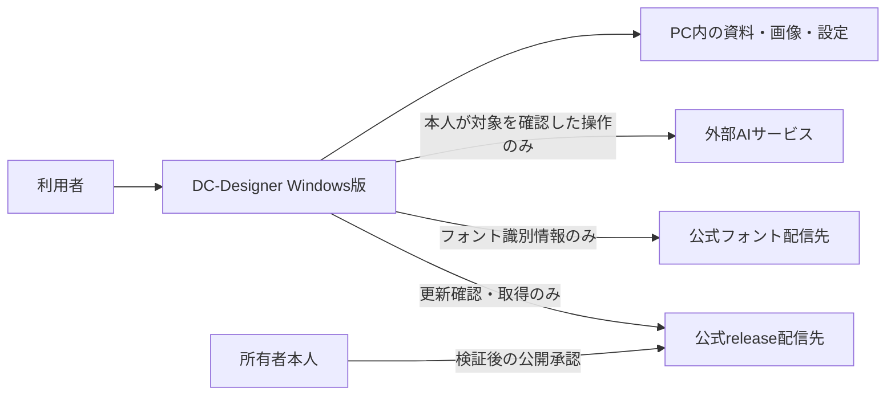

# Windows exe版 release設計：読む入口

- プロジェクト：DC-Designer ／ 版数：v0.1（2026-10-25）／ 状態：設計のみ・未実装
- 配布運用の正本：[配布・更新ポリシー](./release-policy.md)。本書はexe化の追加設計の入口。

> **3行で**
> 1. 利用者の画像・資料・認証情報を、配布物・更新通信・ログへ混ぜない。
> 2. 画像は既定で送信禁止。送信先と対象を本人が確認したAI操作だけ許可する。フォントは作品の文字を送らず取得する。
> 3. 製品用の実行環境・保存先・終了処理を分離し、検証と本人承認を通過したWindowsインストーラーだけを公開する。

## 🧭 判断してほしいこと

| ID | 種類 | 論点・おすすめ | 決まらないと止まるもの |
| --- | --- | --- | --- |
| EXE-Q-01 | 未決 | 配信先と公開範囲。第一候補は公開GitHub Releases。非公開なら開発者PATを配らない取得方式が必要 | 正式公開・更新配信 |
| EXE-Q-02 | 未決 | コード署名サービス・期待する発行者・費用。署名と検証を省略しない | 正式公開・安全な更新 |
| EXE-Q-03 | 未決 | サポートするWindows版とCPU。初版はWindows 11 / x64に絞ることを推奨するが、未承認 | 配布対象・実機試験の確定 |
| EXE-R-01 | リスク | 通信制御・Windowsの子孫プロセス回収・最終配布物の検査は未実装。試験に失敗・検査不能なら配信しない | releaseの合格判定 |

## 全体図

見てほしいところ：画像を扱う経路と、フォント・更新の通信経路を混ぜない。

## 要点

- [要件・技術仕様](./desktop-release-spec.md)：範囲、利用者操作、IDの対応、配布物の合格基準。
- [画像保護・フォント取得](./desktop-release-privacy.md)：送信確認、保存先、資格情報、通信の制約。
- [製品用の実行構成](./desktop-release-runtime.md)：画面・API接続、OAuth、Windowsプロセス、通常終了・障害復旧。
- [配布・更新ポリシー](./release-policy.md)：`main` → `release` → タグ、本人だけの公開承認、混入検査。
- [更新UIの詳細](./desktop-update-design.md)：毎回起動時に案内し、同意後取得・保存して再起動。既存の操作方針は変更しない。

## このドキュメントで決まったこと

- 画像の無断送信・配布物への混入は禁止。外部AIは明示確認した画像だけ送信（ユーザー回答）。[ADR-002](./adr/ADR-002-private-data-and-consent.md)
- 製品用接続とWindows終了処理は推奨構成を採用（ユーザー委任・AI設計判断）。[ADR-003](./adr/ADR-003-desktop-runtime.md)
- フォント取得を維持し、作品文字を含む取得を廃止（取得維持はユーザー指定、取得方式は安全性のための設計判断）。[ADR-004](./adr/ADR-004-font-acquisition.md)
- 許可リストによる隔離ビルドと最終配布物検査を必須化（安全性のための設計判断）。[ADR-005](./adr/ADR-005-release-artifact-boundary.md)
- 変更の範囲・既存設計への影響：[今回の変更レポート](./changes/2026-10-25-desktop-release-design.md)。実装・依存追加・CI設定・権限変更・公開は行っていない。
