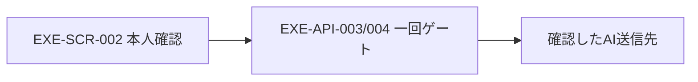

# ADR-002：私有データを分離し、AI送信を一回確認に限定する
- 版数：v0.2（2026-10-26）／状態：採用する設計・未実装（送信条件はユーザー確認済み、細部はAI設計判断。v0.2の確認1回化はユーザー承認済みの改善案）
> **3行で**
> 1. 作品・素材・秘密値をアプリ配置や配布物から分離する。
> 2. AI送信は、本人が確認した宛先・本文・画像bytesだけを一回許可する。
> 3. 実装完了や、OS・他アプリまで含む絶対安全を意味しない。
## 🧭 判断してほしいこと
Codex・ComfyUI連携は段階1〜3の製品版で無効。有効化する段階で、egressを制御不能なら参考画像機能を無効化する。署名・配信先・OS対象の決定は[親入口](../README.md)を参照。
## 全体図

見てほしいところ：確認は包括許可ではなく、一つの固定済み送信内容にだけ結びつく。
## 要点
- [詳細仕様](../desktop-release-privacy.md#ai-gate)：canonical payloadをgateが作り、画像変更・追加・宛先変更では再確認する。
## 詳細
### 状況
画像の`public/generated/`保存と資格情報の平文JSON保存がある。利用者は送信先・対象画像を示した明示確認だけを許可した。
### 決定・理由
`<userRoot>`のworkspace／assetsとOS暗号化secretsへ分離し、ログ・配布・更新通信への私有情報混入を禁止する。
main管理のゲートが実送信bytes・宛先・用途・本文を固定し、main生成の専用確認窓（通常editorとは別のwebContents・別preload）での1回の確認による短命一回許可後だけ送信する。承認は確認窓のwebContentsからのIPCだけをmainが受け付け、`requestId`・`payloadHash`・確認元を照合する。既定は「送信しない」、Esc・閉じるは拒否、期限5分、内容変更で再確認。renderer申告だけを信用しない。
### 代替案
- 一律AI送信禁止：流出経路は減るが、本人が選ぶ送信まで禁止するため不採用。
- 専用確認窓＋ネイティブ確認ダイアログの二重確認：v0.1で採用したが、操作が重く安全性の根拠（確認窓の隔離・main照合）は1回で足りるため、v0.2で1回に改めた。
- 包括同意・renderer自己申告：操作は少ないが、画像追加・fallback・多段処理で許可が拡大するため不採用。
### 影響
拒否・期限切れ・再起動では送らず編集継続。Codex・ComfyUIは段階1〜3で無効。有効化する場合に未知Codex等でegressを制御できなければ参考画像は無効。責任境界と受け入れ基準は詳細仕様で定義する。
## このドキュメントで決まったこと
- 影響：[EXE-REQ-001/003、EXE-FR-003/004](../desktop-release-privacy.md#requirements) → EXE-SCR-002/004、EXE-API-003/004/006、EXE-TBL-001/002/004。RDB追加・実装・CI変更はしない。
- 2026-10-26改訂（決定者：ユーザー（改善案の適用を承認））：二重確認を確認窓での1回に変更。Codex・ComfyUIは段階1〜3で無効。
