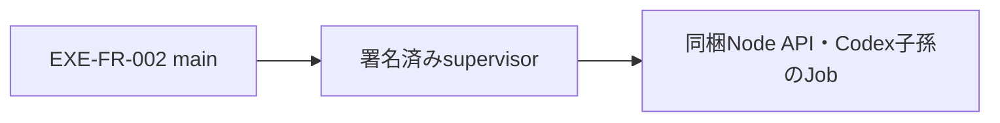

# ADR-003：同梱NodeとWindows supervisorで製品実行環境を管理する
- 版数：v0.1（2026-10-25）／ 状態：採用（設計のみ・未実装）／ 決定者：AI判断（推奨方法をユーザーが委任）
> **3行で**
> 1. sandbox画面から限定preload・mainを通し、製品専用APIだけへ接続する。
> 2. 同梱NodeとCodex子孫を署名済みsupervisorのWindows Jobで管理する。
> 3. 全保存・書込drain・Job空を確認して終了する。Windows実機では未検証。
## 🧭 判断してほしいこと
[EXE-Q-01〜03／EXE-R-01](../README.md#-判断してほしいこと)を維持。署名・OS承認とWindows Job／OAuthの検証が正式配信を止める。
## 全体図

見てほしいところ：Nodeは生成時からJob所属とし、supervisor死亡でも最後のJob HANDLE閉鎖で回収する。
## 要点
- [実行構成の正本](../desktop-release-runtime.md)：固定origin・個体認証・外部browser OAuth・通常終了と更新の共通調停。
## 詳細
### 状況
利用者Node不要の基本起動と、main／API／supervisor異常終了時の所有子孫回収が必要。開発用固定port・taskkill・exit時asyncだけでは保証できない。
### 決定・理由
Electron main＋sandbox renderer＋限定preload、公式Windows Node＋ビルド済みAPI、署名済みnative supervisorを採用。Jobは非継承・kill-on-close・breakaway禁止とし、親実HANDLE監視と生成時`PROC_THREAD_ATTRIBUTE_JOB_LIST`で起動競合を避ける。
画面は同梱静的資源用の固定`app://dc-designer`。私有API・素材は実sender／frameを確認する限定IPCを通す。世代間leaseと停止記録で新旧APIを排他し、全保存・drain・Job空前に終了／更新を許可しない。
### 代替案
- Electron `utilityProcess`：公開APIに生成時Job指定／suspended起動がなく、killもtree保証ではないため不採用。
- `CREATE_SUSPENDED`後にJob割当：生成・所属の間のsupervisor crashで残留し得るため安全fallbackにしない。
- 利用者Node／WSL・開発server：事前導入不要と所有権管理の条件を満たさず不採用。
### 影響
同梱Nodeの容量・セキュリティ更新、helperの開発・署名・CPU別検証が必要。独立exeなのでElectron native addon ABI追従は不要。Jobはegress sandboxではなく、nested Job・Codex・OAuthは実機検証必須。
## このドキュメントで決まったこと
- [EXE-REQ-002/004/007 → EXE-FR-002/006/008](../desktop-release-spec.md#トレーサビリティ) → EXE-SCR-001/005/006、EXE-API-001/002/008/009。データ・AI・フォントの正本は変更しない。
