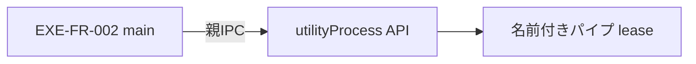

# ADR-003：段階1〜3はutilityProcessと名前付きパイプleaseで製品実行環境を管理する
- 版数：v0.2（2026-10-26）／ 状態：採用（段階1〜3。supervisorは段階4で追加・現時点では実装しない。設計のみ・未実装）／ 決定者：AI判断（推奨方法をユーザーが委任）。v0.2の軽量化はユーザーが2026-10-26に承認
> **3行で**
> 1. sandbox画面から限定preload・mainを通し、製品専用APIだけへ接続する。
> 2. 段階1〜3はElectronの`utilityProcess`でAPIを実行し、名前付きパイプleaseで新旧APIの同時書き込みを防ぐ。supervisor・Job Objectは作らない。
> 3. 全保存・書込drain・utilityProcessのexitとフォント登録子プロセスの完了を確認して終了する。子孫回収が必要な段階4（Codex連携）でsupervisorを追加する。Windows実機では未検証。
## 🧭 判断してほしいこと
[EXE-Q-01〜03／EXE-R-01](../README.md#-判断してほしいこと)を維持。署名・配信先は未承認、対応OSはWindowsのみ（版・CPUは実機確認待ち）。名前付きパイプlease・OAuthの検証が正式配信を止める。
## 全体図

見てほしいところ：utilityProcessは親（main）とのIPCが切れると終了し、パイプleaseはOSが解放する。Codexを無効にするので孫プロセスは常駐しない。
## 要点
- [実行構成の正本](../desktop-release-runtime.md)：固定origin・個体認証・外部browser OAuth・通常終了と更新の共通調停。supervisor・Jobの元設計は同書の[段階4付録](../desktop-release-runtime.md#windows-job)。
## 詳細
### 状況
基本起動は利用者のNode不要で、main異常終了時に新旧APIが同じ保存先へ同時に書き込まないことが必要。supervisorが必要だった主因はCodexの子孫プロセス回収（現行`server/imagegen.ts`のspawnとtaskkill）だが、段階1〜3はCodex連携を製品版で無効にする。開発用固定port・taskkill・exit時asyncだけでは保証できない点は変わらない。
### 決定・理由
Electron main＋sandbox renderer＋限定preload、ビルド済みAPIを`utilityProcess`で実行する。公式Windows Nodeの別同梱・署名済みnative supervisor・Job Object・`PROC_THREAD_ATTRIBUTE_JOB_LIST`・RuntimeLeaseJournal（EXE-TBL-006）・profile.jsonの世代印は**段階1〜3では作らない**。
画面は同梱静的資源用の固定`app://dc-designer`。私有API・素材は実sender／frameを確認する限定IPCを通す。起動token・`127.0.0.1:0`・認証付きhealthは維持する。新旧APIの排他は、単一起動ロックに加え、API workerが利用者SIDと正規化した`userRoot`から作る名前付きパイプ`\\.\pipe\dc-designer-lease-<hash>`をlistenして保持する簡易leaseとする。使用中（`EADDRINUSE`）なら書き込まず「前回の終了処理を待っています」を表示し、期限超過で`failed`。終了は全保存・書込drain・utilityProcessのexitとフォント登録子プロセス（PowerShell、固定コマンド、タイムアウト付き）の完了確認を待つ。
段階1の必須として、`src/editor/ui.tsx`のiframeサムネイル（`?view=render&embed=1`）を受動的な描画snapshotへ置き換える。
### 代替案
| 案 | 扱い |
| --- | --- |
| Electron `utilityProcess` | **段階1〜3で採用**。公開APIに生成時Job指定／suspended起動がなく、killもtree保証ではないが、段階1〜3は孫プロセスを持たない |
| 署名済みnative supervisor＋Job Object＋同梱公式Node | **段階4で追加**（Codex連携を入れるとき）。設計はruntime書の付録に保持し、現時点では実装しない |
| `CREATE_SUSPENDED`後にJob割当 | 生成・所属の間のsupervisor crashで残留し得るため、段階4でも安全fallbackにしない |
| 利用者Node／WSL・開発server | 事前導入不要と所有権管理の条件を満たさず不採用 |
### 影響
段階1〜3はNode別同梱・helper署名・CPU別検証が不要で軽い一方、子孫回収は保証しない。そのためCodex・ComfyUI連携は製品版で無効とし、有効化は段階4のsupervisor追加と実機検証（nested Job・OAuth）を条件とする。utilityProcessは外部送信を防ぐsandboxではなく、egressゲートは別に必要。名前付きパイプleaseはACL・名前衝突・期限超過を実機で検証する。Electron native addon ABI追従は引き続き不要。
## このドキュメントで決まったこと
- [EXE-REQ-002/004/007 → EXE-FR-002/006/008](../desktop-release-spec.md#トレーサビリティ) → EXE-SCR-001/005/006、EXE-API-001/002/008/009。データ・AI・フォントの正本は変更しない。
- 段階1〜3はutilityProcess＋名前付きパイプlease、段階4でsupervisor＋Job Objectを追加（決定者：ユーザーが改善案の適用を承認、2026-10-26）。
