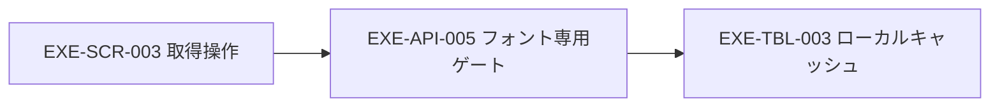

# ADR-004：フォント取得を維持し、作品文字は端末外へ出さない
- 版数：v0.2（2026-10-26）／状態：採用する設計・未実装（取得維持はユーザー確認済み、細部はAI設計判断。v0.2の全文字埋め込みはユーザー承認済みの改善案）
> **3行で**
> 1. カタログのフォント取得・キャッシュ・埋め込みは維持する。
> 2. `text=`を廃止し、段階2では端末内サブセット化せず全文字入りで埋め込む（書き出しは大きくなる。端末内サブセットは後の任意改善）。
> 3. WindowsへのOS登録は取得とは別に確認し、拒否時は昇格しない。
## 🧭 判断してほしいこと
受信・展開後各32MiB／ファイルは未実測のAI設計値。全文字入りの日本語フォントとの適合・書き出しサイズは実測で検証する。
## 全体図

見てほしいところ：外部へ送る選択情報はカタログのfamily・weight・styleだけで、作品本文ではない。
## 要点
- [詳細仕様](../desktop-release-privacy.md#fonts)：固定ホスト・TLS・再検証・ライセンス保持と、別同意のWindows登録。
## 詳細
### 状況
SVG/PPTX用フォント取得が`text=`で作品文字を送る。利用者はフォント取得の維持を希望している。
### 決定・理由
`fonts.googleapis.com`のCSSと`fonts.gstatic.com`の全フォントを目的別ゲートで取得し、検証後に`fonts/`へ保持する。rendererの外部読込と任意URLは拒否する。
文字・ファイル名をURL／Refererへ載せない。取得した全文字入りTTF（UAなしCSSが返す単一TTF）をそのままSVG/PPTXへ埋め込み、段階2では端末内サブセット化もしない（サブセット用ライブラリが無く、現行`server/fonts.ts`も全体を入れる動作で互換）。OS登録はカタログ限定・通常ユーザー・別同意とし、任意コマンド・管理者昇格は禁止する。
### 代替案
- 全面オフライン・取得廃止：通信は減るが、取得維持の要望を満たさないため不採用。
- 外部`text=`サブセット：転送量は少ないが作品文字が外へ出るため不採用。
- 端末内サブセット：外へ出ないが依存ライブラリが要るため段階2では見送り、後の任意改善とする。
### 影響
フルフォント分の容量・通信が増え、書き出しファイル（SVG/PPTX）も大きくなる。URL変更・HTTP障害・OSポリシー拒否では停止・キャッシュ／代替表示とし、画像送信へ切り替えない。未取得時の同一見た目は保証しない。
## このドキュメントで決まったこと
- 影響：[EXE-REQ-005／EXE-FR-005](../desktop-release-privacy.md#fonts) → EXE-SCR-003、EXE-API-005、EXE-TBL-003。設計判断であり、取得・登録の実装変更はしない。
- 2026-10-26改訂（決定者：ユーザー（改善案の適用を承認））：端末内サブセット化を段階2では行わず全文字入りで埋め込む。`text=`廃止とOS登録の別同意（ネイティブダイアログ1回）は維持。
