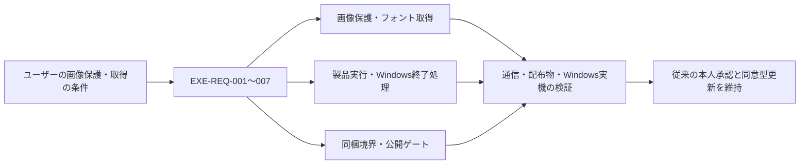

# 変更：画像保護を必須条件にしたWindows exe版 release設計（2026-10-25）

> **3行で**
> 1. 利用者の画像を配布物・更新通信・ログへ混入させず、外部AIには本人が確認した対象だけ送る設計を追加した。
> 2. 製品用の画面・API接続、Windowsの子プロセス管理、作品文字を送らないフォント取得、配布物の混入検査を具体化した。
> 3. 既存の更新操作・本人だけの公開承認を維持。変更は設計文書だけで、実装・依存追加・CI設定・公開は行っていない。

## 🧭 判断してほしいこと

未決・リスクは[読む入口のEXE-Q-01〜03、EXE-R-01](../README.md#-判断してほしいこと)に集約。配信先・公開範囲・署名方式・対象OS／CPUの未確定や検証未達を残したまま、正式配信してよいとはしていない。

## 全体図

見てほしいところ：画像を守るという条件を、実行時だけでなくビルド・配布にも適用した。

## 要点

- [入口](../README.md)：決定・未決・読む順番を集約。
- [要件・技術仕様](../desktop-release-spec.md)：上流IDと全体の対応、同梱境界、診断、合格基準。
- [画像保護](../desktop-release-privacy.md)：既定拒否・一回の送信許可・資格情報・フォント取得。
- [実行構成](../desktop-release-runtime.md)：固定origin・自分のAPI・OAuth・全保存・Job管理。
- [公開方針](../release-policy.md)：既存権限を変えず、混入検査と署名後の再検査を追加。

## 詳細

### 差分

| ドキュメント | 節・ID | 変更 |
| --- | --- | --- |
| `docs/README.md` | EXE-Q-01〜03、EXE-R-01 | 新規。追加設計の入口、未決・リスク・主要判断 |
| `docs/desktop-release-spec.md` | EXE-REQ-001〜007、EXE-US-001〜004、EXE-UC-001〜006 | 新規。要件・操作・Won't・対応表 |
| 同上 | EXE-FR-001、007、009／EXE-NFR-001〜006／EXE-SCR-007／EXE-API-007／EXE-TBL-005 | 新規。同梱・公開の境界、内容を持たない診断、配布目録・合格値 |
| `docs/desktop-release-privacy.md` | EXE-FR-003〜005／EXE-SCR-002〜004／EXE-API-003〜006／EXE-TBL-001〜004 | 新規。画像送信確認、保存・秘密情報、フォント取得・キャッシュ |
| `docs/desktop-release-runtime.md` | EXE-FR-002、006、008／EXE-SCR-001、005、006／EXE-API-001、002、008、009／EXE-TBL-006 | 新規。製品接続、起動・終了、Windowsの所有プロセス、世代間lease・停止記録、内部ウィンドウ。静的protocolと認可IPCを区別 |
| `docs/release-policy.md` | v0.2 → v0.3／EXE-FR-001、007 | 既存権限を保持し、隔離ビルド・目録・署名前後検査・未達時の公開禁止を追加 |
| `docs/desktop-update-design.md` | v0.1 → v0.2／REQ-003、004、FR-004、API-006、保存領域 | 通常終了と共通の保存・プロセス調停と固定originの参照を追加。更新の操作は変更なし |
| `README.md` | Windows版の配布・更新方針 | 新しい入口とプライバシー方針を追加。現行Web版で実装済みではないことを明記 |
| `docs/adr/ADR-002-private-data-and-consent.md` | EXE-REQ-001、003 | 画像・資料・認証の境界と明示許可 |
| `docs/adr/ADR-003-desktop-runtime.md` | EXE-REQ-002、004、007 | 固定origin・同梱Node・Windows supervisorによる製品実行 |
| `docs/adr/ADR-004-font-acquisition.md` | EXE-REQ-005 | 作品文字を送らずフォント取得を維持 |
| `docs/adr/ADR-005-release-artifact-boundary.md` | EXE-REQ-001、002、006 | 許可リスト・隔離ビルド・最終配布物検査 |

### 影響範囲

- 新しい`EXE-`の要件から下流の画面・API・論理ストアまでの対応は[技術仕様のトレーサビリティ表](../desktop-release-spec.md#トレーサビリティ)を正本とする。既存更新のREQ-001〜005、US-001〜002等は改番しない。
- 既存の更新設計のFR-001〜005、SCR-001〜004、API-001〜007は挙動を維持する。特に起動ごとの確認・同意後取得・保存して再起動・busy時は保留・通常終了で無断適用しない条件を変えない。
- 将来のコード側の影響先は、`server/`の保存先・外部通信・認証・生成・フォント、`src/`の送信確認・APIアクセス・保存・書き出し、製品起動・preload・supervisor・パッケージ設定。今回は変更していない。
- 既存の`docs/architecture-c4.html`・`.json`は現行Web版の記録として変更していない。Windows版の実装済み構成図ではない。
- 依存・ロックファイル、実装、テストコード、`.github`の設定、ブランチ・タグ・権限・公開先には触れていない。既に存在した未コミットの更新設計とREADME・方針の差分を保持して追加した。

### 検証の扱い

実施した確認は以下のとおり。Windows起動・画像の通信制約・Job Objectによる回収・署名・更新を実行済みとはしない。

- `git diff --check`：問題なし。実装・依存・CI設定の差分がないことも確認。
- Python 3による文書検査：対象12ファイル、相対リンク・見出し参照135件、要件・操作・画面・API・ストアID、行数、末尾空白、コードブロックの対応に問題なし。Mermaid 13ブロックは囲みの整合確認までで、図の描画実行はしていない。
- 読み取り専用の独立レビューと修正後の再確認：下記の重要指摘を修正し、最終再確認では新たな重大な矛盾の指摘なし。静的確認であり、安全性の実機実証ではない。

限定レビューで見つかった、OpenRouter内部のfallbackによる確認先拡大と、OSフォント登録の確認IDの発行・対象束縛の不足を修正した。仲介先・単一推論先・routing条件を送信確認に含め、OS登録はmain内の対象hashに結び付く確認で完結する契約とした。

統合レビューで見つかった、main再起動をまたぐ新旧APIの競合、同一origin iframeから親bridgeへ到達する経路、API停止後のinstaller開始失敗からの復旧不足を修正した。保存先単位の世代間lease・停止記録、受動的なsandbox描画snapshot、runtime復旧前の編集ロックを追加し、受付停止barrierと専用IPCの迂回禁止も明文化した。

## このドキュメントで決まったこと

ユーザーが確定した画像送信条件とフォント取得維持、推奨方法の委任に基づく技術判断は[全体の決定事項ログ](../desktop-release-spec.md#決定事項ログ)を参照。ADR-001の既存更新方針は置き換えていない。
