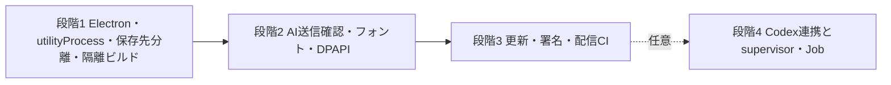

# 変更：Windows exe版を段階分けし、段階1〜3の構成を簡素化（2026-10-26）

> **3行で**
> 1. 対象はWindowsのみと決め、実装を段階1〜4に分けた。Codex連携は段階1〜3の製品版で無効にする。
> 2. APIはElectronの`utilityProcess`で動かし、native supervisor・Job Object・世代記録は段階4（Codex導入時）へ回した。
> 3. AI送信の確認は1回、フォントは段階2では全文字のまま埋め込む。ユーザーが決めた画像保護・フォント取得・更新・公開の条件は変えていない。

## 🧭 判断してほしいこと

配信先（EXE-Q-01）は公開GitHub Releases、コード署名（EXE-Q-02）はSignPath Foundationに決定した（追記、同日）。署名は審査が通るまで正式配信しない。対応版・CPUはWindows 10／11のx64をAI推奨とし、実機確認待ち。

## 全体図

見てほしいところ：段階4は任意。Codexを入れない限りsupervisorは作らない。

## 要点

- 段階分けの正本：[要件・技術仕様の段階分け](../desktop-release-spec.md#phases)。
- 実行構成：[製品用の実行構成](../desktop-release-runtime.md)。supervisor・Job Objectの設計は削除せず付録へ移した。
- AI送信・フォント：[画像保護・フォント取得](../desktop-release-privacy.md)。

## 詳細

### 差分

| ドキュメント | 変更 |
| --- | --- |
| `docs/README.md` | EXE-Q-03を一部決定（Windowsのみ）。段階分けへの入口と今回の改訂を追加 |
| `docs/desktop-release-spec.md` | 段階分け節を新設。採用構成・同梱範囲・受け入れ基準を段階に合わせ、決定事項EXE-D-07〜09を追加 |
| `docs/desktop-release-runtime.md` | 段階1〜3はutilityProcess＋名前付きパイプによる保存先lease。supervisor・Job Object・RuntimeLeaseJournalは段階4の付録へ |
| `docs/desktop-release-privacy.md` | AI送信は専用確認窓での1回の確認。フォントは段階2で全文字埋め込み。Codex・ComfyUIは段階1〜3で無効 |
| `docs/desktop-update-design.md` | 更新は段階3であることと、実行構成の改訂への整合 |
| `docs/release-policy.md` | 対象はWindowsのみ。自作ヘルパーの署名は段階4で導入する場合に限る |
| `docs/adr/ADR-002`・`ADR-003`・`ADR-004` | 二重確認の廃止、utilityProcess採用とsupervisorの段階4化、端末内サブセットの後回し |

### 理由

- supervisorが必要だった主な理由は、Codexの子孫プロセスを確実に回収すること（現行`server/imagegen.ts`）。Codexを段階1〜3で無効にすれば、APIは孫プロセスを常駐させず、utilityProcessの寿命管理で足りる。別exeの開発・署名とNodeの別同梱が不要になる。
- 確認窓とネイティブダイアログの二重確認は、参考画像を使う生成のたびに2回操作させる。mainが作る専用確認窓だけから承認を受け付ければ、editorやworkerが自己承認できないという安全条件は保てる。
- 端末内サブセット化に使うライブラリは依存にない。現行コードも文字が多いと全体を埋め込むため、全文字埋め込みでも互換。書き出しファイルは大きくなる。
- 現行のサムネイルは同一originのアプリを`iframe`で開いている（`src/editor/ui.tsx`）。製品版では使えないため、段階1の必須作業として明記した。

### 影響範囲

- 変更は設計文書だけ。コード・依存・CI・ブランチ権限・公開には触れていない。
- ユーザーが決めた条件（画像は本人確認したものだけ送信、フォント取得維持と作品文字の非送信、同意後取得・保存して再起動、本人だけの公開承認）は変更なし。ADR-001は置き換えていない。

## このドキュメントで決まったこと

- 配信先は公開GitHub Releases、コード署名はSignPath Foundation（ユーザー回答、EXE-D-10・11）。

- 対象プラットフォームはWindowsのみ（ユーザー回答）。
- 改善案（段階分け、utilityProcess採用とsupervisorの段階4化、AI確認1回、全文字埋め込み、iframeサムネイル置き換えの明記）を適用（ユーザー承認）。細部の決定は[決定事項ログ](../desktop-release-spec.md#決定事項ログ)を正本とする。
