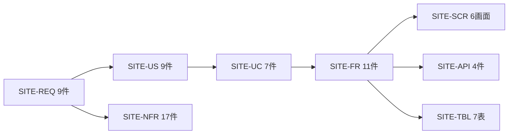

# 00. プロジェクト概要
- プロジェクト：DC-Designer 紹介サイト ／ 版数：v0.1（2026-11-01） ／ インプット：リポジトリの README、ヒアリング（2026-11-01）

> **3行で**
> 1. DC-Designer の紹介・ダウンロード用の静的サイト（日本語）を、`site/` に Astro で作り、GitHub Pages で公開する。
> 2. 版情報はリリースのたびに自動で反映し、未署名の exe を安心して入れてもらうための確認手順を載せる。
> 3. ここには用語集・決定事項ログ・トレーサビリティ表を置く。読む入口は [README](README.md)。

## 🧭 判断してほしいこと
[README](README.md#-判断してほしいこと全ドキュメントから集約) に集約（SITE-Q-01〜04、SITE-R-01〜04）。

## 全体図

見てほしいところ：ID はすべて `SITE-` 付き。既存の Windows 版の設計書（`EXE-`、`docs/adr/ADR-001〜005`）とぶつからない。

## 要点
- [エレベーターピッチ](#エレベーターピッチ)と[スコープ](#スコープ)。
- [用語集](#用語集)：「安定版」「署名状況」「媒体」などの意味をここで固定。
- [決定事項ログ](#決定事項ログ)：ユーザー決定 13 件・おまかせ 4 件・定石 7 件・提案 1 件（SITE-ADR-005）。
- [トレーサビリティ表](#トレーサビリティ表)：REQ から画面・API・表までたどれる。

---

## 詳細

### エレベーターピッチ
ポスターやスライドを手早く作りたい**一般の Windows 利用者**のための **DC-Designer 紹介サイト**は、「何ができるか分からない・知らない exe が不安」という課題を、**実画面の紹介と、常に最新の版・SHA-256・確認手順を載せたダウンロードページ**で解決する静的サイトである。

### スコープ
| In | Out（Won't） |
|---|---|
| トップ・ダウンロード・更新履歴・プライバシー・コード署名ポリシー・404 | Web 版エディタ・英語版・使い方ガイド・アカウント・フォーム |
| リリースとの自動連動・Cookie なし解析 | macOS / Linux・Cookie バナー・独自ドメイン |
| 媒体の枠と仕様 | 媒体の制作（Remotion で後から） |

### 用語集
| 用語 | コード上の名前 | 定義 |
|---|---|---|
| サイト | `site/` | 本設計の対象。紹介・ダウンロード用の静的サイト |
| アプリ／exe 版 | — | DC-Designer の Windows 版（インストーラー `DC-Designer-Setup-<版>.exe`） |
| 配信 CI | `release-windows` | `v*` タグで動く既存のワークフロー。Release を作る |
| サイトのワークフロー | `site.yml` | サイトをビルドして GitHub Pages に公開する |
| リリース | `Release` | GitHub の Release 1 件（SITE-TBL-001） |
| 安定版 | — | draft でも prerelease でもないリリース。最新のものがダウンロード対象 |
| 配布物 | `ReleaseAsset` | Release に付いたファイル。サイトは installer と checksums だけ使う |
| 署名状況 | `signed` | その版の exe に SignPath Foundation の署名があるか |
| 機能 | `Feature` | トップの機能カード 1 枚分（SITE-TBL-003） |
| 媒体 | `Media` | スクショ・動画・OGP 画像（SITE-TBL-004） |
| 枠（プレースホルダー） | `status: placeholder` | 素材がまだ無い媒体 |
| ポリシー | `Policy` | プライバシー・コード署名ポリシー（SITE-TBL-005） |
| ビーコン | — | Cloudflare Web Analytics の計測スクリプト |

### 決定事項ログ
| ID | 決定内容 | 決定者 | 理由 | 影響範囲 | ADR |
|---|---|---|---|---|---|
| SITE-D-01 | サイトは紹介・ダウンロード用の LP（Web 版は作らない） | ユーザー | 小さく早く作る | 全体 | — |
| SITE-D-02 | 載せるもの：機能紹介とスクショ・動画、ダウンロード、更新履歴・ポリシー | ユーザー | — | REQ-001〜008 | — |
| SITE-D-03 | 公開先は GitHub Pages | ユーザー | github.io を使う | 07 | [002](adr/SITE-ADR-002-github-pages.md) |
| SITE-D-04 | 一般利用者向け・日本語のみ | ユーザー | アプリが日本語 | 06 | — |
| SITE-D-05 | Astro で作る | ユーザー | — | 07 | [001](adr/SITE-ADR-001-astro.md) |
| SITE-D-06 | 同じリポジトリの `site/` | ユーザー | リリースと連動しやすい | 07 | [006](adr/SITE-ADR-006-same-repo.md) |
| SITE-D-07 | リリース公開で自動再ビルド | ユーザー | 手作業をなくす | FR-008・009 | [003](adr/SITE-ADR-003-release-trigger.md) |
| SITE-D-08 | ドメインは `itiwoja.github.io/DC-Designer/` | ユーザー | — | 07 | [002](adr/SITE-ADR-002-github-pages.md) |
| SITE-D-09 | Cookie なしの解析を入れる。細かい数値はおまかせ | ユーザー | — | FR-010、05 | [004](adr/SITE-ADR-004-analytics.md) |
| SITE-D-10 | 公開するブランチは main | ユーザー | 文面の修正を早く出せる | FR-009 | — |
| SITE-D-11 | スクショ・動画は後で Remotion で作る | ユーザー | — | REQ-008、06 | — |
| SITE-D-12 | プライバシーは今の動き（AI 送信は追加確認なし）に合わせる | ユーザー | 実際の挙動と一致させる | FR-007 | — |
| SITE-D-13 | 数値目標（KPI・NFR） | Claude判断（おまかせ） | 定石の値 | 01、05 | — |
| SITE-D-14 | ビルドに失敗したら公開中のサイトを残す | 定石 | Pages の既定の動き | FR-008、NFR-011 | — |
| SITE-D-15 | 更新履歴は直近 10 版を開き、古い版は畳む | Claude判断（おまかせ） | 長くなりすぎない | FR-006 | — |
| SITE-D-16 | リリースノートの生 HTML は捨てる | 定石 | 外部の PR タイトルが入る | FR-006、NFR-007 | — |
| SITE-D-17 | 媒体の寸法・上限・命名 | Claude判断（おまかせ） | NFR-003 に合わせる | 06 | — |
| SITE-D-18 | `site/` はアプリと依存を共有しない | 定石 | 配布物の境界（既存 ADR-005） | 07 | — |
| SITE-D-19 | Pages の環境に承認を付けない | 定石 | main へのマージで判断済み | 07 | — |
| SITE-D-20 | DB を持たず、ビルド時のデータを SITE-TBL で定義 | 定石 | 静的サイト | 08 | — |
| SITE-D-21 | 版情報はリポジトリに保存せず毎回取り直す | 定石 | 古い控えを公開しない | 08 | — |
| SITE-D-22 | API の再試行は 3 回（1・2・4 秒） | Claude判断（おまかせ） | 一時的な障害に耐える | 09 | — |
| SITE-D-23 | 閲覧時のブラウザは GitHub API を叩かない | ユーザー（D-07 の帰結） | 回数制限を避ける | 09 | — |
| SITE-D-24 | 設計書は `docs/design/`、ID は `SITE-` 付き | 定石 | 既存の設計書と ID をぶつけない | 全体 | — |

未決の提案：[SITE-ADR-005](adr/SITE-ADR-005-policy-source.md)（ポリシーの正本、SITE-Q-04）。

### ID 体系
`SITE-REQ` 要件 ／ `SITE-US` ストーリー ／ `SITE-UC` ユースケース ／ `SITE-FR` 機能 ／ `SITE-NFR` 非機能 ／ `SITE-SCR` 画面 ／ `SITE-TBL` データ ／ `SITE-API` 外部 IF ／ `SITE-ADR` 判断 ／ `SITE-D` 決定 ／ `SITE-Q` 未決 ／ `SITE-R` リスク。本文の表では `SITE-` を省くことがある（例：FR-004 = SITE-FR-004）。

### トレーサビリティ表
| REQ | US | UC | FR | SCR | API | TBL |
|---|---|---|---|---|---|---|
| REQ-001 | US-001 | UC-001 | FR-001, 002, 011 | SCR-001, 006 | API-004 | TBL-001, 003, 004, 007 |
| REQ-002 | US-003 | UC-002 | FR-004 | SCR-001, 002 | API-004 | TBL-001, 002 |
| REQ-003 | US-004 | UC-002 | FR-004, 005 | SCR-002 | API-002 | TBL-001, 002 |
| REQ-004 | US-007, 009 | UC-005, 006 | FR-008, 009 | 全画面 | API-001, 002 | TBL-001, 002, 006 |
| REQ-005 | US-005 | UC-003 | FR-006 | SCR-003 | API-001 | TBL-001 |
| REQ-006 | US-006 | UC-004 | FR-007 | SCR-004, 005 | — | TBL-005 |
| REQ-007 | US-008 | UC-007 | FR-010 | 全画面 | API-003 | TBL-006 |
| REQ-008 | US-001 | UC-001 | FR-002 | SCR-001 | — | TBL-004 |
| REQ-009 | US-002 | UC-001, 002 | FR-003 | SCR-001, 002 | — | TBL-007 |

### ドキュメント索引
[README](README.md) ／ [01 要件](01_requirements.md) ／ [02 ストーリー](02_user_stories.md) ／ [03 ユースケース](03_use_cases.md) ／ [04 機能](04_functional_spec.md) ／ [05 非機能](05_non_functional.md) ／ [06 画面](06_ux_design.md) ／ [07 アーキテクチャ](07_architecture.md) ／ [08 コンテンツモデル](08_database.md) ／ [09 外部 IF](09_api.md) ／ [10 図](10_diagrams.md) ／ [11 技術仕様](11_tech_spec.md) ／ [adr/](adr/)
