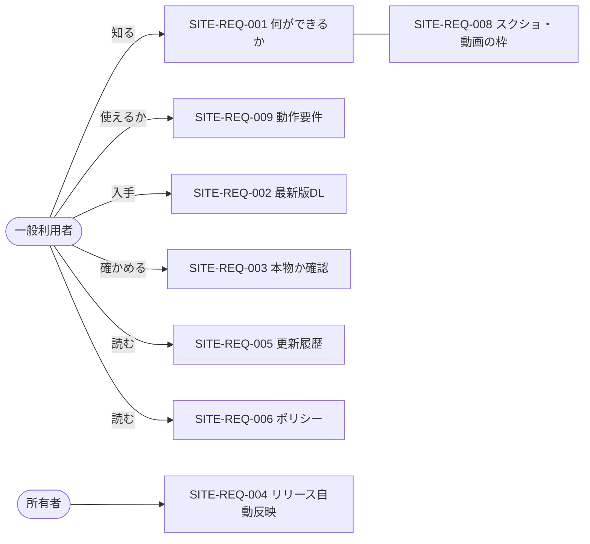

# 01. 要件定義
- プロジェクト：DC-Designer 紹介サイト ／ 版数：v0.3（2026-11-01） ／ インプット：[00_overview](00_overview.md)、ヒアリング（決定事項ログ SITE-D-01〜12）

> **3行で**
> 1. DC-Designer（Windows 版）の**紹介・ダウンロード用の静的サイト**を、日本語・一般利用者向けに作る。
> 2. リリースを公開したら、版番号・SHA-256・更新履歴が**手作業なし**でサイトに反映されることが最重要の制約。
> 3. Web で使えるエディタ・英語版・使い方ガイド・アカウント機能は作らない（[7. スコープ外](#7-スコープ外wont)）。

## 🧭 判断してほしいこと
| # | 種類 | 論点 | 選択肢 | おすすめ（理由） | 決まらないと止まるもの |
|---|---|---|---|---|---|
| SITE-Q-02 | 決定（2026-11-01） | スクショ・動画が揃う前にサイトを公開するか | A: 揃うまで公開しない / B: 仮の画像で先に公開 | **B に決定（ユーザー、SITE-D-26）**：「仮」と分かる仮の画像で先に公開し、Remotion の素材ができたら差し替える | — |

## 全体図

見てほしいところ：利用者側の要件は「知る → 使えるか → 入手 → 確かめる」の一本道。所有者側は運用の手間を減らす要件だけ。SITE-REQ-007（Cookie なし解析）は取り下げた（SITE-D-27）。

## 要点
- 目的は**ダウンロード数を増やすこと**と、**未署名の exe を安心して入れてもらうこと**（[2. 目的](#2-目的成功指標kpi)）。
- 要件は 8 件、すべて Must（[5. 要件](#5-要件)）。SITE-REQ-007（解析）は取り下げて欠番（SITE-D-27）。
- 公開先は GitHub Pages（`https://itiwoja.github.io/DC-Designer/`）、費用 0 円（[6. 制約](#6-制約条件)）。
- SignPath Foundation の署名審査では、プロジェクトのサイトにコード署名ポリシーを載せることが求められる（SITE-REQ-006 の理由）。
- 素材（スクショ・動画）は後で Remotion で作る。それまでは「仮」と分かる仮の画像で公開し、後から差し替える（SITE-REQ-008、SITE-D-26）。

---

## 詳細

### 1. 背景・課題
- DC-Designer は GitHub の README と Releases しか入口がなく、一般の人には「何ができるか」「どれを落とせばよいか」が分かりにくい。
- Windows 版はまだ**コード署名がない**ため、SmartScreen の警告で離脱しやすい。安全を確かめる手段（SHA-256）を分かる形で示す必要がある。
- リリースは v1.0.2〜1.0.6 を 2 日で出すなど頻度が高い。手で更新するサイトでは版情報がすぐ古くなる。

### 2. 目的・成功指標（KPI）
| 指標 | 目標値 | 計測方法 |
|---|---|---|
| トップ → ダウンロードページへの遷移率 | —（測らない） | 測定手段なし（解析を入れないため、SITE-D-27） |
| リリース公開からサイト反映まで | 15 分以内・手作業 0 回 | GitHub Actions の実行記録（SITE-FR-009） |
| ダウンロード数（主な指標） | 前月比で増加 | 毎月 1 日に、全版の installer の `download_count` の合計を GitHub API で所有者が控え、前月の控えとの差を見る（`download_count` は版ごとの累計なので差で見る。サイトでは計測しない） |
| モバイルの Lighthouse 性能スコア | 90 以上 | Lighthouse（SITE-NFR-001） |

数値はおまかせで決めた（SITE-D-13）。

### 3. ステークホルダー
| 役割 | 関心事 | 関与度 |
|---|---|---|
| 所有者（itiwoja） | 運用の手間・費用 0・配信ポリシーとの整合 | 高（唯一の編集者・承認者） |
| 一般利用者 | 何ができるか・安全か・自分の環境で動くか | 高 |
| SignPath Foundation の審査者 | サイト上のコード署名ポリシーとプライバシーの記載 | 中 |

### 4. 利用者・ロール
| ロール | 説明 | 想定人数 |
|---|---|---|
| 閲覧者 | ログインなし。全ページを読める | 月 数百〜数千（おまかせ） |
| 所有者 | リポジトリへ push してサイトを更新する。サイト上の管理画面はない | 1 |

### 5. 要件
| ID | 要件 | 優先度 | 理由 |
|---|---|---|---|
| SITE-REQ-001 | 何ができるアプリかを、トップの 1 画面目で伝える | Must | 入口が README しかない |
| SITE-REQ-002 | 最新の安定版の Windows インストーラーを、迷わずダウンロードできる | Must | サイトの主目的 |
| SITE-REQ-003 | ダウンロードした物が本物か確かめられる（SHA-256・署名の有無・SmartScreen の説明） | Must | 未署名で配っている |
| SITE-REQ-004 | リリースの公開・サイトの文面の変更が、手作業なしでサイトに反映される | Must | リリースの頻度が高い |
| SITE-REQ-005 | 版ごとの更新内容を読める | Must | ユーザー選択（掲載内容） |
| SITE-REQ-006 | プライバシー（アプリの通信、サイトは Cookie を使わず解析もしないこと）とコード署名ポリシーを公開する | Must | SignPath の条件・ユーザー選択 |
| SITE-REQ-007 | ~~Cookie を使わずに閲覧数を把握する~~ | 取り下げ（2026-11-01 ユーザー決定、SITE-D-27） | 解析は入れないことにした。ID は欠番にして振り直さない |
| SITE-REQ-008 | スクリーンショット・紹介動画で機能を見せる（枠を用意し、素材が揃うまでは「仮」と分かる仮の画像で公開する。素材は後から差し替える） | Must | ユーザー選択（掲載内容・SITE-D-26） |
| SITE-REQ-009 | 動作要件と必要なもの（Windows 10/11 x64、AI を使うなら ChatGPT Plus/Pro か API キー）を伝える | Must | 無料プラン非対応で離脱・問い合わせが出る |

### 6. 制約条件
- **費用**：0 円（GitHub Pages の無料枠）。
- **言語**：日本語のみ。
- **技術**：Astro、同じリポジトリの `site/`、GitHub Actions で GitHub Pages へ公開（[SITE-ADR-001](adr/SITE-ADR-001-astro.md)・[002](adr/SITE-ADR-002-github-pages.md)・[006](adr/SITE-ADR-006-same-repo.md)）。
- **配信ポリシー**：`docs/release-policy.md` に従い、PAT や `contents: write` を持つ App を追加しない。既存の配信 CI（`release-windows.yml`）は変更しない（[SITE-ADR-003](adr/SITE-ADR-003-release-trigger.md)）。
- **正確さ**：機能紹介は **exe 版で使える機能だけ**を書く（Codex・ComfyUI 連携は exe 版では無効）。対応 OS は「確認した版だけ対応と表示」（EXE-Q-03）。

### 7. スコープ外（Won't）
| やらないこと | 理由 |
|---|---|
| ブラウザで使えるエディタ（Web 版） | ユーザー選択。認証・保存・費用の設計が別物になる |
| 英語版・多言語 | ユーザー選択（日本語のみ） |
| 使い方ガイド・ドキュメントのページ | 掲載内容で選ばれなかった。GitHub の README へリンクする |
| アカウント・問い合わせフォーム・コメント・メルマガ | 静的サイトの範囲外。問い合わせは GitHub Issues へ |
| macOS / Linux 版の配布 | アプリが Windows のみ（EXE-Q-03） |
| 閲覧数の解析（Cloudflare Web Analytics など） | ユーザー決定（SITE-D-27、SITE-ADR-004）。ダウンロード数は GitHub Releases の `download_count` で見る |
| Cookie 同意バナー | Cookie を使わない・解析も入れない（SITE-ADR-004） |
| スクショ・動画の制作（Remotion） | 所有者が後で作る。本設計は枠・仮の画像・仕様だけ |
| 独自ドメイン | ユーザー選択（github.io を使う） |

## このドキュメントで決まったこと
- SITE-D-01〜12：サイトの種類・掲載内容・公開先・技術・置き場所・言語（決定者：ユーザー）→ [00 決定事項ログ](00_overview.md#決定事項ログ)
- SITE-D-13：KPI の数値（Claude判断（おまかせ））
- SITE-D-26：素材が揃う前に仮の画像で公開する（決定者：ユーザー、2026-11-01）
- SITE-D-27：解析は入れない。SITE-REQ-007 を取り下げ（決定者：ユーザー、2026-11-01）
