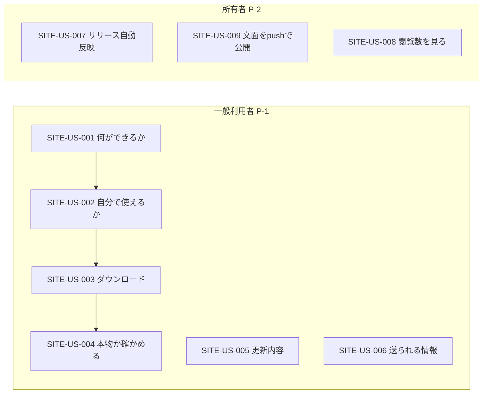

# 02. ユーザーストーリー
- プロジェクト：DC-Designer 紹介サイト ／ 版数：v0.1（2026-11-01） ／ インプット：[01_requirements](01_requirements.md)

> **3行で**
> 1. 一般利用者のストーリーは 6 件。「何ができるか → 使えるか → ダウンロード → 安全か確かめる」の順。
> 2. 所有者のストーリーは 3 件。どれも「push するかリリースするだけで反映される」ことが受け入れ基準。
> 3. 使い方を学ぶ・アプリをブラウザで試すストーリーは扱わない（Won't）。

## 🧭 判断してほしいこと
なし

## 全体図

見てほしいところ：利用者の主導線は US-001→004 の一本。US-005・006 は不安を解消する脇道。

## 要点
- ペルソナは 2 人：一般利用者（学生・サークル・小さな店）と所有者（[ペルソナ](#ペルソナ)）。
- 受け入れ基準は Given/When/Then で、すべて画面かビルドの結果で確かめられる（[ストーリー一覧](#ストーリー一覧)）。
- SmartScreen の警告を前にした利用者の不安（SITE-US-004）が、未署名の間はいちばん重要。

---

## 詳細

### ペルソナ
### P-1：一般利用者
- 属性：学生・サークル・生徒会・小さな店の担当者。Windows の PC を使う。
- 目的：ポスター・スライド・Instagram 投稿を手早く作りたい。
- 困りごと：デザインが苦手。知らない exe を入れるのが不安。ChatGPT の契約で使えるか分からない。
- IT リテラシー：中（インストーラーは入れられるが、ハッシュ値は知らない）。

### P-2：所有者（itiwoja）
- 属性：DC-Designer の開発者・唯一の承認者。
- 目的：リリースに集中し、サイトの更新に手を割かない。
- 困りごと：リリースの頻度が高く、手で版情報を直すと漏れる。

### ストーリーマップ
| アクティビティ | ステップ | ストーリー |
|---|---|---|
| 知る | トップを見る | SITE-US-001、SITE-US-002 |
| 入手する | ダウンロードする・確かめる | SITE-US-003、SITE-US-004 |
| 判断材料を読む | 更新履歴・ポリシー | SITE-US-005、SITE-US-006 |
| 運用する | リリース・文面修正・解析 | SITE-US-007、SITE-US-009、SITE-US-008 |

### ストーリー一覧

### SITE-US-001：何ができるか知る 〔SITE-REQ-001, SITE-REQ-008〕 優先度：Must
**一般利用者として、自分の用途に合うか判断するために、何ができるアプリかを短時間で知りたい。**
- Given トップを開いた When スクロールしない Then アプリ名・一文の説明・ダウンロードボタン・ヒーロー画像が見える
- Given トップ When 機能紹介までスクロールする Then 機能ごとに見出し・2 行の説明・画像（または動画）が並ぶ

### SITE-US-002：自分の環境で使えるか知る 〔SITE-REQ-009〕 優先度：Must
**一般利用者として、無駄にインストールしないために、自分の PC と契約で使えるかを知りたい。**
- Given トップかダウンロードページ When 動作要件を見る Then 「Windows 10 / 11（x64）」と「AI を使うには ChatGPT Plus/Pro のサインインか API キーが必要、無料プランは非対応」が書いてある
- Given 同上 When 読む Then 「手動の編集・保存・書き出しはサインインなしで使える」も分かる

### SITE-US-003：最新版をダウンロードする 〔SITE-REQ-002〕 優先度：Must
**一般利用者として、すぐ使い始めるために、最新版のインストーラーを 1 回のクリックで落としたい。**
- Given 最新の安定版が v1.0.6 When ダウンロードボタンを押す Then `DC-Designer-Setup-1.0.6.exe` のダウンロードが始まる
- Given ボタンの近く When 見る Then 版番号・公開日・ファイルサイズが分かる

### SITE-US-004：本物か確かめる 〔SITE-REQ-003〕 優先度：Must
**一般利用者として、SmartScreen の警告が出ても安心して進めるために、ダウンロードした物が公式の物か確かめたい。**
- Given 未署名の版 When ダウンロードページを見る Then 「この版はコード署名をしていない」こと・SmartScreen での進め方・SHA-256 の値と確かめるコマンドが見える
- Given 署名済みの版 When 同上 Then 「SignPath Foundation の署名つき」と表示され、未署名の注意は出ない

### SITE-US-005：更新内容を読む 〔SITE-REQ-005〕 優先度：Must
**一般利用者として、更新するか判断するために、版ごとに何が変わったか読みたい。**
- Given 更新履歴ページ When 開く Then 新しい順に、版・公開日・更新内容が並ぶ

### SITE-US-006：送られる情報を知る 〔SITE-REQ-006〕 優先度：Must
**一般利用者として、作品や個人情報が漏れないか確かめるために、アプリとサイトが何をどこへ送るか知りたい。**
- Given プライバシーページ When 読む Then AI 利用時の送信先・フォント取得・更新確認・サイトの解析（Cookie なし）が書いてある
- Given コード署名ポリシーページ When 読む Then 署名の対象・役割・SignPath の表記がある

### SITE-US-007：リリースが自動で反映される 〔SITE-REQ-004〕 優先度：Must
**所有者として、更新漏れをなくすために、リリースを公開したらサイトの版情報が自動で変わってほしい。**
- Given 配信 CI（release-windows）が成功した When 15 分待つ Then サイトの版番号・SHA-256・更新履歴が新しい版になっている
- Given 配信 CI が失敗・却下された When — Then サイトは前の版のまま

### SITE-US-009：文面を push で公開する 〔SITE-REQ-004〕 優先度：Must
**所有者として、手早く直すために、`site/` やポリシー文書を main に入れるだけで公開されてほしい。**
- Given `site/**` か `docs/privacy.md`・`docs/code-signing-policy.md` を変えたコミット When main に入る Then 15 分以内に公開される
- Given ビルドが失敗した When — Then 公開中のサイトは前のまま残る

### SITE-US-008：閲覧数を見る 〔SITE-REQ-007〕 優先度：Should
**所有者として、導線を直すために、ページごとの閲覧数を Cookie なしで見たい。**
- Given 解析のトークンを設定した When Cloudflare のダッシュボードを開く Then ページ別・参照元別の閲覧数が見える
- Given トークン未設定 When サイトを開く Then 解析のスクリプトは読み込まれない

## このドキュメントで決まったこと
- ペルソナ・ストーリーの範囲（ヒアリングの回答に基づく）。新しい決定はなし。
