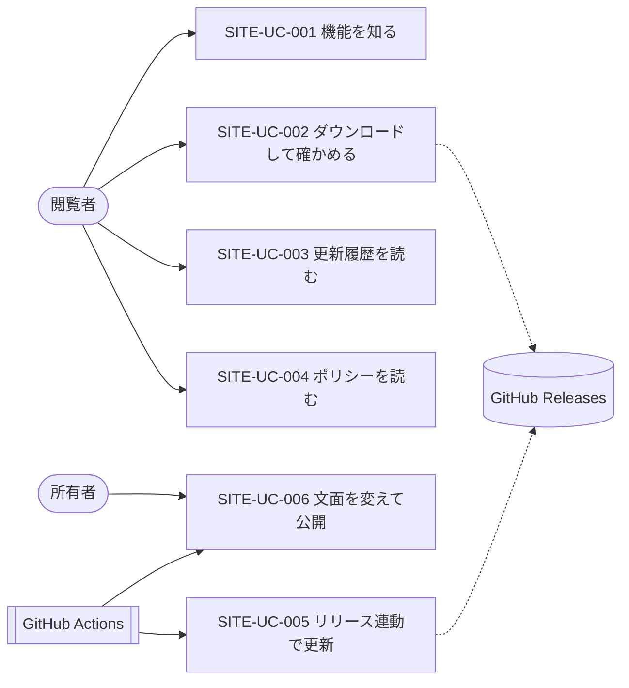

# 03. ユースケース
- プロジェクト：DC-Designer 紹介サイト ／ 版数：v0.2（2026-11-01） ／ インプット：[02_user_stories](02_user_stories.md)

> **3行で**
> 1. ユースケースは 6 件。閲覧者向け 4 件（知る・ダウンロード・更新履歴・ポリシー）と、所有者・CI 向け 2 件（閲覧数を見る SITE-UC-007 は取り下げ）。
> 2. サイトは静的なので、閲覧者のユースケースにサーバー処理はない。外部と通信するのはビルド時の GitHub API と、閲覧時の exe のダウンロード（GitHub Releases）だけ。
> 3. ビルドに失敗したら公開中のサイトをそのまま残す（例外フローの共通方針）。

## 🧭 判断してほしいこと
なし

## 全体図

見てほしいところ：ダウンロードは GitHub Releases から直接。サイトは exe を置かない。

## 要点
- アクターは 4 つ（[アクター一覧](#アクター一覧)）。GitHub Actions を「外部システムのアクター」として扱う。
- SITE-UC-005 のきっかけは配信 CI の**完了**（`workflow_run`）で、Release 公開イベントではない（[SITE-ADR-003](adr/SITE-ADR-003-release-trigger.md)）。
- 安定版が 1 つもない・exe や SHA256SUMS が欠けている場合は、ビルドを失敗させる（[SITE-UC-005](#site-uc-005)）。

---

## 詳細

### アクター一覧
| アクター | 種別 | 説明 |
|---|---|---|
| 閲覧者 | 人 | 一般利用者（P-1）。ログインしない |
| 所有者 | 人 | itiwoja（P-2）。main へ push、リリースを承認する |
| GitHub Actions | 外部システム | サイトのビルド・公開を行う |
| GitHub Releases / API | 外部システム | 版情報・配布物の提供元 |

### ユースケース記述

### SITE-UC-001：機能を知る 〔SITE-US-001, SITE-US-002〕
- アクター：閲覧者
- 事前条件：サイトが公開されている
- トリガー：検索・SNS・GitHub の README からトップを開く
- 基本フロー：1. トップを開く 2. ヒーロー（説明・最新版ボタン・画像）を見る 3. 機能紹介をスクロールする 4. 動作要件を読む 5. ダウンロードページへ進む
- 代替フロー：2a. ヒーローのボタンを押す → 直接ダウンロード（SITE-UC-002 の 3 へ）
- 例外フロー：E1. 画像・動画が読み込めない → 代替テキストと見出しだけで内容が分かる
- 補足：素材がまだ無い枠には「仮」と分かる仮の画像が出る（SITE-D-26）
- 事後条件：なし（閲覧のみ）

### SITE-UC-002：ダウンロードして確かめる 〔SITE-US-003, SITE-US-004〕
- アクター：閲覧者
- 事前条件：最新の安定版の情報がビルド時に埋め込まれている
- トリガー：ダウンロードページを開く
- 基本フロー：1. 版・公開日・サイズ・署名状況を見る 2. 動作要件を確認する 3. ダウンロードボタンを押す → GitHub Releases から exe が落ちる 4. SHA-256 の値をコピーする 5. 表示された PowerShell のコマンドで値を照合する 6. インストーラーを実行する
- 代替フロー：5a. 確かめない → 6 へ ／ 6a. SmartScreen の警告 → 表示された手順（「詳細情報」→「実行」）で進める
- 例外フロー：E1. 値が一致しない → 「実行しないで GitHub Issues か SECURITY.md の窓口へ」の案内に従う ／ E2. GitHub の障害で落ちない → 「すべての版（GitHub Releases）」のリンクから再試行
- 事後条件：閲覧者の PC に公式のインストーラーがある

### SITE-UC-003：更新履歴を読む 〔SITE-US-005〕
- アクター：閲覧者 ／ トリガー：ヘッダーの「更新履歴」
- 基本フロー：1. 版の一覧（新しい順）を見る 2. 版の更新内容を読む 3. 必要なら GitHub の該当 Release へ移る
- 例外フロー：なし（ビルド時に確定済み）

### SITE-UC-004：ポリシーを読む 〔SITE-US-006〕
- アクター：閲覧者（SignPath の審査者を含む） ／ トリガー：フッターのリンク
- 基本フロー：1. プライバシーかコード署名ポリシーを開く 2. 読む 3. 文中のリンク（リポジトリ内の文書）は GitHub 上のファイルへ移る

### SITE-UC-005：リリース連動でサイトを更新する 〔SITE-US-007〕
- アクター：GitHub Actions
- 事前条件：所有者が `v*` タグを push し、配信 CI（release-windows）が承認・公開まで成功した
- トリガー：`workflow_run`（release-windows の completed、結論 success）
- 基本フロー：1. main のサイトのソースを取得 2. GitHub API で Release 一覧を取得（SITE-API-001） 3. 最新の安定版の SHA256SUMS.txt を取得（SITE-API-002） 4. ページを生成 5. GitHub Pages へ公開
- 代替フロー：1a. 配信 CI の結論が success 以外 → 何もしない
- 例外フロー：E1. API の失敗・安定版 0 件・exe か SHA256SUMS の欠落・値の形式不正 → ビルド失敗。公開中のサイトは残り、所有者に Actions の失敗通知が届く
- 事後条件：サイトの版情報が最新の安定版と一致する

### SITE-UC-006：文面を変えて公開する 〔SITE-US-009〕
- アクター：所有者、GitHub Actions
- トリガー：`site/**`・`docs/privacy.md`・`docs/code-signing-policy.md`・サイトのワークフローを変えたコミットが main に入る、または手動実行
- 基本フロー：SITE-UC-005 の 1〜5 と同じ
- 例外フロー：SITE-UC-005 の E1 と同じ

### SITE-UC-007：閲覧数を見る 〔SITE-US-008〕 取り下げ（2026-11-01 ユーザー決定、SITE-D-27）
- 解析は入れないことにしたため取り下げ。ID は欠番にして振り直さない。ダウンロード数は GitHub Releases の `download_count` で見る（[01 KPI](01_requirements.md#2-目的成功指標kpi)）。

## このドキュメントで決まったこと
- [SITE-ADR-003](adr/SITE-ADR-003-release-trigger.md)：リリース連動は `workflow_run` を使う
- SITE-D-14：ビルドに失敗したら公開中のサイトを残す（定石）
- v0.2：SITE-UC-007 を取り下げ（SITE-D-27）
