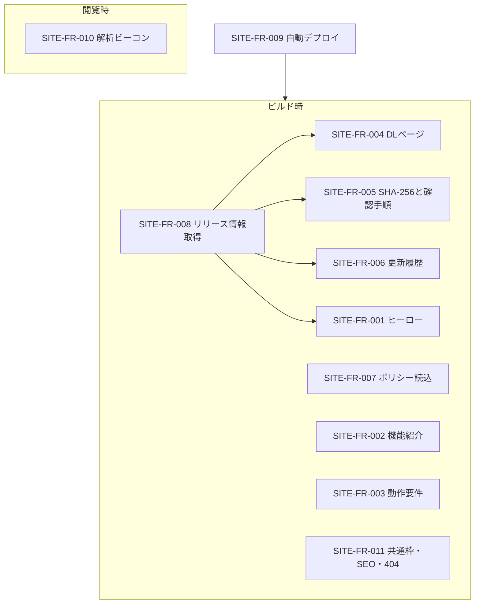

# 04. 機能仕様
- プロジェクト：DC-Designer 紹介サイト ／ 版数：v0.1（2026-11-01） ／ インプット：[03_use_cases](03_use_cases.md)

> **3行で**
> 1. 機能は 11 件。閲覧時に動くのは「解析ビーコン」だけで、ほかはすべて**ビルド時に HTML を生成**する。
> 2. 版情報は GitHub API から取り、最新の**安定版**（draft・prerelease 以外）だけをダウンロード対象にする。
> 3. 署名の有無はリリースノートの決まった文言で判定する案を推す（SITE-Q-01）。

## 🧭 判断してほしいこと
| # | 種類 | 論点 | 選択肢 | おすすめ（理由） | 決まらないと止まるもの |
|---|---|---|---|---|---|
| SITE-Q-01 | 未決 | 版が署名済みかどうかをサイトがどう知るか | A: リリースノートの「この版はコード署名をしていません」を検出 / B: 配信 CI が判定結果の JSON を資産に追加 / C: サイト設定に手で書く | A（配信 CI を変えずに済み、文言は CI が固定で出している。CI の文言を変えたらサイトも直す取り決めにする） | SITE-FR-004 の署名表示 |
| SITE-Q-04 | トレードオフ | ポリシーの正本を `docs/` に置いてサイトは読むだけにするか（`docs/privacy.md` を新設してよいか） | A: docs/ を正本に読み込む / B: site/ に別に書く | A（正本が 1 つで食い違わない。SignPath の条件も満たす） | SITE-FR-007、SITE-TBL-005 |
| SITE-R-02 | リスク | 未署名のため SmartScreen の警告で離脱する | — | 進め方と SHA-256 の確かめ方を、ボタンの直下に出す（SITE-FR-005） | — |

## 全体図

見てほしいところ：SITE-FR-008 が 4 つの機能の元データ。ここが失敗するとビルド全体を止める。

## 要点
- 機能一覧と優先度は [機能一覧](#機能一覧)。Must 10 件・Should 1 件。
- 安定版の選び方・SHA-256 の取り方・失敗時の扱いは [SITE-FR-008](#site-fr-008)。
- リリースノートは外部の PR タイトルを含むので、**HTML を無害化して表示**する（[SITE-FR-006](#site-fr-006)）。
- ポリシーは `docs/` の Markdown を正本として読み込み、リポジトリ内のリンクを GitHub の URL に書き換える（[SITE-FR-007](#site-fr-007)）。
- 素材が無い媒体の枠は、ビルドを止めずに文字だけのカードで出す（[SITE-FR-002](#site-fr-002)）。

---

## 詳細

### 機能一覧
| ID | 機能名 | 概要 | 関連UC | 優先度 |
|---|---|---|---|---|
| SITE-FR-001 | ヒーロー | キャッチ・最新版のボタン・ヒーロー画像 | UC-001 | Must |
| SITE-FR-002 | 機能紹介 | 機能カード（見出し・説明・画像/動画） | UC-001 | Must |
| SITE-FR-003 | 動作要件 | OS・AI の利用条件の表示 | UC-001, 002 | Must |
| SITE-FR-004 | ダウンロード | 最新安定版の exe へのリンクと版情報 | UC-002 | Must |
| SITE-FR-005 | 確認手順 | SHA-256・照合コマンド・SmartScreen の説明 | UC-002 | Must |
| SITE-FR-006 | 更新履歴 | 全公開版のリリースノート | UC-003 | Must |
| SITE-FR-007 | ポリシー | プライバシー・コード署名ポリシー | UC-004 | Must |
| SITE-FR-008 | リリース情報取得 | ビルド時に GitHub API から取得・検証 | UC-005, 006 | Must |
| SITE-FR-009 | 自動デプロイ | main の変更・配信 CI の完了で公開 | UC-005, 006 | Must |
| SITE-FR-010 | 解析ビーコン | Cloudflare Web Analytics（Cookie なし） | UC-007 | Should |
| SITE-FR-011 | 共通枠・SEO・404 | ヘッダー・フッター・OGP・404 | UC-001 | Must |

### <a id="site-fr-001"></a>SITE-FR-001：ヒーロー 〔SITE-UC-001〕
- 入力：最新安定版（SITE-TBL-001）、ヒーロー媒体（SITE-TBL-004 の `hero`）、キャッチ（SITE-TBL-007 の `home`）
- 処理：ボタンの文言は「Windows 版をダウンロード（v{version}）」、リンク先は exe の `browserDownloadUrl`。下に「無料・MIT ライセンス／Windows 10・11（x64）」を小さく出す
- 出力：SCR-001 の 1 画面目

### <a id="site-fr-002"></a>SITE-FR-002：機能紹介 〔SITE-UC-001〕
- 入力：機能（SITE-TBL-003）を `order` 順に、各機能の媒体（SITE-TBL-004）
- 処理：`exeAvailable: false` の機能は出さない。媒体の `status` が `ready` なら画像/動画、`placeholder` なら見出しと説明だけのカード（ビルドは止めない）。動画は `muted` `loop` `playsinline`、`prefers-reduced-motion` のときは自動再生せずポスター画像を出す
- 初期の機能（`exeAvailable: true`）：AI でレイアウトを作る／レイヤーで編集できるエディタ／参考画像の再現／PowerPoint の読み込み・編集・書き出し（アニメーション・台本・発表者ビュー）／Instagram 投稿／PDF を開いて編集／SVG・PNG・PPTX・JSON の書き出し

### <a id="site-fr-003"></a>SITE-FR-003：動作要件 〔SITE-UC-001, SITE-UC-002〕
| 項目 | 表示する内容 |
|---|---|
| OS | Windows 10 / 11（x64）。確認した版だけを書く（EXE-Q-03） |
| AI でレイアウト生成・修正 | ChatGPT Plus / Pro などでサインイン、または OpenRouter の API キー。**ChatGPT 無料プランは非対応** |
| 画像生成 | OpenAI か Gemini の API キー。無ければダミー画像 |
| サインイン不要で使えるもの | 白紙からの手動編集・保存・書き出し |

正本は SITE-TBL-007 の `requirements`。README と食い違ったら README（アプリ側）に合わせる。

### <a id="site-fr-004"></a>SITE-FR-004：ダウンロード 〔SITE-UC-002〕
- 入力：最新安定版（SITE-TBL-001）、exe の資産（SITE-TBL-002 `kind: installer`）
- 出力：版・公開日（`YYYY年M月D日`、JST）・サイズ（MB、小数 1 桁。Windows のエクスプローラーと同じく 1 MB = 1,048,576 バイト）・署名状況・ダウンロードボタン・「すべての版（GitHub Releases）」へのリンク
- 署名状況：`signed` が `false` なら「⚠ この版はコード署名をしていません」、`true` なら「SignPath Foundation の署名つき」。判定は SITE-Q-01

### <a id="site-fr-005"></a>SITE-FR-005：SHA-256 と確認手順 〔SITE-UC-002〕
- 出力：SHA-256（64 桁の小文字 16 進数、コピーボタンつき）と、照合のコマンド
  ```powershell
  Get-FileHash .\DC-Designer-Setup-1.0.6.exe -Algorithm SHA256
  ```
- 照合の注意：`Get-FileHash` は大文字で表示するので、「大文字・小文字は区別せずに見比べてください」と添える
- 未署名のとき：SmartScreen の画面で「詳細情報」→「実行」と進める手順を、画像なしの番号付きリストで出す
- 値が合わないとき：「実行しないで、GitHub Issues か SECURITY.md の窓口に知らせてください」
- コピーボタンは閲覧時の小さなスクリプト（Clipboard API）。使えない環境では値を選択できる文字として出すだけ

### <a id="site-fr-006"></a>SITE-FR-006：更新履歴 〔SITE-UC-003〕
- 入力：draft 以外の全 Release（prerelease は「プレリリース」の札を付けて含める）
- 処理：`body`（Markdown）を HTML に変換し、**生の HTML は捨てる**（許可するのは見出し・段落・リスト・リンク・強調・コード・引用だけ）。リンクは `https:` だけ残す。直近 10 版を開いた状態、それより古い版は `<details>` で畳む
- 出力：版ごとに見出し（`v1.0.6`、アンカー `#v1-0-6`）・公開日・本文・GitHub の Release へのリンク

### <a id="site-fr-007"></a>SITE-FR-007：ポリシー 〔SITE-UC-004〕
- 入力：`docs/privacy.md`（新設）・`docs/code-signing-policy.md`（既存）（SITE-TBL-005）
- 処理：Markdown を HTML にする。相対リンク（`./release-policy.md`、`../SECURITY.md` など）は `https://github.com/itiwoja/DC-Designer/blob/main/<path>` に書き換える。ただしサイトのページになっている文書（2 件）へのリンクはサイト内のページへ
- `docs/privacy.md` に書くこと：アプリが送る先（AI 利用時の ChatGPT・OpenRouter・OpenAI・Gemini、フォント取得の Google Fonts、更新確認の GitHub Releases）と、**AI の操作は追加の確認なしで送信する**こと（今の動き、SITE-D-12）。サイト自体は Cookie を使わず Cloudflare Web Analytics で閲覧数を数えること
- 署名ポリシーの古い文面は SITE-R-01（[11_tech_spec](11_tech_spec.md#12-リスクと対策)）

### <a id="site-fr-008"></a>SITE-FR-008：リリース情報取得 〔SITE-UC-005, SITE-UC-006〕
- 処理：
  1. SITE-API-001 で Release を最大 100 件取得（`GITHUB_TOKEN` で認証）
  2. `draft: true` を捨てる。`prerelease: false` のうち `publishedAt` が最新のものを「最新安定版」にする
  3. 最新安定版の資産から `DC-Designer-Setup-<version>.exe`（installer）と `SHA256SUMS.txt`（checksums）を探す。`latest.yml` は使わない
  4. SITE-API-002 で `SHA256SUMS.txt` を取得し、exe のファイル名の行から値を取る
  5. 署名状況を判定する（SITE-Q-01）
- エラー（すべてビルド失敗。公開中のサイトは残る）：

| 条件 | ビルドのメッセージ |
|---|---|
| API が 2xx 以外・通信失敗（3 回まで再試行） | `GitHub API の取得に失敗しました（HTTP {status}）` |
| 安定版が 0 件 | `公開済みの安定版がありません` |
| exe か SHA256SUMS.txt が無い | `v{version} に {name} がありません` |
| SHA256SUMS.txt に exe の行が無い・64 桁の 16 進数でない | `v{version} の SHA-256 を読めません` |

### <a id="site-fr-009"></a>SITE-FR-009：自動デプロイ 〔SITE-UC-005, SITE-UC-006〕
| きっかけ | 条件 |
|---|---|
| `push`（main） | `site/**`・`docs/privacy.md`・`docs/code-signing-policy.md`・`.github/workflows/site.yml` のいずれかが変わった |
| `workflow_run` | `release-windows` が completed かつ結論が `success` |
| `workflow_dispatch` | 所有者が手で実行 |

同時に走ったら後のものだけ残す（`concurrency: pages`、実行中は取り消さない）。詳細は [07](07_architecture.md#デプロイ構成)。

### <a id="site-fr-010"></a>SITE-FR-010：解析ビーコン 〔SITE-UC-007〕
- ビルド時の変数 `PUBLIC_CF_BEACON_TOKEN` があるときだけ、全ページの `</body>` 前にビーコンを出す。無ければ何も出さない
- Cookie・localStorage を使わない。閲覧者ごとの識別はしない

### <a id="site-fr-011"></a>SITE-FR-011：共通枠・SEO・404 〔SITE-UC-001〕
- ヘッダー：ロゴ・「機能」「ダウンロード」「更新履歴」・GitHub へのリンク。フッター：プライバシー・コード署名ポリシー・SECURITY・MIT ライセンス・GitHub Issues
- 各ページに `title`・`description`・OGP（`og:image` は 1200×630 の `ogp` 媒体。無ければアプリのアイコン）・`canonical`・`sitemap.xml`
- 404 はトップとダウンロードへのリンクだけ

### 権限マトリクス
| 機能 | 閲覧者 | 所有者 |
|---|---|---|
| 全ページの閲覧 | ○ | ○ |
| サイトの更新（push・手動実行） | × | ○（GitHub の権限で制御） |
| 閲覧数を見る | × | ○（Cloudflare のアカウント） |

### ステータス定義
| 対象 | 値 | 意味 |
|---|---|---|
| 媒体（SITE-TBL-004 `status`） | `placeholder` / `ready` | 素材なし / 素材あり。`placeholder` → `ready` の一方向 |
| Release | `draft` / `prerelease` / 安定版 | GitHub の値をそのまま使う。サイトでは変えない |

## このドキュメントで決まったこと
- SITE-D-12：プライバシーは今の動き（AI 送信は追加確認なし）に合わせる（決定者：ユーザー）
- SITE-D-15：更新履歴は直近 10 版を開き、古い版は畳む（Claude判断（おまかせ））
- SITE-D-16：リリースノートの生 HTML は捨てる（定石・安全のため）
