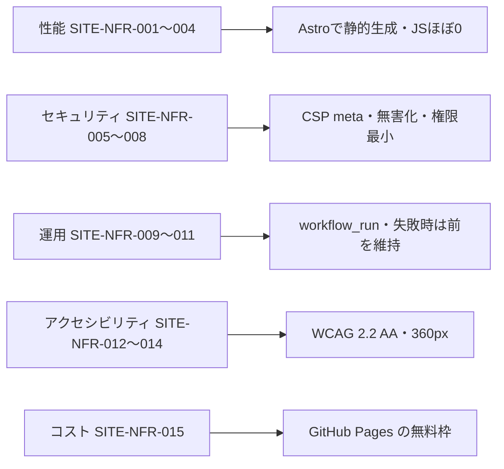

# 05. 非機能要件
- プロジェクト：DC-Designer 紹介サイト ／ 版数：v0.2（2026-11-01） ／ インプット：[01_requirements](01_requirements.md)

> **3行で**
> 1. 性能はモバイルで Lighthouse 90 以上・LCP 2.5 秒未満、JS は 30KB まで。
> 2. 費用 0 円、外部のスクリプトは読み込まない。Cookie を使わず、解析も入れない（SITE-D-27）。
> 3. 可用性は GitHub Pages に任せ、独自の SLA は持たない。数値はすべておまかせで決めた（SITE-D-13）。

## 🧭 判断してほしいこと
なし

## 全体図

見てほしいところ：どの要件も「静的に作って外に出す物を減らす」で満たしている。

## 要点
- 性能の目標はモバイル基準（[性能](#一覧)）。動画は遅延読み込みでトップの転送量に数えない。
- GitHub Pages は応答ヘッダーを設定できないので、CSP は `<meta>` で入れる（SITE-NFR-006）。
- リリース公開からの反映は 15 分以内（SITE-NFR-009）。
- 対応ブラウザは Chrome・Edge・Safari・Firefox の最新 2 版（SITE-NFR-013）。

---

## 詳細

### 一覧
| ID | カテゴリ | 要件 | 目標値 | 根拠 |
|---|---|---|---|---|
| SITE-NFR-001 | 性能 | Lighthouse 性能スコア（モバイル） | 90 以上（全ページ） | KPI（01） |
| SITE-NFR-002 | 性能 | LCP（4G 相当） | 2.5 秒未満 | Core Web Vitals の「良好」 |
| SITE-NFR-003 | 性能 | トップの初回転送量（動画を除く） | 1.5MB 以下。画像は 1 枚 300KB 以下（AVIF/WebP） | 回線の遅い学生の利用 |
| SITE-NFR-004 | 性能 | 閲覧時の JS | 合計 30KB 以下（gzip 後）。CLS 0.1 未満 | Astro の島はコピーボタンだけ |
| SITE-NFR-005 | セキュリティ | 外部へのスクリプト | なし（自サイトのスクリプトだけ）。Cookie・localStorage を使わない。解析は入れない | プライバシーの約束・SITE-D-27 |
| SITE-NFR-006 | セキュリティ | CSP | `<meta http-equiv="Content-Security-Policy">` で `default-src 'self'`、`script-src 'self'`、`connect-src 'self'`、`img-src 'self' data:`、`object-src 'none'`、`base-uri 'self'` | Pages はヘッダー不可 |
| SITE-NFR-007 | セキュリティ | 外部由来の文字の扱い | リリースノートの生 HTML を捨て、`https:` 以外のリンクを消す | 外部 PR のタイトルが入る |
| SITE-NFR-008 | セキュリティ | CI の権限 | サイトのワークフローは `contents: read`・`pages: write`・`id-token: write` だけ。PAT・追加の App を使わない | release-policy.md |
| SITE-NFR-009 | 運用 | 反映の速さ | 配信 CI の完了・main への push から 15 分以内 | KPI（01） |
| SITE-NFR-010 | 運用 | ビルド時間 | 3 分以内 | 反映の速さの内訳 |
| SITE-NFR-011 | 運用 | 失敗時 | 公開中のサイトを残し、Actions の失敗通知で所有者に知らせる。ログに秘密情報を出さない | SITE-D-14 |
| SITE-NFR-012 | アクセシビリティ | 準拠 | WCAG 2.2 AA。文字のコントラスト 4.5:1 以上、画像に代替テキスト、キーボードで全操作 | 一般利用者向け |
| SITE-NFR-013 | 互換性 | 対応ブラウザ | Chrome・Edge・Safari・Firefox の最新 2 版 | 定石 |
| SITE-NFR-014 | 互換性 | 画面幅 | 360px 〜 1920px で横スクロールなし | スマホからの閲覧 |
| SITE-NFR-015 | コスト | 月額 | 0 円 | 制約（01） |
| SITE-NFR-016 | 可用性 | 稼働 | GitHub Pages に依存（独自の SLA なし）。ダウンロードは GitHub Releases に依存 | 静的サイト |
| SITE-NFR-017 | 保守 | 依存 | Astro と Markdown 変換・無害化のライブラリだけ。版は lockfile で固定 | 小規模・1 人運用 |

### 測り方
- SITE-NFR-001〜004：公開後に Lighthouse（モバイル）で全 6 画面を測る。
- SITE-NFR-009・010：Actions の実行時間で見る。
- SITE-NFR-012：axe などの自動検査＋キーボード操作の目視。

## このドキュメントで決まったこと
- SITE-D-13：上の数値はすべて Claude判断（おまかせ）。ユーザーが「数値はおまかせ」を選んだ（ヒアリング 2 回目）
- v0.2：解析を入れない（SITE-D-27）ため、SITE-NFR-005・006・015 から Cloudflare を外した
