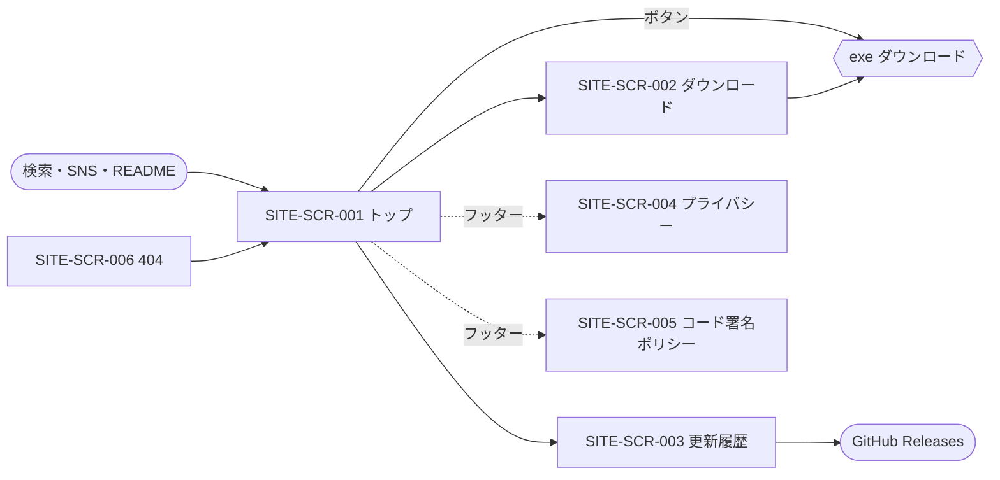

# 06. 画面・UX設計
- プロジェクト：DC-Designer 紹介サイト ／ 版数：v0.4（2026-11-01） ／ インプット：[04_functional_spec](04_functional_spec.md)

> **3行で**
> 1. 画面は 6 つ：トップ・ダウンロード・更新履歴・プライバシー・コード署名ポリシー・404。
> 2. トップの 1 画面目に「何ができるか」と「最新版のボタン」を必ず置く。ダウンロードページは「入れて大丈夫か」に答える場所。
> 3. 媒体（スクショ・動画）は枠だけ決める。素材は後で Remotion で作り、揃うまでは「仮」と分かる仮の画像で公開する（SITE-D-26）。

## 🧭 判断してほしいこと
| # | 種類 | 論点 | 選択肢 | おすすめ（理由） | 決まらないと止まるもの |
|---|---|---|---|---|---|
| SITE-Q-02 | 決定（2026-11-01） | 素材が揃う前に公開するか（[01](01_requirements.md) と同じ） | A / B | **B に決定（ユーザー、SITE-D-26）**：仮の画像で先に公開し、後から差し替える（[媒体の枠](#媒体の枠)） | — |

## 全体図

見てほしいところ：どの画面からも 1 クリックでダウンロードできる（ヘッダーに常に「ダウンロード」）。

## 要点
- URL はすべて `/DC-Designer/` の下（GitHub Pages のプロジェクトサイト）。[画面一覧](#画面一覧)
- トーンは「アプリと同じ明るさ・やさしい日本語・専門用語を避ける」（[デザイン方針](#デザイン方針)）。
- 媒体の寸法と命名、素材が揃うまでの仮の画像は [媒体の枠](#媒体の枠)。
- スマホでは機能カードを 1 列、PC では 2 列（[レスポンシブ](#レスポンシブアクセシビリティ方針)）。

---

## 詳細

### デザイン方針
- 主役はアプリの画面。文字は少なく、1 機能 = 見出し 1 行＋説明 2 行まで。
- 色はアプリのテーマ（`src/themes.ts`）の主要色に合わせる。フォントはアプリと違い Web フォント（Google Fonts）を読まず、システムフォント（Windows は Yu Gothic UI・Meiryo、ほかは各 OS の日本語フォント）にする（SITE-D-31。CSP と転送量のため）。ダーク表示に対応（`prefers-color-scheme`）。
- 「AI が全部作る」と言い切らず、「AI が下書き → 自分で直せる」と書く（レイヤー編集がこのアプリの強み）。

### 画面一覧
| ID | 画面名 | URL | 関連FR |
|---|---|---|---|
| SITE-SCR-001 | トップ | `/DC-Designer/` | FR-001, 002, 003, 011 |
| SITE-SCR-002 | ダウンロード | `/DC-Designer/download/` | FR-003, 004, 005 |
| SITE-SCR-003 | 更新履歴 | `/DC-Designer/changelog/` | FR-006 |
| SITE-SCR-004 | プライバシー | `/DC-Designer/privacy/` | FR-007 |
| SITE-SCR-005 | コード署名ポリシー | `/DC-Designer/code-signing/` | FR-007 |
| SITE-SCR-006 | 404 | `/DC-Designer/404.html` | FR-011 |

### SITE-SCR-001：トップ
```
+--------------------------------------------------+
| [ロゴ] DC-Designer   機能 ダウンロード 更新履歴 GH |
+--------------------------------------------------+
| ポスターを、AIの下書きから          [ヒーロー画像] |
| レイヤーで仕上げる。                1600×1000     |
| [Windows版をダウンロード（v1.0.6）]               |
| 無料・MIT／Windows 10・11（x64）                  |
+--------------------------------------------------+
| 機能紹介  [カード][カード]  …（SITE-TBL-003の順） |
+--------------------------------------------------+
| デモ動画（ループ・効果音つき）                    |
+--------------------------------------------------+
| 動作要件（SITE-FR-003）                            |
+--------------------------------------------------+
| もう一度 [ダウンロード]  ／ フッター               |
+--------------------------------------------------+
```
| 項目 | データ元 | 備考 |
|---|---|---|
| 版番号・ボタンのリンク | SITE-TBL-001/002 | ビルド時 |
| 機能カード | SITE-TBL-003・004 | `placeholder` は仮の画像 |
| ヒーロー画像 | SITE-TBL-004 の `hero` | `placeholder` は仮の画像 |
| デモ動画 | SITE-TBL-004 の `demo` | SITE-FR-002。`placeholder` は仮の画像（静止画） |
- 状態：静的なので「ローディング」「空」は無い。媒体が読めないときは代替テキスト。

### SITE-SCR-002：ダウンロード
```
+--------------------------------------------------+
| DC-Designer for Windows   v1.0.6 ・ 2026年10月30日 |
| 118.1 MB ・ ⚠ この版はコード署名をしていません      |
| [ダウンロード]   すべての版（GitHub Releases）→    |
+--------------------------------------------------+
| SmartScreen の警告が出たら 1.詳細情報 2.実行        |
+--------------------------------------------------+
| 本物か確かめる  SHA-256: 3f2a…  [コピー]           |
|   Get-FileHash "$env:USERPROFILE\Downloads\…" … |
|   合わないときは実行せずに知らせてください          |
+--------------------------------------------------+
| 動作要件（SITE-FR-003）                            |
+--------------------------------------------------+
```
| 操作 | 挙動 | 遷移先 |
|---|---|---|
| ダウンロード | exe の `browserDownloadUrl` へ | GitHub（ダウンロード） |
| コピー | SHA-256 をクリップボードへ。「コピーしました」を 2 秒表示 | — |

### SITE-SCR-003：更新履歴
版ごとに `v1.0.6 ・ 2026年10月30日` の見出しと本文。直近 10 版は開いた状態、それより古い版は畳む。各版に「GitHub で見る →」。

### SITE-SCR-004 / 005：ポリシー
本文だけの読み物レイアウト（最大幅 720px）。冒頭に「最終更新：{正本の最終コミット日}」。

### SITE-SCR-006：404
「ページが見つかりません」とトップ・ダウンロードへのリンク。

### 媒体の枠
素材は `site/src/assets/media/` に置き、SITE-TBL-004 に登録する。

| 枠 | 寸法・形式 | 上限 | 命名 |
|---|---|---|---|
| hero | 1600×1000、AVIF/WebP（ビルドで生成） | 300KB | `hero.png`（原本） |
| 機能画像 | 1200×750 | 1 枚 300KB | `feature-<featureId>.png` |
| デモ動画 | 1920×1080（2026-11-01 に 1280×720 から上げた）、MP4（H.264）＋WebM、効果音つき（ナレーションなし）・15〜30 秒・ポスター画像つき | 8MB | `demo.mp4` / `demo.webm` / `demo-poster.png` |
| OGP | 1200×630、PNG | 300KB | `ogp.png` |
| 仮の画像（素材が揃うまで） | hero・機能画像・デモ動画と同じ寸法、PNG | 1 枚 50KB | `placeholder-hero.png` / `placeholder-feature.png` / `placeholder-demo.png` |

- 仮の画像は `status: placeholder` の枠に出す共通の画像。ひと目で「仮」と分かるようにする：無彩色の地に「画面は準備中」の文字を入れ、アプリの実際の画面に見えるものは描かない。代替テキストも「準備中」と分かる文にする（SITE-D-26）。
- Remotion で素材ができたら、ファイルを置いて `status` を `ready` にするだけで差し替わる。デモ動画は仮の画像を静止画として出す（再生しない）。OGP は今までどおりアプリのアイコンで代える。
- デモ動画・動画のポスター画像・hero は `site/video/`（Remotion、サイトとは別のパッケージ）で作る（2026-11-01 に `ready`）。作り直し方・素材の出典は [site/video/README.md](../../site/video/README.md)。デモ動画は同じ名前の `.webm` があれば先に、`.mp4` を後に出し、ポスター画像は WebP にして配る。

- 動画は `preload="none"`、画面に入ったら読み込む。
- 代替テキストは SITE-TBL-004 の `alt`（必須）。

### 共通 UI コンポーネント
ヘッダー／フッター／ダウンロードボタン（版番号つき）／機能カード／注意ボックス（未署名の警告）／コピーボタン（島にせず `.astro` 内の `<script>`、SITE-D-31）。

### レスポンシブ・アクセシビリティ方針
- 360px：1 列、ヘッダーは「ダウンロード」だけ残してほかはメニュー。768px 以上：機能カード 2 列。
- フォーカスの枠を消さない。動画は `prefers-reduced-motion` で止める。見出しの階層を飛ばさない。

## このドキュメントで決まったこと
- SITE-D-17：媒体の寸法・上限・命名（Claude判断（おまかせ））
- SITE-D-11：素材は後で Remotion で作る（決定者：ユーザー）
- SITE-D-26：素材が揃う前は「仮」と分かる仮の画像で公開し、後から差し替える（決定者：ユーザー、2026-11-01）
- SITE-D-31：フォントはシステムフォント、コピーボタンは島にしない（定石）
