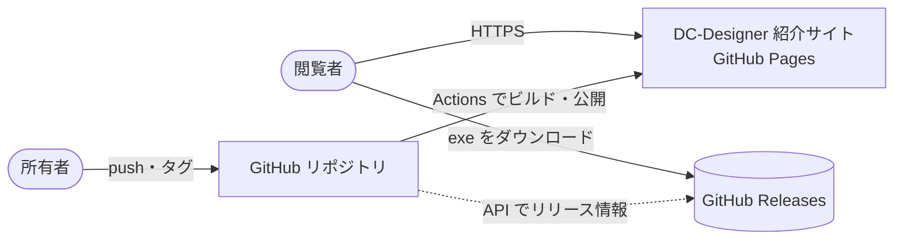
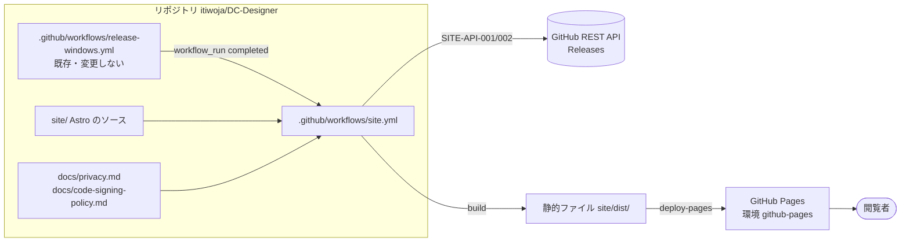
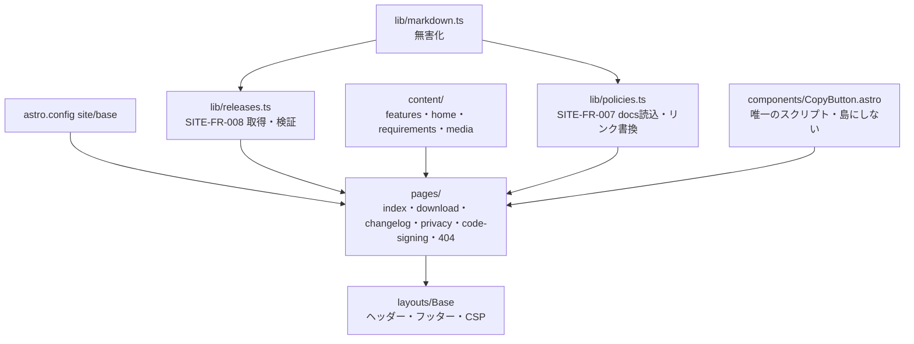

# 07. システムアーキテクチャ
- プロジェクト：DC-Designer 紹介サイト ／ 版数：v0.3（2026-11-01） ／ インプット：[04](04_functional_spec.md)、[05](05_non_functional.md)

> **3行で**
> 1. Astro で静的に生成し、GitHub Actions から GitHub Pages へ公開する。サーバーも DB も持たない。
> 2. リリースとの連動は、配信 CI（release-windows）の完了を `workflow_run` で受ける。配信 CI そのものは変えない。
> 3. 閲覧時に外部へ出るのは、GitHub Releases からのダウンロードだけ。解析は入れない（SITE-D-27）。

## 🧭 判断してほしいこと
| # | 種類 | 論点 | 選択肢 | おすすめ（理由） | 決まらないと止まるもの |
|---|---|---|---|---|---|
| SITE-Q-03 | 決定（2026-11-01） | Cloudflare Web Analytics のトークンを用意するか | A: 入れる / B: 当面入れない | **解析は入れないに決定（ユーザー、SITE-D-27）**。解析そのものをスコープから外し、SITE-FR-010 を取り下げ | — |
| SITE-Q-04 | 決定（2026-11-01） | ポリシーの正本を `docs/` に置いてサイトは読むだけにするか | A: docs/ を正本に読み込む / B: site/ に別に書く | **A に決定（ユーザー、SITE-D-28）**：`docs/privacy.md` を新設し、サイトは読み込むだけ | — |

## 全体図
C4 レベル 1：コンテキスト

見てほしいところ：サイトは exe を置かない。ダウンロードは常に GitHub Releases から。閲覧時にサイトから外部へ送るものは無い。

## 要点
- コンテナは「サイトのソース」「サイトのワークフロー」「GitHub Pages」の 3 つ（[レベル 2](#レベル2コンテナ図)）。
- 技術の選定と代替案は ADR へ（[技術スタック](#技術スタック)）。
- 公開の URL は `https://itiwoja.github.io/DC-Designer/`。Astro の `site` と `base` で固定（[環境](#デプロイ構成)）。
- 独自ドメインに変えると `base` が `/` に変わり、全リンクが変わる（Won't だが、変えるときの影響として記録）。

---

## 詳細

### レベル2：コンテナ図

見てほしいところ：release-windows とサイトのワークフローはファイルが別。権限も別（[SITE-ADR-003](adr/SITE-ADR-003-release-trigger.md)）。

### レベル3：コンポーネント図（site/）


### 技術スタック
| レイヤー | 採用技術 | 理由 | 代替案 |
|---|---|---|---|
| サイト生成 | Astro（静的出力、導入時の最新安定版を固定） | JS をほぼ出さない・Markdown・ビルド時取得が素直 | 素の HTML、Vite+React → [SITE-ADR-001](adr/SITE-ADR-001-astro.md) |
| Markdown | Astro 標準の変換＋無害化（rehype-sanitize 相当） | リリースノートに外部の文字が入る | — |
| 画像 | `astro:assets`（AVIF/WebP をビルドで生成） | SITE-NFR-003 | — |
| ホスティング | GitHub Pages（Actions から公開） | 0 円・リポジトリと同じ場所 | Cloudflare Workers、Vercel → [SITE-ADR-002](adr/SITE-ADR-002-github-pages.md) |
| CI | GitHub Actions、Node 24（配信 CI と同じ） | 既存の CI と揃える | — |
| 解析 | なし（入れない） | ユーザー決定（SITE-D-27）。外部への送信・Cookie・設定がいらない | Cloudflare Web Analytics（取り消し）、GoatCounter、Umami → [SITE-ADR-004](adr/SITE-ADR-004-analytics.md) |
| 置き場所 | 同じリポジトリの `site/`（独自の `package.json`） | リリースと連動しやすい | 別リポジトリ → [SITE-ADR-006](adr/SITE-ADR-006-same-repo.md) |

`site/` はアプリの `package.json` と依存を共有しない（アプリの配布物検査の許可リストに入らないようにする。ADR-005 と整合）。

CSP（SITE-NFR-006）を `<meta>` で入れるため、インラインの CSS・JS を出さない設定にする（SITE-D-31）：`build.inlineStylesheets: 'never'`、スクリプトもインライン化させない（`vite.build.assetsInlineLimit: 0` など）、コピーボタンは `.astro` 内の `<script>` にして島（`client:*`。インラインのスクリプトとフレームワークのランタイムを出す）を使わない。フォントはシステムフォント。守れているかは、ビルド後の HTML を検査するテストで確かめる（[11 §11](11_tech_spec.md#11-テスト方針)）。

### デプロイ構成
| 項目 | 値 |
|---|---|
| 環境 | 本番だけ（GitHub Pages の環境 `github-pages`、デプロイできるブランチは `main` だけ、承認は不要） |
| URL | `https://itiwoja.github.io/DC-Designer/`（Astro：`site: "https://itiwoja.github.io"`、`base: "/DC-Designer"`） |
| 手元での確認 | `site/` で `npm run dev`。版情報の取得は `GITHUB_TOKEN` 無しでも動く（未認証は 60 回/時） |
| 所有者の初期設定 | リポジトリの Settings → Pages → Source を「GitHub Actions」にする |

ワークフローの仕様（抜粋。仕様として示すもので、このままの実装を求めるものではない）：
```yaml
on:
  push: { branches: [main], paths: ["site/**", "docs/privacy.md", "docs/code-signing-policy.md", ".github/workflows/site.yml"] }
  workflow_run: { workflows: ["release-windows"], types: [completed] }
  workflow_dispatch: {}
permissions: { contents: read, pages: write, id-token: write }
concurrency: { group: pages, cancel-in-progress: false }
# build ジョブは workflow_run のとき conclusion == 'success' だけ実行
# checkout は fetch-depth: 0（ポリシーの最終更新日を git log で取るため。既定の 1 だと HEAD の日付になる。SITE-TBL-005）
```

### 認証・認可
- 閲覧者の認証は無い。
- ビルドは Actions の `GITHUB_TOKEN`（`contents: read`）で GitHub API を読む。Pages への公開は OIDC（`id-token: write`）。PAT は使わない。

### 外部連携
| 相手 | いつ | 何を | 失敗時 |
|---|---|---|---|
| GitHub REST API | ビルド時 | Release 一覧（SITE-API-001） | ビルド失敗 |
| GitHub Releases | ビルド時・閲覧時 | SHA256SUMS.txt（SITE-API-002）・exe（SITE-API-004） | ビルド失敗 ／ 閲覧者が再試行 |

### ログ・監視・エラー通知
- ビルドのログは Actions に残る（既定の保持期間）。失敗は GitHub の通知で所有者に届く。
- 公開後の監視は持たない（静的サイト、SITE-NFR-016）。

### 主要な設計判断（ADR）
| ADR | 決定 | 状態 |
|---|---|---|
| [SITE-ADR-001](adr/SITE-ADR-001-astro.md) | Astro で静的生成 | 承認 |
| [SITE-ADR-002](adr/SITE-ADR-002-github-pages.md) | GitHub Pages で配信 | 承認 |
| [SITE-ADR-003](adr/SITE-ADR-003-release-trigger.md) | リリース連動は `workflow_run` | 承認 |
| [SITE-ADR-004](adr/SITE-ADR-004-analytics.md) | 解析は入れない（Cloudflare Web Analytics 案を取り消し） | 取り消し（2026-11-01） |
| [SITE-ADR-005](adr/SITE-ADR-005-policy-source.md) | ポリシーは docs/ を正本に読み込む | 承認 |
| [SITE-ADR-006](adr/SITE-ADR-006-same-repo.md) | 同じリポジトリの site/ | 承認 |

## このドキュメントで決まったこと
- 上の ADR 6 件（v0.2：SITE-ADR-004 を取り消して解析は入れない〔SITE-D-27〕、SITE-ADR-005 を承認〔SITE-D-28〕）
- SITE-D-18：`site/` はアプリと依存を共有しない（定石・配布物の境界を守るため）
- SITE-D-19：Pages の環境に承認は付けない（定石。公開してよいかは main へのマージで判断済み）
- SITE-D-31：インラインの CSS・JS を出さず CSP と両立させる（定石）
