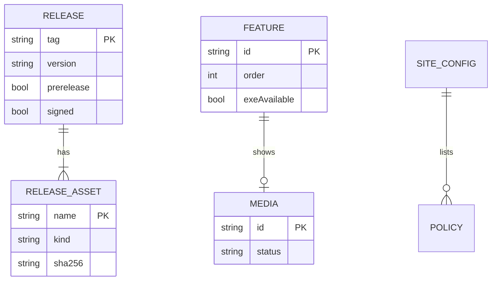

# 08. コンテンツモデル（DB 設計の代わり）
- プロジェクト：DC-Designer 紹介サイト ／ 版数：v0.2（2026-11-01） ／ インプット：[04_functional_spec](04_functional_spec.md)

> **3行で**
> 1. 静的サイトなので DB は持たない。代わりに、ビルド時に扱うデータを 7 つの「表」（SITE-TBL）として定義する。
> 2. 版情報（TBL-001・002）は GitHub API から毎回取り直し、リポジトリに保存しない。
> 3. 手で書くもの（機能・媒体・ポリシー・固定文・設定）は `site/` か `docs/` の Markdown / JSON に置く。

## 🧭 判断してほしいこと
なし

## 全体図

見てほしいところ：RELEASE 系は「取ってくるもの」、FEATURE・MEDIA・POLICY は「書くもの」。両者はつながっていない。

## 要点
- 表の一覧は [テーブル一覧](#テーブル一覧)。名前はコードの型名にもそのまま使う。
- `signed` はリリースノートの「この版はコード署名をしていません」の有無で決める（SITE-D-25、[04](04_functional_spec.md#site-fr-004)）。
- 媒体の `status` は `placeholder` → `ready` の一方向。`placeholder` の間は仮の画像を出す（[SITE-TBL-004](#site-tbl-004)、SITE-D-26）。
- 日時は ISO 8601（UTC）で持ち、表示のときに JST にする。

---

## 詳細

### 方針
- 置き場所：取得データはメモリ上だけ。手書きデータは Astro の content collections（`site/src/content/`）と `docs/`。
- 検証：content collections のスキーマ（zod）でビルド時に検証し、不正ならビルド失敗。
- 命名：フィールドは camelCase。ID はケバブケース。

### テーブル一覧
| ID | 名前 | 論理名 | 置き場所 | 関連FR |
|---|---|---|---|---|
| SITE-TBL-001 | Release | リリース | GitHub API（ビルド時） | FR-001, 004, 006, 008 |
| SITE-TBL-002 | ReleaseAsset | 配布物 | GitHub API ＋ SHA256SUMS.txt | FR-004, 005, 008 |
| SITE-TBL-003 | Feature | 機能紹介 | `site/src/content/features/*.md` | FR-002 |
| SITE-TBL-004 | Media | 媒体 | `site/src/content/media.json` ＋ `site/src/assets/media/` | FR-001, 002, 011 |
| SITE-TBL-005 | Policy | ポリシー文書 | `docs/privacy.md`・`docs/code-signing-policy.md` | FR-007 |
| SITE-TBL-006 | SiteConfig | サイト設定 | `site/astro.config.*` ＋ ビルド時の環境変数 | FR-008, 011 |
| SITE-TBL-007 | PageText | 固定文 | `site/src/content/pages/*.md` | FR-001, 003 |

### SITE-TBL-001：Release
GitHub の Release 1 件。主なフィールド：`tag`, `version`, `publishedAt`, `prerelease`, `signed`

フィールド定義（8 項目）

| フィールド | 型 | 元 | 説明 |
|---|---|---|---|
| tag | string | `tag_name` | `v1.0.6` |
| version | string | `tag` から `v` を除く | `1.0.6` |
| name | string | `name` | `DC-Designer v1.0.6` |
| publishedAt | string (ISO 8601) | `published_at` | |
| prerelease | boolean | `prerelease` | |
| bodyHtml | string | `body` を無害化して HTML に | SITE-FR-006 |
| htmlUrl | string | `html_url` | GitHub の Release ページ |
| signed | boolean | `body` の文言で判定（SITE-D-25） | `body` に「この版はコード署名をしていません」が無ければ true |

- `draft: true` は取り込まない。件数は 100 件まで（超えたら古い方を捨てる。当面は届かない）。

### SITE-TBL-002：ReleaseAsset
Release に付いた配布物のうち、サイトが使う 2 種類だけ。

| フィールド | 型 | 説明 |
|---|---|---|
| name | string | `DC-Designer-Setup-1.0.6.exe` / `SHA256SUMS.txt` |
| kind | `installer` / `checksums` | 名前の形で決める。`latest.yml` などは捨てる |
| size | number | バイト数 |
| browserDownloadUrl | string | `https://github.com/itiwoja/DC-Designer/releases/download/...` |
| sha256 | string \| null | installer だけ。SHA256SUMS.txt の該当行の 64 桁 |

### SITE-TBL-003：Feature
1 ファイル = 1 機能。本文は説明 2 行まで。

| フィールド（frontmatter） | 型 | 必須 | 説明 |
|---|---|---|---|
| id | string | ○ | `ai-layout` など。媒体の命名に使う |
| title | string | ○ | 見出し（20 字まで） |
| order | number | ○ | 表示順 |
| exeAvailable | boolean | ○ | exe 版で使えるか。false は表示しない |
| mediaId | string | — | SITE-TBL-004 の id |

### SITE-TBL-004：Media
| フィールド | 型 | 必須 | 説明 |
|---|---|---|---|
| id | string | ○ | `hero` / `ogp` / `demo` / `feature-<id>` |
| type | `image` / `video` | ○ | |
| status | `placeholder` / `ready` | ○ | `ready` なのにファイルが無ければビルド失敗 |
| src | string | ready のとき | `site/src/assets/media/` からの相対パス。`placeholder` の間は書かず、枠の種類に合った共通の仮の画像（[06 媒体の枠](06_ux_design.md#媒体の枠)）を出す |
| poster | string | video のとき | ポスター画像 |
| alt | string | ○ | 代替テキスト（`placeholder` でも書く） |

### SITE-TBL-005：Policy
| フィールド | 型 | 説明 |
|---|---|---|
| slug | `privacy` / `code-signing` | サイトの URL |
| sourcePath | string | `docs/privacy.md` / `docs/code-signing-policy.md` |
| title | string | 文書の最初の `#` 見出し |
| updatedAt | string | 正本の最終コミット日（`git log -1`、ビルド時） |

### SITE-TBL-006：SiteConfig
| 項目 | 値・元 |
|---|---|
| site / base | `https://itiwoja.github.io` / `/DC-Designer` |
| repo | `itiwoja/DC-Designer` |
| unsignedMarker | `この版はコード署名をしていません`（SITE-D-25。配信 CI の文言を変えたらここも直す） |
| GITHUB_TOKEN | Actions が自動で渡す。ログに出さない |

### SITE-TBL-007：PageText
トップのキャッチ（`home`）・動作要件（`requirements`）など、画面に出す手書きの文。

| フィールド | 型 | 説明 |
|---|---|---|
| slug | `home` / `requirements` | 使う画面の部品 |
| body | Markdown | 本文。動作要件は README（アプリ側）と食い違ったら README に合わせる |

### データ保持・削除ポリシー
- サイトは閲覧者のデータを保存しない。解析も入れないので、閲覧数も記録しない（SITE-D-27）。
- Release を GitHub で消したら、次のビルドでサイトからも消える。

## このドキュメントで決まったこと
- SITE-D-20：DB を持たず、ビルド時のデータを SITE-TBL として定義する（定石・静的サイト）
- SITE-D-21：版情報はリポジトリに保存せず毎回取り直す（定石。古い控えを公開する危険を避ける）
- v0.2：`signed` の判定（SITE-D-25）・仮の画像（SITE-D-26）を確定し、解析のトークン `PUBLIC_CF_BEACON_TOKEN` を外した（SITE-D-27）
