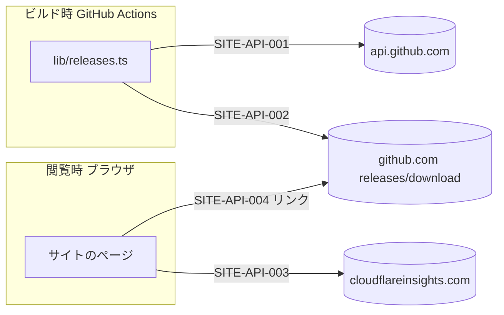

# 09. API 設計（利用する外部インターフェース）
- プロジェクト：DC-Designer 紹介サイト ／ 版数：v0.1（2026-11-01） ／ インプット：[04](04_functional_spec.md)、[06](06_ux_design.md)、[08](08_database.md)

> **3行で**
> 1. サイトは API を**提供しない**。ここでは、サイトが**使う**外部インターフェース 4 つを定義する。
> 2. ビルド時に使うのは GitHub の Release 一覧と SHA256SUMS.txt。どちらかが失敗したらビルドを止める。
> 3. 閲覧時に使うのは解析ビーコンと exe のダウンロードだけ。

## 🧭 判断してほしいこと
なし

## 全体図

見てほしいところ：閲覧時のブラウザは GitHub API を叩かない（回数制限と失敗表示を考えなくてよい）。

## 要点
- 一覧は [エンドポイント一覧](#エンドポイント一覧)。
- GitHub API は Actions の `GITHUB_TOKEN` で認証する（リポジトリあたり 1,000 回/時。ビルド 1 回で 1 回）。
- 再試行は 3 回まで（1・2・4 秒あけて）。それでも失敗ならビルド失敗（[SITE-API-001](#site-api-001)）。

---

## 詳細

### 共通仕様
- 形式：GitHub API は JSON（`Accept: application/vnd.github+json`、`X-GitHub-Api-Version: 2022-11-28`）。
- 日時：ISO 8601（UTC）。
- エラーの扱い：ビルドのエラーメッセージは [SITE-FR-008](04_functional_spec.md#site-fr-008) の表のとおり。

### エンドポイント一覧
| ID | 方向 | メソッド | 宛先 | 概要 | 関連 |
|---|---|---|---|---|---|
| SITE-API-001 | ビルド → GitHub | GET | `https://api.github.com/repos/itiwoja/DC-Designer/releases?per_page=100` | Release 一覧 | FR-008、TBL-001・002 |
| SITE-API-002 | ビルド → GitHub | GET | SHA256SUMS.txt の `browser_download_url` | SHA-256 | FR-008、TBL-002 |
| SITE-API-003 | ブラウザ → Cloudflare | GET/POST | `https://static.cloudflareinsights.com/beacon.min.js` → `https://cloudflareinsights.com/cdn-cgi/rum` | 閲覧の計測 | FR-010、SCR 全部 |
| SITE-API-004 | ブラウザ → GitHub | GET | exe の `browser_download_url` | ダウンロード（ただのリンク） | FR-001・004、SCR-001・002 |

### <a id="site-api-001"></a>SITE-API-001：GET /repos/itiwoja/DC-Designer/releases
- 認証：`Authorization: Bearer ${GITHUB_TOKEN}`（Actions）。手元では無しでもよい（60 回/時）。
- 使うフィールド：`tag_name`, `name`, `draft`, `prerelease`, `published_at`, `body`, `html_url`, `assets[].name`, `assets[].size`, `assets[].browser_download_url`

<details>
<summary>レスポンス例（使う部分だけ）</summary>

```json
[
  {
    "tag_name": "v1.0.6",
    "name": "DC-Designer v1.0.6",
    "draft": false,
    "prerelease": false,
    "published_at": "2026-10-30T05:52:59Z",
    "html_url": "https://github.com/itiwoja/DC-Designer/releases/tag/v1.0.6",
    "body": "Windows 10 / 11（x64）向けのインストーラーです。\n\n> **この版はコード署名をしていません。** …\n\nSHA-256: `…`\n\n## What's Changed\n…",
    "assets": [
      { "name": "DC-Designer-Setup-1.0.6.exe", "size": 123810973, "browser_download_url": "https://github.com/itiwoja/DC-Designer/releases/download/v1.0.6/DC-Designer-Setup-1.0.6.exe" },
      { "name": "SHA256SUMS.txt", "size": 94, "browser_download_url": "…/SHA256SUMS.txt" },
      { "name": "latest.yml", "size": 351, "browser_download_url": "…/latest.yml" }
    ]
  }
]
```

</details>

- エラー：

| HTTP | 扱い |
|---|---|
| 403 / 429（回数制限） | `retry-after` か `x-ratelimit-reset` まで待たず、ビルド失敗（次のきっかけで再実行） |
| 5xx・通信失敗 | 3 回まで再試行 → ビルド失敗 |
| 200 で安定版 0 件 | ビルド失敗 |

### SITE-API-002：SHA256SUMS.txt の取得
- 形式（配信 CI の `sha256sum` の出力）：1 行 = `<64桁の16進数><空白2つ><ファイル名>`
  ```
  3f2a…e9  DC-Designer-Setup-1.0.6.exe
  ```
- 処理：exe の名前と一致する行を探し、先頭の 64 桁を小文字にして使う。見つからない・形式が違うならビルド失敗。
- リダイレクト（`objects.githubusercontent.com`）に従う。

### SITE-API-003：Cloudflare Web Analytics ビーコン
- ページに置くもの：`<script defer src="https://static.cloudflareinsights.com/beacon.min.js" data-cf-beacon='{"token":"${PUBLIC_CF_BEACON_TOKEN}"}'></script>`
- 送られるもの：ページの URL・参照元・ブラウザの種類・表示速度。Cookie・localStorage は使わない。
- CSP：`script-src` と `connect-src` に宛先を許可（SITE-NFR-006）。

### SITE-API-004：exe のダウンロード
- `<a href="{browserDownloadUrl}">`。`download` 属性は付けない（別オリジンでは効かない）。
- GitHub の障害時は「すべての版（GitHub Releases）」の `https://github.com/itiwoja/DC-Designer/releases` へ。

## このドキュメントで決まったこと
- SITE-D-22：再試行 3 回（1・2・4 秒）（Claude判断（おまかせ））
- SITE-D-23：閲覧時のブラウザは GitHub API を叩かない（ユーザー選択「リリース公開で自動再ビルド」の帰結）
