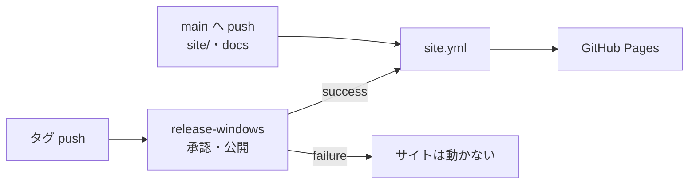
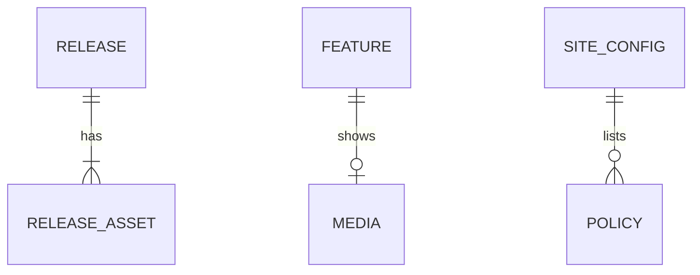
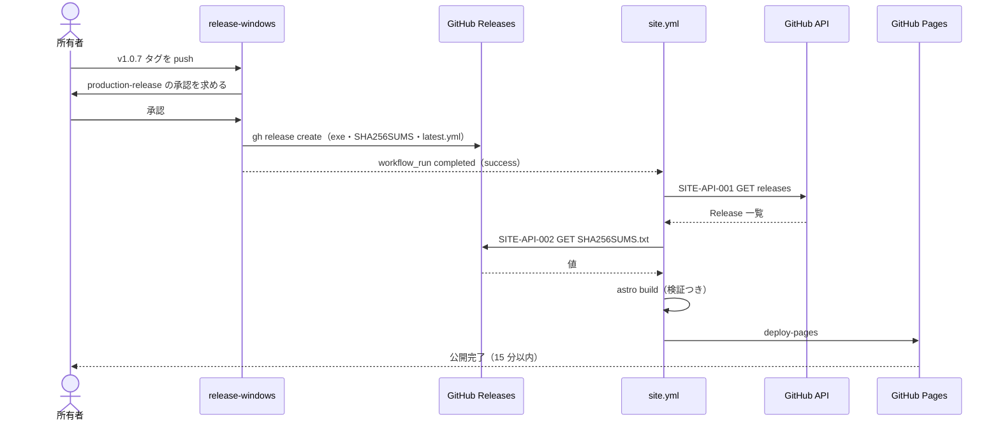
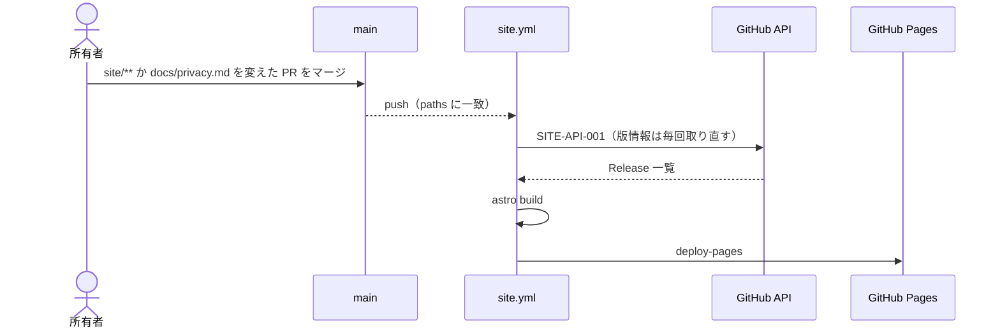
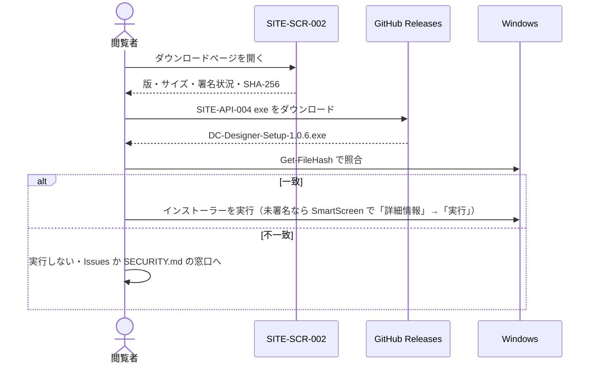
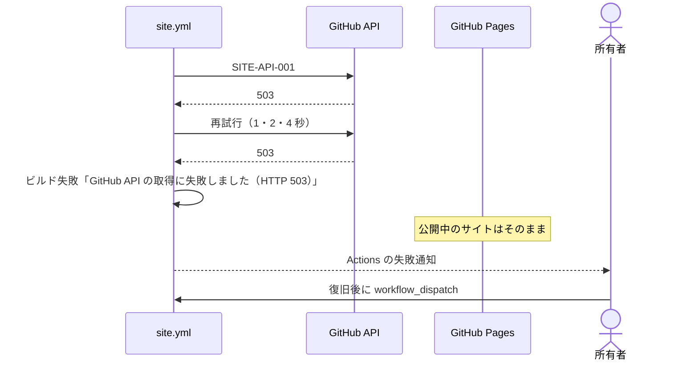
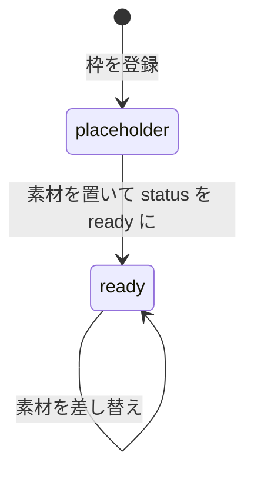

# 10. ER 図 / シーケンス図 / 状態遷移図
- プロジェクト：DC-Designer 紹介サイト ／ 版数：v0.1（2026-11-01） ／ インプット：[03](03_use_cases.md)、[08](08_database.md)、[09](09_api.md)

> **3行で**
> 1. シーケンス図は 4 枚：リリース連動の公開・push での公開・ダウンロードと確認・ビルド失敗。
> 2. リリース連動は「タグ push → 配信 CI（承認つき）→ 完了 → サイトのワークフロー」の順で、配信 CI が失敗・却下されたらサイトは動かない。
> 3. 状態遷移があるのは媒体（`placeholder` → `ready`）だけ。

## 🧭 判断してほしいこと
なし

## 全体図

見てほしいところ：サイトの公開のきっかけは 2 系統（リリースと文面の変更）だけ。

## 要点
- ER 図は [08](08_database.md#全体図) と同じ（ここに再掲）。
- [リリース連動](#site-uc-005リリース連動でサイトを更新する) が最重要の流れ。
- [ビルド失敗](#例外ビルド失敗) では公開中のサイトが残る。

---

## 詳細

### ER 図

フィールドは [08](08_database.md#テーブル一覧)。

### SITE-UC-005：リリース連動でサイトを更新する

### SITE-UC-006：文面を変えて公開する

### SITE-UC-002：ダウンロードして確かめる

### 例外：ビルド失敗

### 状態遷移図：媒体（SITE-TBL-004）

## このドキュメントで決まったこと
- 新しい決定はなし（03・07・09 の決定を図にしたもの）
