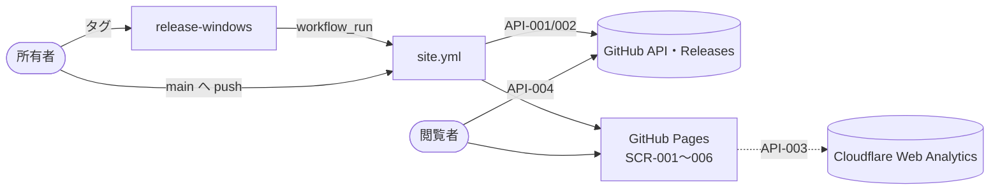

# 11. 技術仕様書
- プロジェクト：DC-Designer 紹介サイト ／ 版数：v0.1（2026-11-01） ／ インプット：[01](01_requirements.md)〜[10](10_diagrams.md)

> **3行で**
> 1. Astro で作る日本語の静的 LP を、同じリポジトリの `site/` に置き、GitHub Actions で `https://itiwoja.github.io/DC-Designer/` に公開する。
> 2. 版情報・SHA-256・更新履歴はビルド時に GitHub API から取り、配信 CI（release-windows）の完了で自動で作り直す。
> 3. サーバー・DB・アカウント・Web 版エディタ・英語版は持たない。各節の詳細はリンク先を正本にする。

## 🧭 判断してほしいこと
| # | 種類 | 論点 | おすすめ | 詳細 |
|---|---|---|---|---|
| SITE-Q-01 | 未決 | 署名済みかの判定方法 | A：リリースノートの未署名の文言を検出 | [04](04_functional_spec.md) |
| SITE-Q-02 | 未決 | 素材が揃う前に公開するか | A：ヒーロー 1＋機能 3 が揃うまで公開しない | [01](01_requirements.md) |
| SITE-Q-03 | 未決 | Cloudflare Web Analytics のトークンを用意するか | A：用意する（未設定でも公開は止まらない） | [07](07_architecture.md) |
| SITE-Q-04 | トレードオフ | ポリシーの正本を docs/ に置きサイトは読むだけにするか（`docs/privacy.md` 新設） | A：docs/ を正本に読み込む | [ADR-005](adr/SITE-ADR-005-policy-source.md) |
| SITE-R-01 | リスク | `docs/code-signing-policy.md` のプライバシー節が古い（AI 送信の確認窓は撤去済み） | サイトに載せる前に正本を今の動きに直す（本設計の範囲外） | [12](#12-リスクと対策) |
| SITE-R-02 | リスク | 未署名で SmartScreen の警告が出て離脱する | 手順と SHA-256 をボタン直下に出す | [04](04_functional_spec.md) |
| SITE-R-03 | リスク | 機能紹介が exe 版と食い違う（Codex・ComfyUI は exe で無効など） | `exeAvailable` で出し分け、README の変更時に見直す | [08](08_database.md) |

## 全体図

見てほしいところ：外とつながる線は 4 本だけ（API-001〜004）。

## 要点
- 技術スタックと ADR は [2](#2-システム全体像)、機能は [3](#3-機能概要)。
- 最重要の流れはリリース連動（[10](10_diagrams.md#site-uc-005リリース連動でサイトを更新する)）。
- セキュリティは「外へ出す物を減らす・外から来る文字を無害化・CI の権限を最小」（[8](#8-セキュリティ設計)）。

---

## 詳細

### 1. 概要
- 目的：一般利用者に「何ができるか」を伝え、Windows 版を安心してダウンロードしてもらう（[01](01_requirements.md)）。
- スコープ：紹介・ダウンロード・更新履歴・ポリシーの 6 画面。Won't は [01 §7](01_requirements.md#7-スコープ外wont)。
- 対象読者：サイトを実装・運用する人（所有者）。

### 2. システム全体像
C4 図は [07](07_architecture.md)。Astro（静的）・GitHub Pages・GitHub Actions（Node 24）・Cloudflare Web Analytics。判断は SITE-ADR-001〜006（005 は提案）。

### 3. 機能概要
11 機能（Must 10・Should 1）。一覧は [04 機能一覧](04_functional_spec.md#機能一覧)。閲覧時に動くのはコピーボタンと解析ビーコンだけ。

### 4. データモデル
DB の代わりに 7 つの SITE-TBL（[08](08_database.md)）。Release・ReleaseAsset は毎回 API から取り、Feature・Media・Policy・PageText は Markdown / JSON に手で書く。

### 5. インターフェース
提供する API は無い。利用するのは SITE-API-001〜004（[09](09_api.md)）。

### 6. 画面構成
SITE-SCR-001〜006（[06](06_ux_design.md)）。どの画面からも 1 クリックでダウンロード。

### 7. 非機能要件への対応方針
| NFR | 実現手段 |
|---|---|
| SITE-NFR-001〜004 性能 | 静的生成・島はコピーボタンだけ・画像を AVIF/WebP に・動画は遅延読み込み |
| SITE-NFR-009・010 反映 | `workflow_run`・push の paths で必要なときだけビルド |
| SITE-NFR-012〜014 | セマンティックな HTML・コントラスト・360px から 1 列 |
| SITE-NFR-015 コスト | GitHub Pages・Cloudflare の無料枠 |

### 8. セキュリティ設計
- 認証：閲覧者なし。CI は `GITHUB_TOKEN`（`contents: read`）と OIDC（`pages: write`・`id-token: write`）だけ。PAT なし（SITE-NFR-008、`docs/release-policy.md`）。
- 入力検証：リリースノートの生 HTML を捨てる・`https:` 以外のリンクを消す（SITE-NFR-007）。content collections はスキーマで検証。
- 配信の境界：`site/` はアプリと依存を共有せず、アプリの配布物の許可リストに入らない（SITE-D-18、既存 ADR-005）。
- 秘密情報：サイトに秘密は無い。ビーコンのトークンは公開されてよい値としてリポジトリ変数に置く。
- 個人情報：Cookie・localStorage なし。閲覧数は Cloudflare に送られることをプライバシーに書く（SITE-FR-007）。
- CSP は `<meta>` で（SITE-NFR-006）。

### 9. エラーハンドリング・ログ・監視
ビルド時の失敗はすべてビルドを止め、公開中のサイトを残す（[04 SITE-FR-008](04_functional_spec.md#site-fr-008)・[10 例外](10_diagrams.md#例外ビルド失敗)）。通知は Actions の失敗通知。公開後の監視は持たない。

### 10. 環境・設定
| 名前 | 種類 | 必須 | 説明 |
|---|---|---|---|
| GITHUB_TOKEN | Actions が自動で渡す | ○（CI） | SITE-API-001 の認証。手元では任意 |
| PUBLIC_CF_BEACON_TOKEN | リポジトリ変数 | — | 無ければビーコンを出さない |
| Pages の Source | リポジトリ設定 | ○ | 「GitHub Actions」 |

環境は本番だけ。手元では `site/` で `npm run dev`。

### 11. テスト方針
| レベル | 観点 |
|---|---|
| 単体 | 安定版の選び方（draft・prerelease の除外）、SHA256SUMS の解析（不一致・形式不正）、署名判定、リンクの書き換え、無害化（`<script>`・`javascript:` が消える） |
| ビルド | 媒体 `ready` でファイルが無いと失敗、content のスキーマ違反で失敗 |
| 表示 | 6 画面を 360px・1280px で撮って確認、Lighthouse・axe（SITE-NFR-001・012） |
| 連動 | `workflow_dispatch` で版情報が最新の Release と一致すること |

### 12. リスクと対策
| # | リスク | 対策 |
|---|---|---|
| SITE-R-01 | 署名ポリシーの正本のプライバシー節が「本人が確認した内容を送る」のまま。サイトに載せると今の動き（確認なしで送信）と食い違い、SignPath の審査者にも誤った説明になる | 公開前に `docs/code-signing-policy.md` を直す（アプリ側の文書なので本設計の範囲外）。SITE-ADR-005（提案）ではサイトは正本を読むだけ |
| SITE-R-02 | 未署名で SmartScreen の警告 | SITE-FR-005 |
| SITE-R-03 | 機能紹介と exe の差 | SITE-TBL-003 の `exeAvailable` |
| SITE-R-04 | 配信 CI の名前（`release-windows`）を変えると連動が切れる | ワークフロー名を変えるときは `site.yml` も直す取り決め（SITE-ADR-003） |

### 13. 未決事項・Claude判断（おまかせ）で決めた項目
- 未決：SITE-Q-01〜04（上の表）。SITE-ADR-005 は提案のまま。
- おまかせ（数値だけ）：SITE-D-13（数値目標）、15（更新履歴の畳み方）、17（媒体の寸法）、22（再試行）。一覧は [00 決定事項ログ](00_overview.md#決定事項ログ)。

### 14. 参照ドキュメント
- 本設計：[README](README.md)、[00](00_overview.md)〜[10](10_diagrams.md)、[adr/](adr/)
- 既存：[配布・更新ポリシー](../release-policy.md)、[Code signing policy](../code-signing-policy.md)、[Windows 版の配布設計](../README.md)、[AI 送信確認の撤去](../changes/2026-10-26-desktop-ai-direct-send.md)
