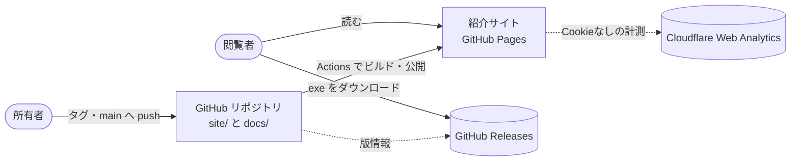

# DC-Designer 紹介サイト 設計書
> **3行で**：一般の Windows 利用者に DC-Designer を知ってもらい、安心してダウンロードしてもらう日本語の静的サイト ／ トップ・ダウンロード・更新履歴・ポリシーの 6 画面、版情報はリリースで自動更新、Astro＋GitHub Pages（`https://itiwoja.github.io/DC-Designer/`） ／ Web 版エディタ・英語版・使い方ガイド・アカウントは作らない

- 版数：v0.1（2026-11-01） ／ 状態：設計のみ（`site/` もワークフローもまだ無い）
- Windows 版の配布設計（`docs/README.md`）とは別の設計書。ID はすべて `SITE-` 付き。

## 🧭 判断してほしいこと（全ドキュメントから集約）
| # | 種類 | 論点 | おすすめ | 決まらないと止まるもの | 詳細 |
|---|---|---|---|---|---|
| SITE-Q-01 | 未決 | 版が署名済みかをサイトがどう知るか | リリースノートの「この版はコード署名をしていません」を検出（配信 CI を変えずに済む） | ダウンロードページの署名表示 | [04](04_functional_spec.md) |
| SITE-Q-02 | 未決 | スクショ・動画が揃う前に公開するか | ヒーロー 1 枚＋機能画像 3 枚が揃うまで公開しない | 公開日 | [01](01_requirements.md) |
| SITE-Q-03 | 未決 | Cloudflare Web Analytics のアカウント・トークンを用意するか | 用意する（未設定でもビーコンを出さずに公開できる） | 解析だけ | [07](07_architecture.md) |
| SITE-Q-04 | トレードオフ | ポリシーの正本を `docs/` に置いてサイトは読むだけにするか（`docs/privacy.md` を新設してよいか） | 正本を docs/ に 1 つだけ置く（食い違わない・SignPath の条件も満たす） | プライバシー・署名ポリシーの画面 | [ADR-005](adr/SITE-ADR-005-policy-source.md) |
| SITE-R-01 | リスク | `docs/code-signing-policy.md` のプライバシー節が古い（AI 送信の確認窓は 2026-10-26 に撤去済み）。そのままサイトに載る | 公開前に正本を今の動きに直す（本設計の範囲外） | コード署名ポリシーの公開 | [11](11_tech_spec.md#12-リスクと対策) |
| SITE-R-02 | リスク | 未署名で SmartScreen の警告が出て離脱する | 進め方と SHA-256 の確かめ方をボタン直下に出す | — | [04](04_functional_spec.md) |
| SITE-R-03 | リスク | 機能紹介が exe 版と食い違う | 機能ごとに `exeAvailable` を持たせて出し分ける | — | [08](08_database.md) |
| SITE-R-04 | リスク | 配信 CI の名前を変えると自動連動が切れる | 名前を変えるときは `site.yml` も直す | — | [ADR-003](adr/SITE-ADR-003-release-trigger.md) |

## 全体図（C4 レベル1：コンテキスト）

見てほしいところ：サイトは exe を置かない。版情報はビルド時に GitHub から取る。

## 読む順番
| 目的 | 読むもの | 所要 |
|---|---|---|
| 全体像だけ知りたい | この README → [11_tech_spec](11_tech_spec.md) の要約層 | 5 分 |
| 何を作るか判断したい | [01](01_requirements.md) → [06](06_ux_design.md) の要約層 | 10 分 |
| 実装する | [07](07_architecture.md) → [08](08_database.md) → [09](09_api.md) → [10](10_diagrams.md) → [04](04_functional_spec.md) | — |

## 主要な設計判断（ADR）
| ADR | 決定 | 状態 |
|---|---|---|
| [SITE-ADR-001](adr/SITE-ADR-001-astro.md) | Astro で静的に生成 | 承認 |
| [SITE-ADR-002](adr/SITE-ADR-002-github-pages.md) | GitHub Pages で配信（Cloudflare 案から変更） | 承認 |
| [SITE-ADR-003](adr/SITE-ADR-003-release-trigger.md) | リリース連動は `workflow_run`（`release: published` は GITHUB_TOKEN 起因で発火しない） | 承認 |
| [SITE-ADR-004](adr/SITE-ADR-004-analytics.md) | Cloudflare Web Analytics（Cookie なし） | 承認 |
| [SITE-ADR-005](adr/SITE-ADR-005-policy-source.md) | ポリシーは `docs/` を正本に読み込む | 提案（SITE-Q-04） |
| [SITE-ADR-006](adr/SITE-ADR-006-same-repo.md) | 同じリポジトリの `site/` | 承認 |

## 最近の変更
- 2026-11-01 v0.1 初版
