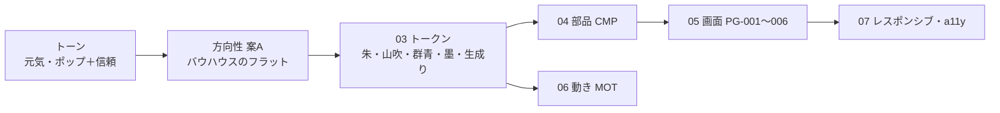

# 00. 体験方針（ブリーフ）
> 版：v0.1（2026-11-01）｜ 関連：[README](README.md)・[01_ia](01_ia.md)・上流 [../06_ux_design](../06_ux_design.md)

> **3行で**
> - DC-Designer 紹介サイトの見た目を、**色料の三原色（赤・黄・青）を少しずらした朱・山吹・群青**で作り直す。
> - トーンは「元気・ポップ」と「信頼・誠実」の両立。三色の図形（●▲■）で遊び、読む所は白い紙と墨の文字で落ち着かせる。
> - 一番してほしい行動は **Windows 版のダウンロード**。主ボタンは群青で、どの画面からも 1 クリック。

## 🧭 判断してほしいこと
| # | 種類 | 論点 | 選択肢 | おすすめ（理由） | 決まらないと止まるもの |
|---|---|---|---|---|---|
| UI-R-01 | リスク | Outfit の自前配信は上流の SITE-D-31（Web フォントを読まない）と食い違う | — | 欧文サブセットを同じオリジンから配信。CSP は `default-src 'self'` が `font-src` に効くので止まらない（[07](07_responsive_a11y.md#フォントの読み込み)） | `--font-display` |
| UI-R-02 | リスク | 上流 06 の「色はアプリのテーマに合わせる」と食い違う（06 は直さない決定：UI-D-23） | — | 色・形の正本はこの UI 設計書と README に明記する | 実装者の迷い |

## 全体図

見てほしいところ：色は 03 だけに書き、下流はトークン名で参照する。

## 要点
- 利用者：一般の Windows 利用者（PC 中心）。目的は「何ができるか知る → 安心してダウンロード」。
- 表現レベルは**標準**。ダイヤルは 個性 5・動き 5・密度 2（ゆったり）。
- ライト表示のみ（ダーク表示はやめる。UI-D-05）。
- 飾り（●▲■）はトップ中心。ダウンロード・ポリシーは見出しの小さな印だけ（UI-D-11）。
- アクセシビリティ目標は WCAG 2.2 AA（上流と同じ）。

---

## 詳細

### 体験の原則
| 原則 | 意味 | 効く場所 |
|---|---|---|
| 迷わせない | 主ボタンは各画面 1 つ。ヘッダーに常に「ダウンロード」 | 全 PG |
| 遊ぶのは飾りだけ | 三色の図形・色面で楽しさを出し、本文・表・手順は墨と白で静かに | PG-001 と読み物の PG |
| 安心を先に | 未署名の注意・SHA-256 の確かめ方はボタンのすぐ下 | PG-002 |

### ダイヤル
| ダイヤル | 値 | 見え方 |
|---|---|---|
| 個性（variance） | 5 ほどよく変化 | 画面いっぱいの粒の中に中央寄せの大きな見出し（2026-11-01 に左寄せから変更）、群青の帯で区切る |
| 動き（motion） | 5 標準 | ホバー・押した反応＋スクロールでカードが出る＋ヒーローの粒（マウスを追う・開いた直後に集まって●▲■になる） |
| 密度（density） | 2 ゆったり | セクション余白 スマホ 64px・PC 112px |

### ID 体系
上流（spec-designer）の `SITE-` 系 ID と混ざらないよう、UI 設計書の論点・決定は `UI-` を付ける。

| 接頭辞 | 対象 | 定義場所 |
|---|---|---|
| PG-001〜006 | ページ（`SITE-SCR-001〜006` と 1 対 1） | [01](01_ia.md#ページ一覧) |
| SEC-001-01 | ページ内のセクション | [01](01_ia.md#セクション構成) |
| CMP-001〜 | 部品 | [04](04_components.md) |
| MOT-001〜 | 動き | [06](06_motion.md) |
| `--color-*` など | トークン | [03](03_tokens.md) |
| UI-Q / UI-R / UI-D | 判断してほしいこと / リスク / 決定事項 | 各ファイル・このファイル |

### 対応表（PG → SEC → CMP）
| PG | 主な SEC | 使う CMP |
|---|---|---|
| PG-001 トップ | ヒーロー・主要機能・その他の機能・デモ・動作要件・最後の帯 | CMP-001〜005・007・008（弱）・009・011・014・015（CMP-006 は廃止） |
| PG-002 ダウンロード | 版とボタン・SmartScreen・確かめる・動作要件 | CMP-001〜005・008（強）・009・010・011・012 |
| PG-003 更新履歴 | 版の一覧 | CMP-001・002・003・004・011・013 |
| PG-004 プライバシー / PG-005 コード署名 | 本文 | CMP-001・002・003・004・005（印）・009（表）・011 |
| PG-006 404 | 案内 | CMP-001・002・003・005・011 |

MOT → CMP / SEC：MOT-001 → CMP-003 ／ MOT-003 → CMP-007 ／ MOT-004・MOT-005 → SEC-001-01 の canvas（部品にはしない）。MOT-002 は廃止。

## 決定事項ログ
決め方：**ユーザー**＝質問への回答 ／ **定石**＝業界の定石で聞かずに決めた（理由つき）。「おまかせ」はなし（細かい数値も一つずつ聞く、とユーザーが選んだため）。

| # | 決定 | 決め方 | 理由・由来 |
|---|---|---|---|
| UI-D-01 | 三原色は色料の赤・黄・青。朱 `#E5432E`・山吹 `#F2B21B`・群青 `#2F55D4` | ユーザー | ポスター・印刷物らしさ |
| UI-D-02 | トーン：元気・ポップ＋信頼・誠実 | ユーザー | — |
| UI-D-03 | 表現レベル：標準 | ユーザー | 速さ・分かりやすさ優先 |
| UI-D-04 | ダイヤル：個性 5・動き 5・密度 2 | ユーザー | — |
| UI-D-05 | ライト表示のみ（`color-scheme: light`） | ユーザー | 三色の見え方を 1 つに固定 |
| UI-D-06 | 方向性：案A バウハウスのフラット | ユーザー | [02](02_visual_direction.md) |
| UI-D-07 | 主ボタン：群青＋白文字（6.23:1） | ユーザー | 安心して押せる印象 |
| UI-D-08 | ~~見出しの欧文・数字・ロゴ文字に Outfit（OFL）を自前配信~~ → UI-D-38 で置き換え。本文はシステムフォント | ユーザー | 上流 SITE-D-31 を一部変更（UI-R-01） |
| UI-D-09 | 本文 16px・行間 1.8 | ユーザー | — |
| UI-D-10 | 角丸：ボタン 8px・カード 12px | ユーザー | — |
| UI-D-11 | 図形の飾りはトップ中心、他ページは見出しの小さな印だけ | ユーザー | 読み物を邪魔しない |
| UI-D-12 | 地は生成り `#FBF8F1`、カードは白 | ユーザー | 紙のポスターらしさ |
| UI-D-13 | セクション余白：スマホ 64px・PC 112px | ユーザー | — |
| UI-D-14 | 影なし・縁は 1px | ユーザー | フラット |
| UI-D-15 | 動きの長さ：ホバー 150ms・出現 400ms | ユーザー | — |
| UI-D-16 | イージング：少し弾む `cubic-bezier(0.34, 1.56, 0.64, 1)` | ユーザー | 位置・大きさの動きに使う。色の変化は弾みが効かないので減速（UI-D-30） |
| UI-D-17 | 演出：スクロールでカードが出る／~~ヒーローの●▲■が読み込み時に弾んで入る~~（UI-D-44 で置き換え） | ユーザー | パララックスは入れない |
| UI-D-18 | アイコンは使わず●▲■の図形だけ | ユーザー | 依存を増やさない・統一感 |
| UI-D-19 | 機能は主要 3 つ（AI レイアウト・レイヤー編集・書き出し）を大きく、残り 4 つを小さく | ユーザー | 1 グループ 5 つまでの定石 |
| UI-D-20 | 主ボタンの文言・ヘッダーの「ダウンロード」は今のまま | 定石 | 上流の決定を変えない |
| UI-D-21 | 色の派生（濃い朱 `#C93421`・濃い群青 `#2443B0`・薄い色面 3 つ・補助文字・縁 2 段）は三色と墨から導出 | 定石 | 文字・ホバー・色面に使うため。比は [03](03_tokens.md#コントラスト表) |
| UI-D-22 | 文字の段・字間・ブレークポイント 375/768/1024/1440・z-index の段 | 定石 | [03](03_tokens.md) |
| UI-D-23 | 上流 `../06_ux_design.md` にはリンクを足さず、直さない | ユーザー | UI-R-02 |
| UI-D-24 | ロゴはアプリのアイコン（紺・クリーム・サーモン・ミント）をそのまま使う | ユーザー | アプリ本体と同じ見た目で「本物」と分かる。図形の性格はすでにバウハウス |
| UI-D-25 | 「⚠」などの絵文字は使わず、山吹の▲図形に置き換える | 定石 | アイコンに絵文字を使わない（UI-D-18） |
| UI-D-26 | 大事な所ではない装飾の縁（カード）は 1.53:1 でよい。操作部品の縁は 3:1 以上の別トークン | 定石 | WCAG 1.4.11 は操作部品の境界に適用 |
| UI-D-27 | 山吹は生成り・白の上では文字・細線・意味を持つ印に使わない（1.77:1） | 定石 | [03](03_tokens.md#使い方の制約) |
| UI-D-28 | 朱 `#E5432E` は文字に使わない。赤系の文字は `#C93421` | 定石 | 生成り地 3.83:1 |
| UI-D-29 | スクロールの出現は小さな外部スクリプト（IntersectionObserver）で 400ms・弾んで出す。JS が無ければ最初から表示 | ユーザー | 400ms と弾みは CSS のスクロール連動では再現できないため、最初の説明（JS 不要）から変えて確認した |
| UI-D-30 | 色の変化（ホバー）は減速 `cubic-bezier(0.2, 0, 0, 1)` | 定石 | 色に行き過ぎ（弾み）は効かず、効いても色が濁るだけ |
| UI-D-31 | トップ最後の群青の帯の見出しは「ダサいスライドとはもうおさらば。」 | ユーザー | ページの終わりに次の行動を 1 つ置く |
| UI-D-32 | ヘッダーのナビを畳む幅を 640px → 768px に揃える | 定石 | ブレークポイントを 4 段に統一 |
| UI-D-33 | ヘッダーの「ダウンロード」小ボタンはナビ扱いで、「1 画面に主ボタン 1 つ」に数えない | 定石 | 全ページで同じ場所・同じ見た目にして迷わせない。目立たせるのはヒーローの大ボタン |
| UI-D-34 | ヘッダーの高さを 56px → 64px | 定石 | 余白「ゆったり」に合わせ、ボタン 44px の上下に余白を取る |
| UI-D-35 | 朱と群青は隣り合わせない（1.53:1）。（帯の図形は UI-D-37 でなくした） | 定石 | 境目がにじんで見える |
| UI-D-36 | 見出しの小さな印（12px）には墨の 1px 縁を付ける | 定石 | 山吹の▲が白・生成りの上で見えなくなるのを防ぐ |
| UI-D-37 | 機能カードの exe 版の制限は、カード内の注意の箱をやめ、見出しに「※1」を付けてカード群の下に注釈で書く。同じ文は同じ番号にまとめる。群青の帯の▲は置かない | ユーザー | カードの中が重くなる・帯は見出しとボタンだけで足りる |
| UI-D-38 | 見出し・ボタン・ロゴ・ナビの書体を手書き風ポップ体 Mochiy Pop One（OFL・400 のみ）に。和文も欧文もこの書体 | ユーザー | 2026-11-01「もっとポップで手書き風・元気に」。3 案（Yusei Magic / Hachi Maru Pop / Mochiy Pop One）から選んだ |
| UI-D-39 | Mochiy Pop One はサイトで使う文字（約 790 字）だけに絞った woff2 1 ファイル（92KB）を同じオリジンから配る。作り直しは `site/scripts/subset-display-font.py` | 定石 | 全体は 5MB あり重い。原稿に無い漢字は本文の書体で出るだけ |
| UI-D-40 | ヒーローの背景に、マウスを追って集まる●▲■の粒を置く（MOT-004）。範囲はヒーローだけ（UI-D-42 で帯を画面いっぱいに広げた） | ユーザー | 2026-11-01、Google Antigravity の最初の画面を参考に |
| UI-D-41 | 本文・注意書き・コードの書体は変えない | ユーザー | 長文（ポリシー・更新履歴）の読みやすさを保つ |
| UI-D-42 | ヒーローを作り直す。範囲はヒーローだけ。中央寄せ・ヘッダーを除いた画面いっぱい（`--hero-min-height`）に粒を敷き、画面画像は帯のすぐ下へ | ユーザー | 2026-11-01「ヒーローがパーティクルになったから Redesign」。Antigravity の最初の画面を参考に |
| UI-D-43 | ヒーローの見出しを一段大きく：`--text-hero` を 375px 40px・1440px 68px。3 行 | ユーザー | 中央の 1 要素で画面を支える |
| UI-D-44 | CSS の大きな●▲■（CMP-006）と入りの動き（MOT-002）は廃止。開いた直後に粒が集まって見出しの周り 3 か所に●▲■を作り、1 秒保ってほどける（MOT-005） | ユーザー | 動きの主役を粒 1 つにまとめる |
| UI-D-45 | 1024px 未満（スマホ・タブレット）では形を作らず、粒が漂うだけ。形は PC だけ | ユーザー | 2026-11-01「タブレットは対応しない。PC のみで可」。768〜1023px は見出しの横に形（120px＋24px）を置く余白も無い |
| UI-D-46 | reduced-motion では形になった状態（1024px 未満は止めた粒）を 1 枚だけ描く。JS が無いときは何も出さない | ユーザー | canvas は JS が要る。CSS の図形を残すと部品が 1 つ増える |
| UI-D-47 | 粒の家の位置と●▲■の形は、文字の塊（見出し〜ボタン）の外枠＋24px に入れない。形の間は粒がマウスに反応しない | 定石 | 文字の後ろの模様は読みにくさの元（a11y）。形が途中で崩れると分からない |
| UI-D-48 | ヒーローのボタンを 2 つに：主「Windows 版をダウンロード」＋ゴースト 大「機能を見る」（`#features` へ）。副は「1 画面に主ボタン 1 つ」に数えない | ユーザー | 画像が帯の下に回るので、先を見たい人の行き先を置く。数え方は UI-D-33 と同じ考え |
| UI-D-49 | ヒーローの画面画像は帯の下・中央・最大 960px。`loading="lazy"`・先読みしない。LCP は見出しの文字 | 定石 | 最初の画面の外に出たため |
| UI-D-50 | 粒の数：768px 未満 90・768〜1023px 270・1024px 以上 450 個。形 1 つに 120 個。集まる 1.2 秒は減速、ほどける 0.9 秒はばね | 定石 | 形を点描で埋めるのに要る数を面積から計算（[06 MOT-005](06_motion.md#mot-005)） |
| UI-D-51 | ヒーローの 2 つのボタンは 768px 未満で縦に並べて幅いっぱい、768px 以上で横に並べる | 定石 | 375px では横に入らない。768px 以上は 630px ほどで収まる |
| UI-D-52 | ヘッダーとボタンをポップ体に合わせて作り直す：ヘッダーは上に貼り付け、下の縁を●▲■の 3 色の帯（4px）に。ボタンは丸い形・縁 2px・アイコン付き。ヘッダーのダウンロードはゴーストに下げ、ヒーローの版番号は補足の行へ | ユーザー | 2026-11-01「ヘッダーをもうちょいかっこよく。ダウンロードと機能を見るボタンもなんか違う」。平らな四角・1px の細い縁が見出しのポップ体と合っていなかった。塗りの青を 1 画面 1 つにする |
| UI-D-53 | ヘッダー下の 3 色の帯を、左から右へゆっくり流し続ける（1 画面幅 24 秒・等速。reduced-motion では止める） | ユーザー | 2026-11-01「このヘッダーのカラフルな線を動かしてほしい」。目を取らないよう遅く・細いまま |
| UI-D-54 | ヘッダーをすりガラスに（白 60%＋後ろを 12px ぼかす）。トップはヒーローの帯をヘッダーの下まで伸ばし、粒が透けて見えるようにする | ユーザー | 2026-11-01「ヘッダーを半透明で背景透ける感じとかにできる？」。文字は墨のまま、ぼかしで粒が文字の邪魔をしない |
| UI-D-55 | すりガラスを紙色 25%＋ぼかし 4px に弱める（UI-D-54 の白 60%・12px を変更） | ユーザー | 2026-11-01「背景の色良いんだけど、白系だからヘッダーが不透明になっているのが分かりにくい」。白の地は紙色の背景の上で不透明な白い板に見え、12px のぼかしでは小さな粒が消えていた。地を背景と同じ紙色にし、粒の形が分かる程度にぼかしを弱めた |
| UI-D-56 | フッターの注記の行に、作成者として GitHub アカウント（@itiwoja）へのリンクを出す | ユーザー | 2026-11-01「作成者として私のGitHubアカウントを掲載して」。アカウント名は `SITE_CONFIG.author` の 1 か所で持つ |
