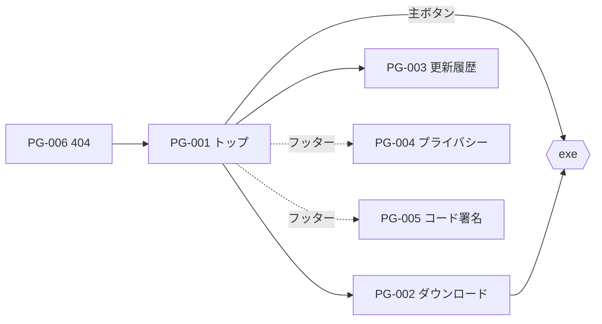

# 01. 情報設計
> 版：v0.1（2026-11-01）｜ 関連：[00_brief](00_brief.md)・上流 [../06_ux_design](../06_ux_design.md)

> **3行で**
> - ページは上流と同じ 6 つ（PG-001〜006 ＝ SITE-SCR-001〜006）。URL もナビも変えない。
> - トップの機能は「主要 3 つを大きく・残り 4 つを小さく」の 2 段に分ける。
> - トップの最後は群青の帯でダウンロードをもう一度出す。

## 🧭 判断してほしいこと
なし

## 全体図

見てほしいところ：ヘッダーの「ダウンロード」はどの PG からも PG-002 へ 1 クリック。

## 要点
- ナビは今のまま：ヘッダー「機能・更新履歴・GitHub」＋「ダウンロード」ボタン、フッターにポリシー類。
- トップのセクションは 6 つ。1 セクション 1 メッセージ（[セクション構成](#セクション構成)）。
- 主要 3 機能は ID で指定：`ai-layout`・`layer-editor`・`export`（UI-D-19）。

---

## 詳細

### ページ一覧
| PG | SCR（上流） | 名前 | URL | 主ボタン | ページ末の次の行動 |
|---|---|---|---|---|---|
| PG-001 | SITE-SCR-001 | トップ | `/DC-Designer/` | Windows 版をダウンロード | 群青の帯のダウンロード |
| PG-002 | SITE-SCR-002 | ダウンロード | `/DC-Designer/download/` | ダウンロード | すべての版（GitHub Releases） |
| PG-003 | SITE-SCR-003 | 更新履歴 | `/DC-Designer/changelog/` | （なし：読むページ） | GitHub Releases で見る |
| PG-004 | SITE-SCR-004 | プライバシー | `/DC-Designer/privacy/` | （なし） | フッター |
| PG-005 | SITE-SCR-005 | コード署名ポリシー | `/DC-Designer/code-signing/` | （なし） | フッター |
| PG-006 | SITE-SCR-006 | 404 | `/DC-Designer/404.html` | トップへ | ダウンロード（副） |

### ナビ
| 場所 | 中身 | 型 |
|---|---|---|
| ヘッダー | ロゴ／機能・更新履歴・GitHub／「ダウンロード」ボタン | 768px 未満は「メニュー」に畳む（[CMP-002](04_components.md#cmp-002-ヘッダーとメニュー)） |
| フッター | プライバシー・コード署名ポリシー・SECURITY・MIT ライセンス・GitHub Issues | 5 項目（定石の上限内） |

### セクション構成
**PG-001 トップ**

| SEC | 伝えること（1つ） | 地 | 図形 |
|---|---|---|---|
| SEC-001-01 ヒーロー | 何のアプリか＋ダウンロード | 生成り（ヘッダーを除いた画面いっぱい） | 全面に●▲■の粒。開いた直後に粒が集まって見出しの周りに●▲■を作る（1024px 以上）。画面画像は帯のすぐ下（同じ SEC） |
| SEC-001-02 機能 | ポスター作成（PDF・PNG）とスライド作成（PPTX）の 2 つ | 生成り | カードごとに●▲の印と薄い色面 |
| ~~SEC-001-03 その他の機能~~ | 廃止（2026-11-01。機能を 2 つに絞ったため） | — | — |
| SEC-001-04 デモ | 動く様子 | 生成り | なし |
| SEC-001-05 動作要件 | 自分の PC で動くか | 生成り | 見出しの小さな印 |
| SEC-001-06 最後の帯 | ダウンロード | 群青 | 図形は置かない（UI-D-37） |

**PG-002 ダウンロード**：SEC-002-01 版とボタン → SEC-002-02 SmartScreen の進め方（未署名の版だけ）→ SEC-002-03 本物か確かめる → SEC-002-04 動作要件。

**PG-003 更新履歴**：SEC-003-01 版の一覧（新しい順、最新だけ開いた状態）。

**PG-004・005**：SEC-004-01・SEC-005-01 本文（最終更新日つき）。

**PG-006**：SEC-006-01 案内（図形＋「ページが見つかりません」＋トップへ）。
