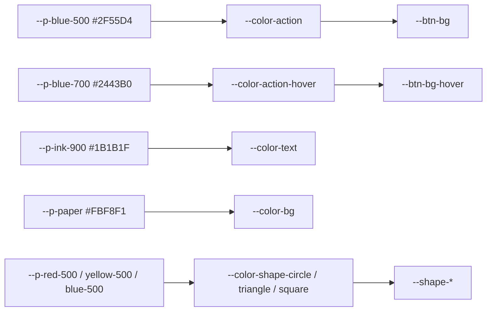

# 03. デザイントークン
> 版：v0.1（2026-11-01）｜ 関連：[02_visual_direction](02_visual_direction.md)・[04_components](04_components.md)

> **3行で**
> - 色・文字・余白・角丸・動きを **primitive → semantic → component** の 3 層の CSS 変数で決める。値はこのファイルだけが正本。
> - 文字に使える色の組はすべて 4.5:1 以上。朱 `#E5432E` と山吹 `#F2B21B` は文字に使わない（飾り専用）。
> - ライト表示のみ。今の `global.css` のダーク用の値と `color-scheme: light dark` は使わない（UI-D-05）。

## 🧭 判断してほしいこと
| # | 種類 | 論点 | 選択肢 | おすすめ（理由） | 決まらないと止まるもの |
|---|---|---|---|---|---|
| UI-R-03 | リスク | 山吹は生成り地 1.77:1・白地 1.88:1。文字や意味のある印に使うと読めない | — | 飾りの図形と、墨の文字を載せる色面（バッジ・注意の地）だけに使う（[使い方の制約](#使い方の制約)） | CMP-006・008・013 |

## 全体図

```
■ #E5432E 朱      ■ #C93421 濃い朱（文字）  ▫ #FBE3DF 薄い朱（色面）
■ #F2B21B 山吹    ▫ #FDF0C9 薄い山吹（注意の地・色面）
■ #2F55D4 群青    ■ #2443B0 濃い群青（ホバー） ▫ #E3E9FB 薄い群青（色面）
■ #1B1B1F 墨      ■ #5A5A63 補助文字  ■ #8C877D 操作部品の縁  ▫ #CFCBC2 飾りの縁
□ #FBF8F1 生成り（地）  □ #FFFFFF 白（カード）
```
見てほしいところ：派生色は三色と墨から作った（UI-D-21）。新しい色相は足していない。

## 要点
- 主ボタン・リンク・フォーカスは群青に統一（[色](#色)）。
- 文字：見出し・ボタン・ロゴ・ナビは手書き風ポップ体 Mochiy Pop One（和文・欧文とも）、本文はシステムフォント（[文字](#文字)、UI-D-38）。
- 余白は 4px 刻み、セクション余白は 64px／112px（[余白](#余白・角丸・縁)）。
- 影のトークンは作らない（影なし：UI-D-14）。
- 動き：150ms／400ms、位置の動きは弾む、色は減速（[動き](#動き)）。

---

## 詳細

### 色
<details>
<summary>primitive（生の色。部品から直接使わない）</summary>

```css
:root {
  color-scheme: light;
  --p-red-500: #E5432E;    /* 朱：飾り専用 */
  --p-red-700: #C93421;    /* 濃い朱：赤系の文字 */
  --p-red-100: #FBE3DF;
  --p-yellow-500: #F2B21B; /* 山吹：飾り・墨文字を載せる色面だけ */
  --p-yellow-100: #FDF0C9;
  --p-blue-500: #2F55D4;   /* 群青 */
  --p-blue-700: #2443B0;
  --p-blue-100: #E3E9FB;
  --p-ink-900: #1B1B1F;    /* 墨 */
  --p-ink-600: #5A5A63;
  --p-ink-400: #8C877D;
  --p-ink-200: #CFCBC2;
  --p-paper: #FBF8F1;      /* 生成り */
  --p-white: #FFFFFF;
}
```

</details>

| semantic | 値 | 役割 | 使う所 |
|---|---|---|---|
| `--color-bg` | `--p-paper` | ページの地・表の見出し行 | 全 PG・CMP-009 |
| `--color-surface` | `--p-white` | カード・パネル・ヘッダー・フッター・帯の上のボタン | CMP-002・003・007・009・011・013 |
| `--color-text` | `--p-ink-900` | 本文・見出し | 全体 |
| `--color-text-muted` | `--p-ink-600` | 日付・サイズ・補足 | CMP-009・013 |
| `--color-action` | `--p-blue-500` | 主ボタンの地・リンク | CMP-003・004 |
| `--color-action-hover` | `--p-blue-700` | ホバー時 | CMP-003・004 |
| `--color-on-action` | `--p-white` | 主ボタンの文字・群青の帯の文字 | CMP-003・014 |
| `--color-focus` | `--p-blue-500` | フォーカスの輪（生成り・白の上） | 全操作部品 |
| `--color-focus-on-band` | `--p-yellow-500` | フォーカスの輪（群青の帯の上） | CMP-014 |
| `--color-border` | `--p-ink-200` | 飾りの縁（カード・表・パネル・媒体） | CMP-002・007・009・010・011・013・015 |
| `--color-border-control` | `--p-ink-400` | 操作部品の縁（メニューの開閉ボタン） | CMP-002 |
| `--color-band` | `--p-blue-500` | 群青の帯 | CMP-014 |
| `--color-notice-bg` | `--p-yellow-100` | 注意の地（未署名・exe 版の制限） | CMP-008 |
| `--color-danger-text` | `--p-red-700` | コピー失敗など、うまくいかなかった文 | CMP-012 |
| `--color-badge-bg` | `--p-yellow-500` | 「最新」バッジの地（文字は墨） | CMP-013 |
| `--color-tint-circle` / `-triangle` / `-square` | `--p-red-100` / `--p-yellow-100` / `--p-blue-100` | 主要機能カードの画像の背面・帯の上のボタンのホバー | CMP-003・007 |
| `--color-shape-circle` / `-triangle` / `-square` | `--p-red-500` / `--p-yellow-500` / `--p-blue-500` | ●▲■の図形（帯の上は▲だけ） | CMP-005・006・008・011・014 |
| `--color-code-bg` | `--p-paper` | SHA-256・コマンドの地（白いパネルの中） | CMP-010 |

### 使い方の制約
| 色 | してよい | してはいけない |
|---|---|---|
| 朱 `#E5432E` | 図形・大きい文字（24px 以上／太字 19px 以上） | 本文・リンク・小さな文字（生成り 3.83:1） |
| 山吹 `#F2B21B` | 図形・墨の文字を載せる地・群青の帯の上のフォーカスの輪 | 生成り・白の上の文字・細線・意味のある印（1.77:1／1.88:1） |
| 飾りの縁 `#CFCBC2` | カード・表・パネルの縁 | 操作部品の境界（1.53:1） |
| 白カード／生成り地 | 縁 1px と組み合わせる | 縁なしで並べる（1.06:1 で境界が見えない） |

### コントラスト表
`contrast.py` で計算した値。NG の組は使わない。

| 前景 | 背景 | 比 | 判定 | 使う所 |
|---|---|---|---|---|
| 墨 `#1B1B1F` | 生成り `#FBF8F1` | 16.19:1 | 文字 OK | 本文 |
| 墨 | 白 | 17.17:1 | 文字 OK | カード内 |
| 補助 `#5A5A63` | 生成り | 6.43:1 | 文字 OK | 補足 |
| 補助 | 白 | 6.82:1 | 文字 OK | 日付・サイズ |
| 補助 | 薄い山吹 `#FDF0C9` | 6.01:1 | 文字 OK | 注意の補足 |
| 群青 `#2F55D4` | 生成り | 5.87:1 | 文字 OK | リンク |
| 群青 | 白 | 6.23:1 | 文字 OK | リンク・帯の上の白ボタン |
| 群青 | 薄い群青 `#E3E9FB` | 5.14:1 | 文字 OK | 色面の上のリンク |
| 群青 | 薄い朱 `#FBE3DF` | 5.09:1 | 文字 OK | 色面の上のリンク |
| 群青 | 薄い山吹 | 5.48:1 | 文字 OK | 注意の中のリンク |
| 白 | 群青 | 6.23:1 | 文字 OK | 主ボタン・帯の文字 |
| 白 | 濃い群青 `#2443B0` | 8.38:1 | 文字 OK | 主ボタンのホバー |
| 濃い朱 `#C93421` | 白 | 5.25:1 | 文字 OK | 失敗の文 |
| 濃い朱 | 生成り | 4.95:1 | 文字 OK | 失敗の文 |
| 濃い朱 | 薄い山吹 | 4.62:1 | 文字 OK | 注意の中の強調 |
| 墨 | 山吹 | 9.12:1 | 文字 OK | 「最新」バッジ |
| 墨 | 薄い山吹 / 薄い群青 / 薄い朱 | 15.11 / 14.16 / 14.03:1 | 文字 OK | 色面の上の文字 |
| 山吹 | 群青 | 3.31:1 | UI 部品 OK | 帯の上のフォーカスの輪 |
| 縁 `#8C877D` | 生成り / 白 | 3.37 / 3.57:1 | UI 部品 OK | メニューボタンの縁 |
| 朱 | 生成り | 3.83:1 | 大きい文字・図形のみ | 図形 |
| 山吹 | 生成り / 白 | 1.77 / 1.88:1 | **NG**（飾りのみ） | 図形 |
| 朱 | 群青 | 1.53:1 | **NG**（隣に並べない） | — |
| 縁 `#CFCBC2` | 生成り | 1.53:1 | 飾りの縁のみ | カード |

### 文字
| トークン | 値 | 使う所 |
|---|---|---|
| `--font-display` | `"Mochiy Pop One", var(--font-body)` | ロゴの文字・見出し・ボタン・ナビ・版番号（使う文字だけに絞ったファイル。無い字は本文の書体に落ちる） |
| `--font-body` | `"Yu Gothic UI", "Meiryo UI", Meiryo, "Hiragino Sans", "Noto Sans CJK JP", "Noto Sans JP", system-ui, sans-serif` | 本文（今と同じ） |
| `--font-mono` | `ui-monospace, "Cascadia Mono", Consolas, "Noto Sans Mono CJK JP", monospace` | SHA-256・コマンド |
| `--text-sm` | 0.875rem（14px） | 補足・バッジ・メタ |
| `--text-base` | 1rem（16px） | 本文 |
| `--text-lg` | 1.25rem（20px） | h3・小さな機能カードの見出し |
| `--text-2xl` | clamp(1.5rem, 1rem + 2vw, 2rem) | h2 |
| `--text-page` | clamp(1.75rem, 1.2rem + 2.5vw, 2.5rem) | 各ページの h1 |
| `--text-hero` | clamp(2.25rem, 1.5rem + 3.5vw, 3.5rem) | トップの h1 |
| `--weight-regular` / `--weight-bold` / `--weight-display` | 400 / 700 / 400 | 本文 / 本文中の強調 / Mochiy の見出し（400 しかないので太字を偽造させない） |
| `--leading-body` / `--leading-heading` | 1.8 / 1.35 | — |
| `--tracking-body` / `--tracking-heading` | 0.04em / 0.02em | 和文の字間（定石） |
| `--measure` | 40em | 読み物の 1 行の上限（約 40 字） |

### 余白・角丸・縁
| トークン | 値 | 使う所 |
|---|---|---|
| `--space-1`〜`--space-8` | 4 / 8 / 12 / 16 / 24 / 32 / 48 / 64px | 部品の内側・間 |
| `--section-y` | 64px（768px 以上で 112px） | セクションの上下 |
| `--gutter` | 16px（768px 以上で 24px、1024px 以上で 32px） | 画面の左右 |
| `--container` | 1120px | 中身の最大幅 |
| `--radius-sm` | 4px | SHA-256・コードの枠 |
| `--radius-button` | 8px | ボタン・メニュー |
| `--radius-card` | 12px | カード・パネル・画像の枠 |
| `--radius-pill` | 999px | バッジ |
| `--border-width` | 1px | すべての縁 |
| `--focus-ring` | 3px solid、外側 2px | フォーカス |

### その他
| トークン | 値 |
|---|---|
| `--z-header` / `--z-menu` / `--z-skip` | 10 / 30 / 40 |
| ブレークポイント | 375 / 768 / 1024 / 1440px（CSS 変数にできないのでメディアクエリの値として使う） |

### 動き
| トークン | 値 | 使う所 |
|---|---|---|
| `--dur-hover` | 150ms | ホバー・押した反応 |
| `--dur-enter` | 400ms | スクロールの出現・ヒーローの図形 |
| `--stagger` | 80ms | 並んだものを順に出す間隔 |
| `--ease-bounce` | cubic-bezier(0.34, 1.56, 0.64, 1) | 位置・大きさの動き（UI-D-16） |
| `--ease-out` | cubic-bezier(0.2, 0, 0, 1) | 色の変化（UI-D-30） |

### component トークン（代表）
| component | 参照 |
|---|---|
| `--btn-bg` / `--btn-bg-hover` / `--btn-fg` | `--color-action` / `--color-action-hover` / `--color-on-action` |
| `--btn-radius` | `--radius-button` |
| `--card-bg` / `--card-border` / `--card-radius` | `--color-surface` / `--color-border` / `--radius-card` |
| `--shape-size-hero` | clamp(48px, 8vw, 120px) |
| `--shape-size-mark` | 12px（見出しの小さな印。墨の 1px 縁つき：UI-D-36） |

## このドキュメントで決まったこと
[UI-D-05・07・09〜16・21・22・26〜28・30](00_brief.md#決定事項ログ)
