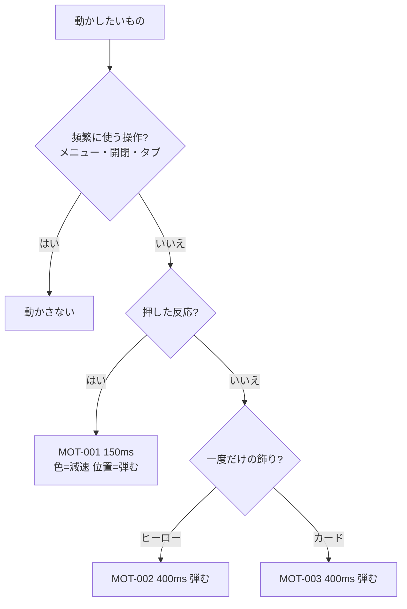

# 06. 動き・操作感
> 版：v0.1（2026-11-01）｜ 関連：[03_tokens](03_tokens.md#動き)・[04_components](04_components.md)

> **3行で**
> - 動かすのは 4 つだけ：ボタンのホバー（MOT-001）・ヒーローの●▲■の入り（MOT-002）・スクロールでカードが出る（MOT-003）・ヒーローの背景でマウスを追う●▲■の粒（MOT-004）。
> - 位置の動きは「少し弾む」、色の変化は減速。動かすのは transform と opacity だけ。
> - 動きを減らす設定（`prefers-reduced-motion`）では、すべて最初から最後の状態で表示する。

## 🧭 判断してほしいこと
| # | 種類 | 論点 | 選択肢 | おすすめ（理由） | 決まらないと止まるもの |
|---|---|---|---|---|---|
| UI-R-04 | リスク | 「少し弾む」を多く使うと安っぽく見える。出現 400ms は UI の動きの目安（300ms 以内）を超える | — | 弾むのは位置・大きさだけ、1 回だけ、移動 16px 以内。400ms は飾りの出現なので許す（操作の反応はすべて 150ms） | MOT-002・003 |

## 全体図

## 要点
- 頻繁に使う操作（メニュー・更新履歴の開閉・フォーカス・リンク）は動かさない。
- 演出は 1 回だけ。戻ってスクロールしても再生しない。
- 図形は場所を先に確保して、動きでレイアウトをずらさない。

---

## 詳細

### MOT-001
**ボタンのホバー・押した反応**（CMP-003）
| 項目 | 値 |
|---|---|
| 目的 | 押せることを伝える |
| 色 | 地の色が変わる。`--dur-hover`・`--ease-out` |
| 位置 | hover で 2px 上へ、active で 0。`--dur-hover`・`--ease-bounce` |
| reduced-motion | 色だけ変える。位置は動かさない |

### MOT-002
**ヒーローの●▲■の入り**（CMP-006）
| 項目 | 値 |
|---|---|
| 目的 | 最初の 1 画面で「作る楽しさ」を見せる |
| きっかけ | ページを開いたとき 1 回（CSS のアニメーション。JS なし） |
| 動き | 大きさ 0.6 → 1、下から 16px → 0、透明 → 不透明 |
| 長さ・間隔 | `--dur-enter`、● → ▲ → ■ の順に `--stagger` ずつ遅らせる（最後が終わるのは約 560ms） |
| イージング | `--ease-bounce` |
| reduced-motion | 最初から表示（アニメーションなし） |
| 守ること | 見出し・主ボタンは動かさず、最初から押せる |

### MOT-003
**スクロールでカードが出る**（CMP-007）
| 項目 | 値 |
|---|---|
| 目的 | 機能を 1 つずつ見せ、読む順を作る |
| 対象 | 主要機能カード 3 枚・ほかの機能カード 4 枚 |
| きっかけ | カードの上端が画面の下から 10% に入ったとき 1 回。外部スクリプト（IntersectionObserver、1KB 程度）で判定する（UI-D-29） |
| 動き | 下から 16px → 0、透明 → 不透明 |
| 長さ・間隔 | `--dur-enter`、同じ行のカードは `--stagger` ずつ |
| イージング | `--ease-bounce` |
| JS が無い・動かない | 最初から表示（隠すのは JS が付けたクラスがあるときだけ） |
| reduced-motion | 最初から表示 |
| 最初から画面に入っているカード | 隠さない（ちらつきを出さない） |

### MOT-004
**ヒーローの背景でマウスを追う●▲■の粒**（SEC-001-01。参考：Google Antigravity の最初の画面。UI-D-40）
| 項目 | 値 |
|---|---|
| 目的 | 最初の画面で「触って遊べる・元気」を伝える |
| 対象 | ヒーローの背景に敷いた canvas（`aria-hidden`・`pointer-events: none`）。重なりは 画像と図形 < 粒 < 文字・ボタン（画像の上でも輪が見えるように） |
| 粒 | ● 朱・▲ 山吹・■ 群青の小さな図形。画面幅に応じて 60〜160 個、4〜9px |
| 普段 | 各粒は自分の「家の位置」の周りをふわふわ漂う |
| マウスが近いとき | カーソルの周りの輪に引き寄せられ、回り込むように流れる。ばね＋減衰で少し遅れてついてくる |
| 離れたとき | ばねで家の位置に戻る |
| タッチ端末 | スクロールを邪魔しない（preventDefault しない） |
| 止める条件 | ヒーローが画面外・タブが裏にあるとき（IntersectionObserver・`document.hidden`） |
| JS が無い・動かない | 何も出ない（レイアウトは崩れない） |
| reduced-motion | 動かさない（静止した粒か、出さない） |

### 動かさないもの
| 対象 | 理由 |
|---|---|
| ヘッダーのメニュー（`details`） | 頻繁に使う |
| 更新履歴の開閉 | 頻繁に使う |
| リンクのホバー | 下線の太さが変わるだけで十分 |
| フォーカスの輪 | すぐ見えることが大事 |
| コピーの「コピーしました」 | 文が出るだけで伝わる |
| ページの移動・スクロール | 普通のスクロール（`scroll-behavior` は使わない） |
| 404 の●▲■ | 飾りだけのページで動かす理由がない |
| デモ動画 | 自動再生しない（上流の決定） |
