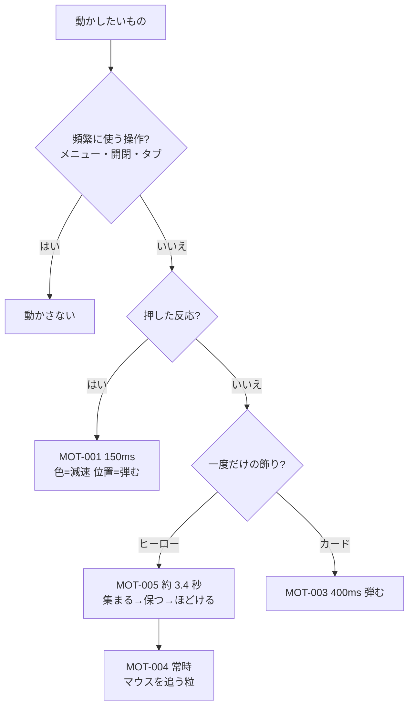

# 06. 動き・操作感
> 版：v0.1（2026-11-01）｜ 関連：[03_tokens](03_tokens.md#動き)・[04_components](04_components.md)

> **3行で**
> - 動かすのは 4 つだけ：ボタンのホバー（MOT-001）・スクロールでカードが出る（MOT-003）・ヒーロー全面でマウスを追う●▲■の粒（MOT-004）・開いた直後に粒が集まって●▲■の形になる（MOT-005）。MOT-002 は廃止。
> - 位置の動きは「少し弾む」、色の変化は減速。動かすのは transform と opacity だけ。
> - 動きを減らす設定（`prefers-reduced-motion`）では、すべて最初から最後の状態で表示する。

## 🧭 判断してほしいこと
| # | 種類 | 論点 | 選択肢 | おすすめ（理由） | 決まらないと止まるもの |
|---|---|---|---|---|---|
| UI-R-04 | リスク | 「少し弾む」を多く使うと安っぽく見える。出現 400ms は UI の動きの目安（300ms 以内）を超える | — | 弾むのは位置・大きさだけ、1 回だけ、移動 16px 以内。400ms は飾りの出現なので許す（操作の反応はすべて 150ms） | MOT-003 |
| UI-R-08 | リスク | 粒が最大 450 個。古い PC で重い可能性 | — | 画面外・裏タブで止める。実機で重ければ 1024px 以上の数を減らす（形の点描が粗くなる） | MOT-004・005 |
| UI-R-07 | リスク | MOT-005 は開いてから約 3.4 秒動く。見出しを読む最初の数秒に目を取られる | — | 形は見出しの外だけに作る・文字とボタンは最初から表示して押せる・1 回だけ。実画面で長いと感じたら「保つ」1 秒を短くする | MOT-005 |

## 全体図

## 要点
- 頻繁に使う操作（メニュー・更新履歴の開閉・フォーカス・リンク）は動かさない。
- 演出は 1 回だけ。戻ってスクロールしても再生しない。
- 図形は場所を先に確保して、動きでレイアウトをずらさない。

---

## 詳細

### MOT-001
**ボタンのホバー・押した反応**（CMP-003）
| 項目 | 値 |
|---|---|
| 目的 | 押せることを伝える |
| 色 | 地の色が変わる。`--dur-hover`・`--ease-out` |
| 位置 | hover で 2px 上へ、active で 0。`--dur-hover`・`--ease-bounce` |
| reduced-motion | 色だけ変える。位置は動かさない |

### MOT-002
**（廃止 2026-11-01）ヒーローの●▲■の入り**。CMP-006 の廃止に合わせてやめた。役割は [MOT-005](#mot-005) が引き継ぐ。ID は使い回さない。

### MOT-003
**スクロールでカードが出る**（CMP-007）
| 項目 | 値 |
|---|---|
| 目的 | 機能を 1 つずつ見せ、読む順を作る |
| 対象 | 主要機能カード 3 枚・ほかの機能カード 4 枚 |
| きっかけ | カードの上端が画面の下から 10% に入ったとき 1 回。外部スクリプト（IntersectionObserver、1KB 程度）で判定する（UI-D-29） |
| 動き | 下から 16px → 0、透明 → 不透明 |
| 長さ・間隔 | `--dur-enter`、同じ行のカードは `--stagger` ずつ |
| イージング | `--ease-bounce` |
| JS が無い・動かない | 最初から表示（隠すのは JS が付けたクラスがあるときだけ） |
| reduced-motion | 最初から表示 |
| 最初から画面に入っているカード | 隠さない（ちらつきを出さない） |

### MOT-004
**ヒーローの背景でマウスを追う●▲■の粒**（SEC-001-01。参考：Google Antigravity の最初の画面。UI-D-40）
| 項目 | 値 |
|---|---|
| 目的 | 最初の画面で「触って遊べる・元気」を伝える |
| 対象 | ヒーロー全面（`--hero-min-height`）に敷いた canvas（`aria-hidden`・`pointer-events: none`）。重なりは 粒 < 文字・ボタン。画面画像は帯の外（下）にあるので重ならない |
| 粒 | ● 朱・▲ 山吹・■ 群青の小さな図形（3 種は同じ数）。4〜9px。数は 768px 未満 90 個・768〜1023px 270 個・1024px 以上 450 個（MOT-005 で形を埋めるため増やした）。重い端末向けに、描くのは `requestAnimationFrame` の 1 回につき 1 枚、`devicePixelRatio` は 2 で頭打ち |
| 家の位置 | 帯の中にばらまく。ただし**文字の塊（見出し〜ボタン）の外枠＋24px の中には置かない**（文字の後ろの模様で読みにくくしない：UI-D-47） |
| 普段 | 各粒は自分の「家の位置」の周りをふわふわ漂う |
| マウスが近いとき | カーソルの周りの輪に引き寄せられ、回り込むように流れる。ばね＋減衰で少し遅れてついてくる |
| 離れたとき | ばねで家の位置に戻る |
| タッチ端末 | スクロールを邪魔しない（preventDefault しない） |
| 止める条件 | ヒーローが画面外・タブが裏にあるとき（IntersectionObserver・`document.hidden`） |
| JS が無い・動かない | 何も出ない。生成りの地に文字とボタンだけ（帯の高さは CSS で決まるので崩れない） |
| reduced-motion | 動かさない。1024px 以上は MOT-005 の「形になった状態」を 1 枚だけ描く。1024px 未満は粒を家の位置に止めて 1 枚描く（UI-D-46） |
| 始まり | MOT-005 が終わってから（1024px 未満は開いた直後から） |

### MOT-005
**開いた直後に、粒が集まって●▲■の形になり、ほどける**（SEC-001-01。CMP-006 の後継。UI-D-44）
| 項目 | 値 |
|---|---|
| 目的 | 最初の 1 画面で「バラバラの素材が形になる＝ポスターを作る」を一度だけ見せる |
| 範囲 | 1024px 以上だけ。1024px 未満は形を作らず、すぐ MOT-004（UI-D-45） |
| 形の場所 | 見出しの周り 3 か所。文字の塊（見出し〜補足の 1 行）の外枠を `box`、形の大きさを `s` として、各形の中心は ● (`box.left − 24 − s/2`, `box.top + s/2`)・▲ (`box.right + 24 + s/2`, `box.centerY`)・■ (`box.left − 24 − s/2`, `ボタン列.bottom − s/2`)。どれも外枠＋24px の外で、帯の端から 16px 以上内側 |
| 置けないとき | 横の空き `(帯の幅 − box.width) / 2` が `s + 40` 未満なら、その回は形を作らず MOT-004 だけにする（ウィンドウを狭めた PC など） |
| 形の大きさ | `--hero-form-size`（1024px で約 143px → 1440px で 200px） |
| 粒の割り当て | ● は朱の●だけ、▲ は山吹の▲だけ、■ は群青の■だけで埋める（図形と色の 1 対 1：02）。1 つの形に使う数は 120 個。残りの粒は家の位置で漂う |
| 埋め方 | 形の内側に格子で点を取る。格子の間隔は、割り当てた数で形がちょうど埋まる値を計算で決める（1440px で ● 約 16px・■ 約 18px・▲ 約 12px の点描になる）。近い粒から順に点へ割り当てる |
| 1. 出る | 0〜0.3 秒：帯の中のでたらめな位置で透明 → 不透明 |
| 2. 集まる | 0.3〜1.5 秒（1.2 秒）：形の点へ動く。`--ease-out`（減速。行き過ぎない） |
| 3. 保つ | 1.5〜2.5 秒（1 秒）：形のまま。各粒がその場で ±1px だけ揺れる |
| 4. ほどける | 2.5〜3.4 秒（0.9 秒）：家の位置へ戻る。ばね（MOT-004 と同じ）で少し遅れて散る。そのまま MOT-004 へ |
| マウス | 1〜3 の間は粒はマウスに反応しない。4 から反応する（形が途中で崩れて分からなくなるのを防ぐ） |
| 回数 | ページを開くたびに 1 回。戻ってきてもスクロールで再生しない |
| 止める条件 | 1〜4 の途中でヒーローが画面外・タブが裏 → 残りを飛ばして MOT-004 の普段の状態へ |
| JS が無い | 何も出ない |
| reduced-motion | 3 の状態（形）を 1 枚だけ描いて止める。1024px 未満は家の位置の粒を 1 枚（UI-D-46） |
| 守ること | 見出し・説明・2 つのボタンは最初から表示して押せる（canvas は `pointer-events: none`）。動かすのは canvas の中だけで、レイアウトは動かさない |

### 動かさないもの
| 対象 | 理由 |
|---|---|
| ヘッダーのメニュー（`details`） | 頻繁に使う |
| 更新履歴の開閉 | 頻繁に使う |
| リンクのホバー | 下線の太さが変わるだけで十分 |
| フォーカスの輪 | すぐ見えることが大事 |
| コピーの「コピーしました」 | 文が出るだけで伝わる |
| ページの移動・スクロール | 普通のスクロール（`scroll-behavior` は使わない） |
| 404 の●▲■ | 飾りだけのページで動かす理由がない |
| ヒーローの「機能を見る」で #features へ移るとき | 普通のページ内移動（`scroll-behavior: smooth` は使わない） |
| デモ動画 | 自動再生しない（上流の決定） |
