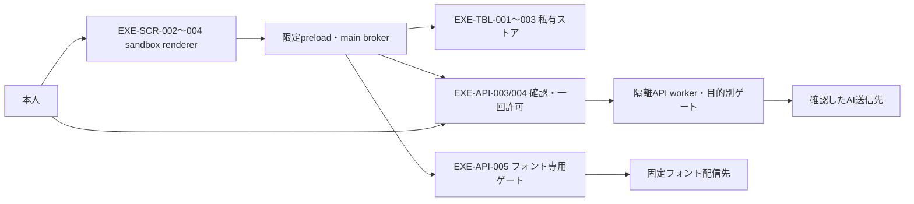

# Windows版：私有データ・AI送信確認・フォント取得設計

- プロジェクト：DC-Designer ／ 版数：v0.1（2026-10-25） ／ 状態：設計のみ・未実装
- 上位設計：[Windows exe release設計](./desktop-release-design.md) ／ 既存方針：[配布・更新](./release-policy.md)

> **3行で**
> 1. 画像・資料・認証情報は利用者別の保存先へ分離し、配布物・ログ・更新通信へ混ぜない。
> 2. AIには、送信先と実際に送る画像・本文を提示し、本人がその一回を確認した場合だけ送る。
> 3. フォント取得は残すが作品文字は送らない。これは実装済み・絶対安全の保証ではない。

## 🧭 判断してほしいこと

| ID | 種類 | 論点 | おすすめ・止まるもの |
| --- | --- | --- | --- |
| [EXE-R-01](./desktop-release-design.md) | リスク | 外部CLI・ComfyUIの拡張が画像を外へ送る可能性 | egressを制御・検証できない経路では参考画像機能を無効化。AI送信の受け入れ判定に影響 |
| [EXE-Q-01〜03](./desktop-release-design.md) | 未決 | コード署名・配信先・公開範囲・対象OSの確定 | 親入口へ集約。本書では決めない |

## 全体図

見てほしいところ：rendererから外部へ直接通信する経路はなく、フォント取得にAIの画像送信許可は流用しない。

## 要点
- [要件と責任境界](#requirements)：原本だけでなく派生画像・音声・資料も保護する。
- [私有ストア](#stores)：安定した利用者ルートをアプリ配置・CIから分離する。
- [AI送信](#ai-gate)：実送信内容を固定し、変更・追加・再試行では許可を使い回さない。
- [フォント取得](#fonts)：フルフォントを取得し、作品文字による絞り込みは端末内だけで行う。
- [画面・IPC](#interfaces)と[受け入れ観点](#acceptance)：拒否・障害でも送らず編集を続ける。

## 詳細

### 要件・現状・責任境界

| ID | 要件 | 優先度 | 機能 |
| --- | --- | --- | --- |
| EXE-REQ-001 | 画像等を無断送信・公開・配布物混入させない。AI送信は送信先・対象を提示した本人の明示確認だけを例外とする | Must | [EXE-FR-004](#exe-fr-004) |
| EXE-REQ-003 | 作品・ブラウザ保存・資格情報を更新から独立させ、秘密情報を保護する | Must | [EXE-FR-003](#exe-fr-003) |
| EXE-REQ-005 | カタログのフォント取得を維持し、作品文字を外部へ送らない | Must | [EXE-FR-005](#exe-fr-005) |

- 対象は原本・取り込み画像・参照画像・生成画像・スクリーンショット・サムネイル・自動比較画像・音声・資料・本文・ファイル名・関連メタデータ。AIの出力だから公開可能とはみなさない。
- Won't：テレメトリ／クラッシュの自動アップロード、無確認の画像送信、汎用URL代理取得、任意コマンド実行API、RDB追加、画像を含む診断自動送信。
- 防ぐ範囲は本アプリが管理する保存・通信・配布経路。OS／管理者／同一利用者の他アプリ／マルウェア／利用者が選ぶクラウド同期先・明示エクスポート先まで支配できるとの保証はしない。
- 作品のディスク全体暗号化は本設計の保証外。同意してAIへ送った後の相手側の保存・学習・再配布も技術的には取り消せず、確認画面で注意を示す。
- **以下は設計差分であり、現状に保護機構があるとは扱わない。** workerの起動・Windowsでの回収方法は[実行構成](./desktop-release-runtime.md)を正本とし、本書で重複定義しない。

| 現状の根拠 | 設計との差 |
| --- | --- |
| [`server/imagegen.ts:12`](../server/imagegen.ts#L12) | 生成・取り込み画像の既定保存先が`public/generated/`。私有`assets/`へ分離が必要 |
| [`server/chatgpt-auth.ts:26–28,68–88`](../server/chatgpt-auth.ts#L26) | `chatgpt.json`にJSONで資格情報を保存。ファイルmode指定だけをWindows暗号化とはみなさない |
| [`src/render/export.ts:65`](../src/render/export.ts#L65)、[`server/fonts.ts:76–84,104–118`](../server/fonts.ts#L76) | SVG/PPTXのフォント取得で`text=`に作品文字が入る。端末内サブセットへ変更する設計 |
| [`server/fonts.ts:138–175`](../server/fonts.ts#L138) | Windowsユーザーフォント配置・HKCU登録がある。取得とは別の明示確認と入力制限が必要 |

### EXE-FR-003：データ・資格情報の保護

入力は作品・素材・設定・資格情報、出力は私有ストアへの保存結果と秘密値を含まない状態だけ。容量不足・権限拒否・暗号化不可では保存失敗を返し、アプリ配置や平文保存へ退避しない。

`<userRoot>`は`%LOCALAPPDATA%/DC-Designer/`の便宜表記。アプリID・`app://dc-designer`のorigin・ブラウザpartition・利用者ルートを通常更新で変更せず、アプリ配置先・`dist`・CIステージングとは完全に分離する。

保存先の責務と論理ストア（新規RDBではない）

| 保存先／ID | 内容・主な論理項目 | 保護・寿命 |
| --- | --- | --- |
| `workspace/`・`assets/`／EXE-TBL-001 | `workspaceId`、`revision`、`assetId`、`opaqueId`、`kind`、`mimeType`、`byteLength`、`contentHash`、`derivedFrom?`と作品・素材実体 | 通常更新で維持。アプリが開いた作品の素材だけ解決。参照画像と生成物を区別 |
| `secrets/`／EXE-TBL-002 | `secretRef`、`providerId`、`credentialKind`、`ciphertext`、`updatedAt`、復号・失効の状態 | Windows DPAPIに結びつくOS暗号化。main管理。バックアップ・移行・配布から除外 |
| `fonts/`／EXE-TBL-003（fontcache） | `fontRef`、`family`、`weight`、`style`、`contentHash`、`license`、`sourceHost`、`validatedAt`、`osInstallState` | 検証済み全フォントとライセンス。作品由来サブセットは私有生成物として区別 |
| main管理メモリ／EXE-TBL-004 | `requestId`、`ownerContext`、`workspaceRevision`、`canonicalPayload`、`payloadHash`、画像manifest、送信先・用途、`expiresAt`、`state` | 短命一回の確認・送信記録。再起動・ログアウト・確認元切断で破棄。ディスク・バックアップへ保存しない |
| `browser/` | 安定originのブラウザ保存・端末内設定 | 秘密値は置かない。作品復元に必要な領域は形式を識別して移行 |
| `runtime/`／EXE-TBL-006 | [世代間lease・停止記録](./desktop-release-runtime.md#runtime-lease) | 再生成可能なキャッシュではない。通常更新で維持し、キャッシュ削除・移行・作品バックアップから除外。詳細は実行構成の正本を参照 |
| `cache/` | 再生成可能なキャッシュ。更新専用キャッシュは他用途と分離 | 私有画像を含む場合も同じ保護対象。不要時削除可。配布の入力にしない |
| `logs/` | 時刻・処理段階・エラー分類・アプリ版だけ | 画像、本文、ファイル名、絶対パス、送信hash、認証値、トークン付きURLを記録しない |

- 素材は[EXE-API-009](./desktop-release-runtime.md#exe-api-009)の認可済みIPCを通じて取得する。brokerが作品scopeと素材IDを台帳へ照合して検証済みbytesを返し、rendererが一時Blob URLを作る。任意path、`file:`、外部URL、パストラバーサル、symlink／junction経由の領域外参照を拒否する。
- `runtimeUrl`は一時的な表示用参照であり、永続的なファイルパス・外部送信URL・公開許可ではない。保存するのは素材IDで、作品切替・窓終了等で一時URLを破棄する。画像・音声をローカルHTTPや汎用`app://`資源として公開しない。
- 資格情報はElectronのOS暗号化機構を介したWindows DPAPIで保護し、通常利用者だけのアクセス制限を併用する。暗号化可否を検査できない／復号不能なら`reauthRequired`にし、平文fallbackはしない。
- 復号値は必要な送信先の処理へ必要な間だけ渡す。rendererへ読み戻すAPIや、workerへ資格情報の永続フォルダを渡す契約は設けない。信頼するAPIの保存サービスはworkspace／assetsを管理するが、AIアダプター・Codex・ComfyUIへは当該操作の許可snapshotだけを渡す。
- APIやCLIを同一Windows利用者の権限で起動するだけでは、OSのファイルアクセスを強制隔離したことにはならない。フォルダ指定・read-only・Job Objectだけを流出防止の証明とせず、経路ごとのアクセス・送信制約を検証できなければ該当連携を無効にする。ローカルプロセスのメモリまで絶対保護できるとはしない。
- 利用者画像・資格情報をインストーラー、asar、`dist`、ソースマップ、リポジトリ、CI artifact、更新メタデータ・更新要求へ混入させない。ビルドの入力は承認済み製品アセットと合成fixtureに限定し、実利用の`public/generated/`を製品アセットとみなさない。

### EXE-FR-004：AI画像送信確認・目的別通信

入力は作品revision・用途・送信候補、出力は確認対象の固定manifestと実行状態。既定は拒否であり、設定の一括同意、過去の生成成功、AIが返した「許可」、rendererの自己申告は本人の確認に代わらない。

- sandbox rendererは外部HTTP・WebSocket・画像／CSS読込・フォーム・iframe・ナビゲーション等で直接通信しない。限定preloadとmain brokerだけが、正規origin・メインフレーム・送信元・入力型・操作権限を検証する。
- mainが管理する目的別ゲートをAI・認証・フォント・更新で分離する。更新は[既存のmain管理](./desktop-update-design.md#技術仕様)を維持し、認証先・フォント先・更新先へ作品を転送する権限は与えない。
- ローカルAPIの起動認証tokenと画像の送信許可は別物である。旧来の生成・チャット・再現・自動比較等のHTTP経路から直接呼んでも、すべてのAIアダプター・upload・再試行の送信直前に同じゲートを通す。許可なしの旧APIは確認待ちを返すか拒否し、`consent: true`等のrenderer指定で迂回させない。
- 外部通信は登録済みproviderの検証済みendpointに限定する。TLS、最終送信先、各リダイレクト、ヘッダー、本文をゲートで検査し、任意URL代理取得・画像付きURLやRefererによる漏えいも拒否する。
- main／隔離workerが素材実体を取得して派生画像を確定し、**実際に送信するbytesのSHA-256**とサイズ・MIME・派生元を持つmanifestを作る。縮小・圧縮・切り抜き後の実体を確認対象とし、rendererが渡すhash・画像一覧だけは信用しない。
- gateが`providerId`・正確な`endpoint`・`model`・`providerRouting`・用途・全送信本文・画像manifestを含むcanonical payloadを生成する。画像bytesを不変snapshotに固定し、送信直前の一致検証でTOCTOUを防ぐ。認証値は表示本文に含めず、確認先に対応するものだけを付与する。
- OpenRouter等の仲介サービスでは、HTTP接続先だけでなく仲介者・実際の推論事業者・選択endpoint／regionを確認画面に示す。`providerRouting`にその単一の選択とルーティング制約を固定し、事業者・endpoint・region変更は再確認する。
- 画像付きOpenRouter要求は、採用版の公式仕様で一つの対象に限定できる完全なprovider slugを用い、`provider.only`と`provider.order`をその選択だけに限定、`allow_fallbacks: false`・`data_collection: deny`・`zdr: true`を固定する。基底slugで複数endpointを許可しない。自動model routing・model fallback・サーバー側tools／plugins等による別事業者への転送も無効化する。
- 選択範囲を一つに限定できない・必要パラメーターが拒否／無視される・実際の宛先を検証できない場合、その画像経路は無効にする。これらは[OpenRouterのAPI仕様](https://openrouter.ai/docs/guides/routing/provider-selection)に基づく制約であり、相手内部の非保持を技術的に証明するものではない。送信先の利用条件と仲介を含む注意を本人に示す。
- 確認UIはmainが作る専用のsandboxモーダル窓で、確定manifestだけをプレーンテキスト・ローカルプレビューとして表示する。通常editorと同じpreload権限を与えず、外部読込・任意HTML・別窓からの操作を拒否する。
- `confirmAiRequest`の`approve`は承認済みという自己申告ではなく、main所有のネイティブ確認ダイアログを開く要求である。mainが保持する同じmanifestの宛先・画像枚数等を最終表示し、既定ボタン「送信しない」に対する本人の肯定応答をmainが直接受けた場合だけ許可する。rendererの`isTrusted`等の申告・通常editor・workerによる自動呼出しでは許可しない。
- 許可は確認元・作品revision・canonical payload全体に結びつく短命一回分。成功・失敗・送達不明を問わず一度dispatchしたら消費し、通信再試行も新しい確認を要する。

| 状況 | 許可・通信の扱い | 編集への影響 |
| --- | --- | --- |
| 未確認・拒否・Esc・閉じる・期限切れ・再起動 | 画像送信0 bytes。許可を発行／復元しない | 継続 |
| 画像の追加・変更、派生画像の作り直し、自動比較スクショ追加、本文・用途変更 | 旧確認を無効化して再提示。差分だけを暗黙に許可しない | 継続 |
| provider fallback、endpoint／model変更、画像付きリダイレクト | 自動転送せず停止。新しい送信先と対象で再確認 | 継続 |
| 同意前の疎通・preflight・upload準備 | 画像・本文・ファイル名を外へ出さない。画像付き事前uploadは禁止 | 継続 |
| dispatch後のタイムアウト・切断 | `outcomeUnknown`を区別。既送信分は撤回できない。自動再送しない | 継続 |
| 拒否・期限超過がdispatch前に発生 | `denied`／`expired`。送らない | 継続 |

- 多段AI処理は確認対象の範囲を拡大しない。生成→評価→修正で追加の画像・比較スクショ・送信先が必要なら、その段階で別の一回確認を求める。画像なしのAI要求も本文・送信先を目的別ゲートで制限する。
- CodexはCLIがローカルで動くことと処理がオフラインであることを区別する。参照画像の暗黙添付、広い作業フォルダ探索、他セッションの生成物取り込みを禁止し、ジョブ固有の入力・出力だけを扱う。
- Codexの未知バージョンで画像egressを制御・検証できない場合は参考画像機能を無効にする。参考画像を付けなくても他の私有画像を探索・送信できる経路が残るなら、そのCodex連携全体を無効にする。プロンプト上の「送信しない」指示だけを防壁としない。
- ComfyUIも指定先・workflow・custom nodeからの外部egressを検査対象にする。ローカル指定はloopbackの検証済み接続に限定し、遠隔指定・外部転送・参照画像追加は別送信として確認する。制御不能なら画像を渡さない。

### EXE-FR-005：作品文字を送らないフォント取得

入力はカタログの`family`・`weight`・`style`と用途、出力は検証済み`fontRef`と取得／OS登録状態。取得・表示・埋め込みを維持するが、`text=`による外部サブセット取得は廃止する。

- Google Fontsにはカタログのfamily／weight／styleだけを送る。作品文字、タイトル、ファイル名、画像、任意URLをクエリ・ヘッダー・Referer・本文へ含めない。IP・選んだフォント・接続時刻が配信元へ伝わることは確認画面に示す。
- 全文字範囲を持つ対象faceを取得して`fonts/`へキャッシュし、SVG/PPTX埋め込みのサブセット処理は端末内で行う。配信が分割フォントなら必要な全配布範囲を取得し、作品文字を指定して外部に絞り込みを依頼しない。
- Google Fonts CSSの取得先は`fonts.googleapis.com`、フォント実体は`fonts.gstatic.com`の固定許可ホスト・HTTPSのみ。CSS内URL・リダイレクトごとにscheme・host・port・最終宛先を再検証し、追加ホストを自動許可しない。
- CSSをrendererへ外部読込させない。外部`@import`・任意URL・想定外のContent-Typeを拒否し、受信／展開サイズ・件数・時間に上限を設け、フォント構造・hash・ライセンス・埋め込み制限を検査してからローカル利用する。
- 1ファイルの受信・展開後上限は各32MiBを**AI設計値（未実測）**とする。日本語フルフォントとの適合は正式配信前に確認し、超過時は停止して値を見直す。作品文字送信へ切り替えて回避しない。
- ライセンス文・取得元・埋め込み制限をキャッシュと許される書き出しに保持する。フォント提案AIは取得機能ではなくAI目的別ゲートに属し、資料や画像を取得通信へ紛れ込ませない。
- WindowsへのOSインストールはキャッシュ取得とは**別の明示同意**。`acquire(target: windowsUser)`内部で検証済みキャッシュを確定後、main所有のネイティブ確認ダイアログへ対象face・ライセンス・登録先を示し、mainが本人の応答を直接得る。rendererから同意済みIDを入力する契約にはしない。
- OS登録の内部許可は要求元・対象face集合・実ファイルhashに結び付け、確認完了から5分以内の一回だけ有効とする。拒否・窓切断・内容変更・期限切れ・使用後は無効。登録直前にも同一bytesを検証し、別フォントへの流用・自動再試行を拒否する。拒否しても取得済みキャッシュは使える。
- 登録はカタログ限定の検証済みファイルを通常ユーザーのフォント領域へ置く固定操作・HKCU登録に限定し、実行対象を固定して引数を安全に分離・検証する。管理者昇格、任意シェル文字列、任意path・コマンド引数を受け付けない。

| 条件 | 結果 |
| --- | --- |
| オフラインで検証済みキャッシュあり | ローカル利用。ネットワーク不要 |
| オフライン・未取得／HTTP障害／配信URL変更 | 取得失敗を表示し、代替表示・再取得を選べる。画像送信は行わない |
| フォント検証・ライセンス検証に失敗 | 対象を利用・OS登録しない。既存の検証済みキャッシュを破壊しない |
| Windowsポリシー・権限によるOS登録拒否 | `osInstallDenied`。アプリ内キャッシュ利用・代替表示を維持し、昇格や制約回避をしない |
| 代替表示または埋め込み不可 | 未取得・代替フォントと警告する。別端末も同一の見た目になると保証しない |

### 画面・限定IPC契約

以下は将来の契約であり、既存APIの実装完了を意味しない。全APIは限定IPCで、rendererへ任意HTTP通信・秘密値の読戻し・任意ファイル参照・コマンド実行能力を公開しない。確認に必要な送信先URLは表示するが、自由な接続先指定は許可しない。

| ID | 画面・表示 | 操作・状態／関連機能 |
| --- | --- | --- |
| EXE-SCR-002 | AI送信確認：provider・正確なendpoint・model・仲介者と推論事業者／region・用途、全本文、原本と区別した実送信画像プレビュー・枚数・サイズ、相手側保存への注意 | 準備中／確認待ち／無効／送信中／成功／失敗／送達不明。初期フォーカスは「送信しない」。「この内容を一回送信」だけが許可。閉じる・Escは拒否／EXE-FR-004 |
| EXE-SCR-003 | フォント取得：family・weight・style、取得先、ライセンス、キャッシュとOS登録の別々の状態 | 未取得／取得中／キャッシュ済み／オフライン／失敗。「取得」と「Windowsにもインストール」を分離。AIへの送信同意を兼ねない／EXE-FR-005 |
| EXE-SCR-004 | 秘密情報設定：provider別の未設定・設定済み・再認証必要。入力値は伏字、保存後の値は返さない | 保存／登録を削除／ログアウト／私有データの明示削除を区別。削除範囲を再確認し、失敗を成功表示しない／EXE-FR-003 |

確認画面はキーボード操作、読み上げ可能なラベル、フォーカス移動・復帰を持つ。Enter単独・連打・画像準備中では同意を成立させず、送信対象が変わったら更新を知らせて再確認する。

EXE-API-003〜006：入出力・状態・失敗時の契約

| ID／契約名 | 入力 | 出力・状態 | 拒否・副作用／関連ID |
| --- | --- | --- | --- |
| EXE-API-003 `desktopPrivacy.prepareAiRequest` | `workspaceId`、`workspaceRevision`、登録済み`providerId`・`modelId`・`purpose`、本文入力、対象`assetIds`・派生処理指定。任意endpoint・path・確定hash指定は不可 | main／workerが確定した`requestId`、`expiresAt`、`manifest`、`payloadHash`、`state: prepared`。mainが対応する確認UIへ同じ内容を渡す | 素材不明・revision不一致・未許可provider・安全に固定できない派生処理で失敗。画像付き外部通信なし／EXE-FR-004、EXE-SCR-002、EXE-TBL-001/004 |
| EXE-API-004 `desktopPrivacy.confirmAiRequest` | 当該確認用UIだけから`requestId`、`payloadHash`、`decision: approve/deny`。`approve`はmainの最終ネイティブ確認を要求するだけで、本人の許可そのものではない | 拒否なら`denied`。mainが直接得た肯定応答・一致検証成功なら一回だけ`dispatching`へ移り、`completed`／`failed`／`outcomeUnknown`を秘密値なしで返す。画像の出力は新規私有asset参照 | 未確認元・期限切れ・内容変更・重複呼出しを拒否。`expired`／`invalidated`では送信せず、必要なら再prepare。workerの自動承認・tokenのrenderer再利用不可／EXE-FR-004、EXE-SCR-002、EXE-TBL-004 |
| EXE-API-005 `desktopFonts.acquire` | カタログの`family`、`weights`、`style`、`target: cache/windowsUser`。`windowsUser`はmain内で対象を検証して別のネイティブ確認を行う要求であり、同意済みを意味しない | `fontRefs`、`license`、`state: cached/installed/osInstallDenied`、`fromCache`。進行中は`acquiring`。本人がOS登録を拒否・取消した場合は`cached`と`osInstallState: declined`を返す。fontRefからのみローカル利用 | カタログ外・任意URL・本文文字指定・同意なしOS登録を拒否。登録許可は内部で要求元・face・hashに束縛し一回消費。ネットワーク／検証失敗は`failed`、既存キャッシュを維持／EXE-FR-005、EXE-SCR-003、EXE-TBL-003 |
| EXE-API-006 `desktopSecrets.set/remove` | `set`は登録済み`providerId`・`credentialKind`・入力した`value`、`remove`は`secretRef`と当該削除の確認情報。資格情報型はカタログで制限 | `secretRef`、`state: configured/unset/reauthRequired`。`remove`は未登録でも`unset`。値は応答しない | OS暗号化不能・書込失敗・削除失敗は分類エラー。成功前に既存値を失わず、平文保存しない。暗号化済みOAuth資格情報の保存も同じ保護方針／EXE-FR-003、EXE-SCR-004、EXE-TBL-002 |

- `manifest`は`providerId`・`endpoint`・`model`・`providerRouting`・`purpose`・全送信本文と、各画像の`assetId`・`derivedFrom?`・`contentHash`・`byteLength`・`mimeType`・ローカルプレビュー参照。`providerRouting`は直接接続なら`direct`、仲介なら仲介者・単一推論先・endpoint／region・固定routing制約。`payloadHash`はそのcanonical payloadの算出値であり、ログへ保存しない。
- EXE-TBL-004の`state`は`prepared`から`denied`／`expired`／`invalidated`／`dispatching`、`dispatching`から`completed`／`failed`／`outcomeUnknown`へだけ遷移する。終端状態から再送・許可範囲拡大はできない。
- 許可期限は準備完了から5分以内を**AI設計値（未実測）**とし、超過時は再確認。実送信中の期限切れは未送信を意味せず、送達不明を区別する。
- 共通失敗分類：`INVALID_ARGUMENT`、`UNAUTHORIZED_CONTEXT`、`NOT_FOUND`、`CONSENT_REQUIRED`、`CONSENT_EXPIRED`、`PAYLOAD_CHANGED`、`ALREADY_CONSUMED`、`DESTINATION_BLOCKED`、`NETWORK_FAILED`、`VALIDATION_FAILED`、`STORAGE_FAILED`、`REAUTH_REQUIRED`。利用者向け説明と段階だけを返し、外部エラー本文・秘密値・絶対pathは返さない。

### バックアップ・移行・削除・障害

| 場面 | データの扱い |
| --- | --- |
| 通常更新・ロールバック | workspace／assets／browser／fonts／secretsは維持。データ形式の互換性を確認し、単にプログラムを戻すだけでデータを巻き戻さない |
| バックアップ | 利用者が範囲と保存先を明示選択した作品・assets・必要な非秘密設定を対象にする。secrets・送信許可・ログは除外。バックアップ自体も私有データと表示 |
| 形式変更・保存先移行 | 秘密値を除くバックアップ、形式検証、元データ維持、失敗時の旧形式利用または復旧案内を条件とする。未完了移行を成功扱いしない |
| 別PC・別Windows利用者への移行／DPAPI復号不能 | 秘密値を移さず再認証。作品は独立して開ける。旧平文JSONの自動コピー・平文fallbackは禁止し、旧資格情報の移行可否は再認証を既定とする |
| ログアウト／資格情報削除 | 対象のローカル資格情報・短命許可を消し、可能ならproviderへ失効要求。失効通信失敗は別表示。workspace／assetsは消さない |
| アンインストール | 既定は利用者データ維持。明示的な「私有データも削除」で対象領域と復元不能の注意を確認。実データ・runtime記録の削除は所有Jobの停止確認後だけ行い、確認不能を削除で回避しない。OS登録済みフォントを無断で削除しない |
| 作品・全私有データの明示削除 | assetsの共有参照も確認して対象を削除。ログアウトと同義にしない。外部バックアップ・エクスポート・相手側保存・SSDの物理消去まで保証しない |
| エラー・クラッシュ | 端末内の分類ログだけ。画像・認証値・本文入りの例外／stdout／stderrを直接保存しない。ダンプ・診断ファイルを自動送信しない |

### 受け入れ観点と追跡

以下は将来の検証基準であり、本書作成時に通信検査・ビルド・Windows実機検証を実行した結果ではない。

| 要件 | 画面・API・ストア | 受け入れ観点 |
| --- | --- | --- |
| EXE-REQ-001 → EXE-FR-004 | EXE-SCR-002／EXE-API-003/004／EXE-TBL-001/004 | 通信検査で未同意・拒否・期限切れ・再起動時の画像bytesが0。直接HTTP／WebSocket／画像URL等のrenderer迂回も0。確認した送信先・本文・画像bytesと実通信が一致 |
| 同上 | 同上 | 画像変更・追加・自動比較スクショ・派生処理変更・fallback・endpoint／model変更で再同意。重複confirm・再送・多段処理で許可拡大0。未知Codex／制御不能egressでは参考画像を渡さない |
| 同上 | 同上 | OpenRouter等の内部負荷分散・provider／region切替・model fallback・server tool転送を確認し、単一の確認先に固定できなければ画像要求を拒否する |
| EXE-REQ-003 → EXE-FR-003 | EXE-SCR-004／EXE-API-006／EXE-TBL-001/002 | 既知の合成画像・本文・秘密値fixtureを用い、インストーラー／asar／dist／ソースマップ／CI artifact／ログ／更新通信への混入を検出。許可した製品fixtureと私有fixtureを区別 |
| 同上 | 同上 | 通常更新で作品と認証状態を維持。別利用者・別PC・DPAPI失敗時は再認証し、平文を残さない。バックアップ秘密値0。保存失敗・移行失敗・削除失敗を成功表示しない |
| EXE-REQ-005 → EXE-FR-005 | EXE-SCR-003／EXE-API-005／EXE-TBL-003 | フォントURL・Referer・全要求に作品文字・ファイル名0、`text=`0、画像bytes0。フルフォントのキャッシュと端末内サブセットで取得・埋め込み可能 |
| 同上 | 同上 | 許可外ホスト・リダイレクト・偽Content-Type・上限超過・壊れたフォントを拒否。オフライン未取得と代替表示を警告。OS登録の別同意、ポリシー拒否時の非昇格とキャッシュ維持を確認 |
| 同上 | 同上 | OS登録はmain確認で提示したface・hashと一致する一回だけ。変更・期限切れ・再利用・別窓・確認拒否で登録0件、取得済みキャッシュは維持 |

REQ→US→UCの上流対応は[技術仕様の対応表](./desktop-release-spec.md#トレーサビリティ)が正本。本書のEXE接頭辞IDは[既存更新設計](./desktop-update-design.md)の接頭辞なしIDと別の名前空間とする。

## このドキュメントで決まったこと

- ユーザー確認済み：画像のAI送信は送信先・対象画像を提示した本人の明示確認だけを許可し、フォント取得は維持する。
- [ADR-002](./adr/ADR-002-private-data-and-consent.md)：私有ストアと目的別通信・短命一回確認。画像プレビューとmainが直接得る最終確認を分離する設計判断。
- [ADR-004](./adr/ADR-004-font-acquisition.md)：作品文字を送らないフルフォント取得と、別同意のOS登録を採用する設計判断。
- AI設計値：AI／OSフォント登録の許可期限各5分、フォント1ファイル受信・展開後各32MiB。安全性の実証値ではなく、正式配信前に妥当性を検証する。
- 署名・公開先・OS対象は[親入口](./desktop-release-design.md)、更新の振る舞いは[既存設計](./desktop-update-design.md)へ委ねる。本書は実装・CI変更・公開を許可しない。
