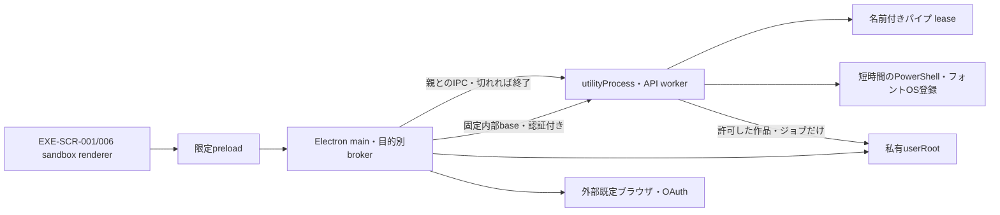
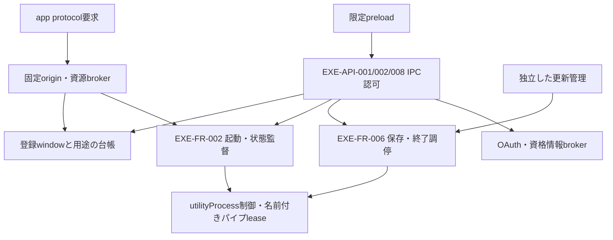
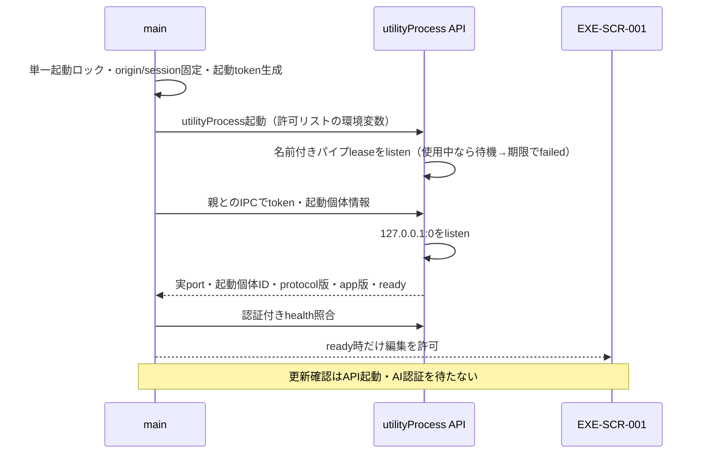
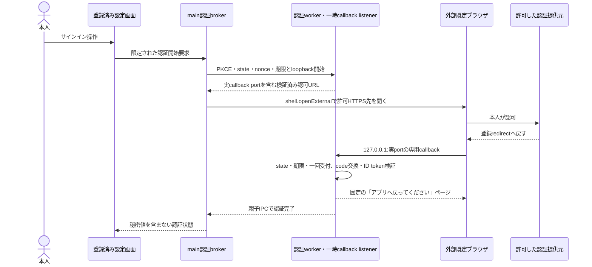
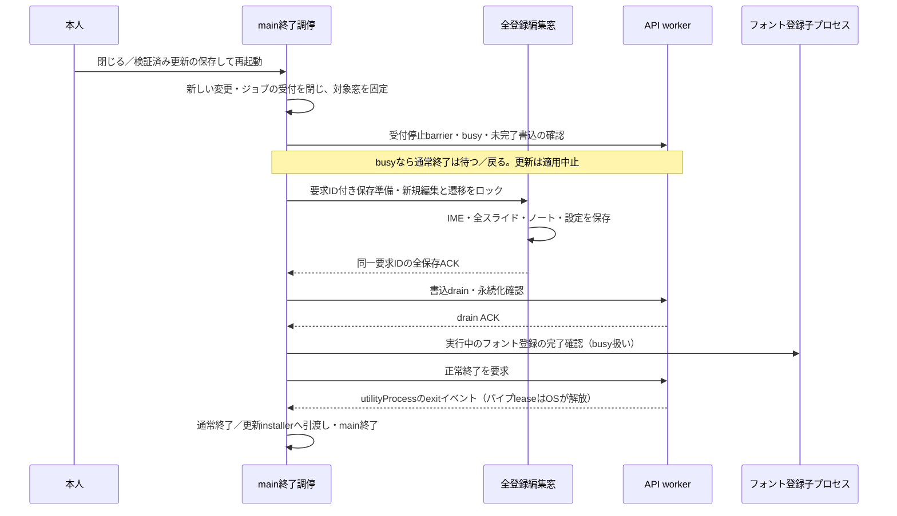
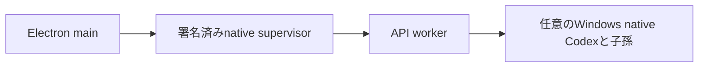

# Windows版：製品用接続・実行環境・終了設計

- プロジェクト：DC-Designer ／ 版数：v0.2（2026-10-26）／ 状態：設計のみ・未実装
- 入力：[読む入口](./README.md)、[要件・技術仕様](./desktop-release-spec.md)（段階分けの正本）。構成の決定者：ユーザー委任によるAI推奨判断（段階1〜3のutilityProcess構成は2026-10-26にユーザーが承認）。

> **3行で**
> 1. 画面から実行環境を切り離し、同梱した実行環境だけへ安全に接続する。
> 2. 段階1〜3はElectronの`utilityProcess`でAPIを動かし、名前付きパイプleaseで新旧APIの同時書き込みを防ぐ。全保存・書込drain・utilityProcessのexitとフォント登録子プロセスの完了を確認してから終了する。supervisor・Job Objectは段階4（Codex連携時）の設計として[付録](#windows-job)へ移し、現時点では作らない。
> 3. 画像保護・フォント取得・更新の既存方針は変えない。Windows実機での成立確認は未実施。

## 🧭 判断してほしいこと

[EXE-Q-01〜03／EXE-R-01](./README.md#-判断してほしいこと)を維持する。署名・配信先は未承認。対応OSはWindowsのみ（版・CPUは推奨値で実機確認待ち）。utilityProcess終了・名前付きパイプlease・OAuth・通信制約の検証不能は正式配信を止める。

## 全体図（C2：コンテナ）

見てほしいところ：段階1〜3はCodexを製品版で無効にするため、APIは孫プロセスを常駐させない。残る子プロセスはフォント登録の短時間PowerShellだけ。utilityProcessは外部送信を防ぐsandboxではない。段階の全体順は[親仕様](./desktop-release-spec.md)を正本とする。

## 要点

- [構成・識別子](#identity)：画面origin・保存先は固定し、利用者にNode・npm・WSLを要求しない。
- [実行環境・排他](#runtime-lease)：utilityProcessと名前付きパイプleaseで新旧APIの同時書き込みを防ぐ。supervisor・Jobは[段階4の付録](#windows-job)。
- [接続・IPC](#connection)：起動ごとの秘密値をrendererへ出さず、登録した画面だけへ権限を渡す。
- [OAuth](#oauth)：外部ブラウザと一時loopback listenerを使い、内部API認証とは分離する。
- [保存・終了・復旧](#shutdown)：全対象の保存・書込drain・utilityProcess終了とフォント登録子プロセス完了の確認を省略しない。

## 詳細

### 構成・識別子・現状との差

関連：[EXE-REQ-002/004/007、EXE-UC-001/004、EXE-FR-002/006/008](./desktop-release-spec.md#機能技術仕様の所在)。本書はその実行契約の正本であり、画像送信・資格情報・フォント・論理ストアの詳細は[画像保護設計](./desktop-release-privacy.md#stores)へ委ねる。

| 境界 | 製品版の契約 |
| --- | --- |
| 画面 | Electron main＋sandbox renderer＋限定preload。`contextIsolation`有効、rendererのNode.js利用は無効 |
| origin・session | `app://dc-designer`固定。`protocol.registerSchemesAsPrivileged`で`standard`・`secure`・`supportFetchAPI`をready前に登録。同梱した静的資源だけを配信し、`bypassCSP`は使わない |
| ブラウザ保存 | `appId`は`io.github.itiwoja.dcdesigner`、partitionは`persist:dc-designer`をAI推奨とし、更新をまたいで固定。`userData=<userRoot>/browser/`をready前に設定し、対象sessionへhandlerを登録 |
| 実行環境 | **段階1〜3**：Electronの`utilityProcess`でビルド済みJSの専用API workerを実行。公式Windows Nodeの別同梱・native supervisor・Job Objectは作らない（段階4の設計は[付録](#windows-job)）。utilityProcessは親（main）とのIPCが切れると終了する |
| 所有関係 | Electronの単一起動ロックと、API workerが保持する保存先単位の名前付きパイプleaseを併用。同名が使用中なら新APIは書き込みを始めない。二重起動側は既存窓の表示要求だけで終了し、既存APIへ再接続・停止しない |
| 配置 | プログラムはユーザー単位の専用インストール先。`<userRoot>=%LOCALAPPDATA%/DC-Designer/`と分離し、管理者権限を要求しない |
| 私有領域 | `workspace/`・`assets/`・`browser/`・`fonts/`・`secrets/`・`runtime/`・`cache/`・`logs/`の責務は画像保護設計を参照。段階1〜3の排他は[名前付きパイプlease](#runtime-lease)を正本とする（EXE-TBL-006・世代印は段階4の付録） |

- 現行[`package.json`](../package.json)のbuildはViteのみ。製品起動では`file://`、開発Vite、`tsx`、npm、watch、開発用環境変数・カレントディレクトリに依存しない。
- 現行[`server/index.ts`](../server/index.ts#L23)の固定port・無認証静的配信と[`server/imagegen.ts`](../server/imagegen.ts#L257)の開発用Codex停止処理を、そのまま製品の保証にしない。
- 段階1〜3はNodeの別同梱が不要で、Electron同梱のランタイムを使うため配布物が軽い。一方、utilityProcessは公開APIに生成時Job指定がなく`kill()`も子孫回収の保証ではないため、子孫回収が必要になる段階4でsupervisorを追加する。[ADR-003](./adr/ADR-003-desktop-runtime.md)に代替案を記録する。
- **段階1の必須タスク：iframeサムネイルの置き換え。** 現行[`src/editor/ui.tsx`](../src/editor/ui.tsx#L126)は同一originのReactアプリを`iframe src="?view=render&embed=1"`で開いてサムネイル・描画プレビューを出している。製品版では使えないため、段階1で「受動的な描画snapshot（画像化したプレビュー）」へ置き換える（[IPC共通契約](#ipc共通契約)）。これを終えるまで段階1を完了としない。

### C3：mainの主要コンポーネント

見てほしいところ：更新確認はAPI起動・ChatGPT認証から独立する。更新適用だけが共通の保存・終了調停に合流する。

### 保存先の排他（名前付きパイプlease）

Electronの単一起動ロックはmain死亡時に解放されるため、旧APIの停止証明にはしない。段階1〜3では、API workerが利用者SIDと正規化した`userRoot`から作るハッシュで**Windows名前付きパイプ`\\.\pipe\dc-designer-lease-<hash>`をlistenして保持**する簡易leaseとする。

- 新APIはlistenに成功してから作品・素材・設定への書き込みを始める。同名が使用中（`EADDRINUSE`）なら書き込みを始めず、「前回の終了処理を待っています」を表示する。期限（**AI推奨値**：起動監視と同じ30秒）を超えたら`failed`とし、再試行／診断を案内する。
- パイプはプロセス終了時にOSが解放する。記録ファイルの整合確認・世代印・停止記録は不要。旧PID消失や記録の有無で安全と判定せず、leaseを取れたことだけを書き込み開始の条件にする。
- パイプ名は利用者SIDと`userRoot`に結び付け、別利用者・別保存先と衝突させない。Nodeの`net.Server`はパイプのACLを指定できないため既定のDACLを使う（libuvは最初のインスタンスとして作成するため、同名の二重listenは`EADDRINUSE`になる）。他プロセスによる名前の先取り・ポリシー拒否は書き込みを始めずに`failed`とする。パイプはデータを流さないため、先取りの影響は起動不能にとどまる。
- パイプは排他専用であり、API tokenやデータを流さない。接続してきた要求は何も処理せず閉じる。
- **EXE-TBL-006 `RuntimeLeaseJournal`と`<userRoot>/profile.json`の世代印は、段階1〜3では使わない。** 元の設計は[付録](#runtime-lease-journal)に残す。

### EXE-FR-002：起動個体・API接続

見てほしいところ：TCP接続成功ではなく、自分が起動したAPIの認証・個体・版・準備完了を照合する。

- mainが起動ごとに暗号学的乱数で256bit以上のtokenと起動個体IDを生成する。tokenはutilityProcessの親子IPC（`postMessage`）でだけ渡し、コマンドライン・URL・ログ・renderer・永続ストアには出さない。
- workerは`127.0.0.1:0`へbindし、実際に割り当てられたport、起動個体ID、`apiProtocolVersion`、`appVersion`を親子IPCでmainへ返す。ワイルドカードbind・空きportの事前探索・別APIへの接続fallbackはしない。
- mainは認証付きhealthで起動個体ID・API protocol版・app版・`ready`を照合する。秘密値・内部port・起動個体IDを含まない状態だけをrendererへ渡す。AI未認証・任意連携未導入はAPI障害と区別する。
- 起動の監視期限は30秒を**AI推奨値**とする。超過・版不一致・応答不正は`failed`とし、旧utilityProcessのexit確認まで再起動しない。古い制御応答・health結果でreadyへ戻さない。
- APIの環境変数は必要なものの許可リストから構成し、開発者のAPIキー・プロキシ・`NODE_OPTIONS`等を無条件に継承しない。製品entryは任意のカレントディレクトリの`.env`を読まず、子プロセスへ他providerの秘密値や全環境変数を引き渡さない。
- `protocol.handle`は目録で承認した同梱コード・静的資源だけに限定する。API・私有画像を`app://.../api`や`/generated`の汎用HTTP中継として公開しない。PDF.jsのcmaps等は承認済み同梱資源として配信できるが、利用者のPDF自体は配信しない。
- 製品フロントのAPI transportはEXE-API-009の限定IPCへ接続する。mainが実際の`IpcMainInvokeEvent.sender`・`senderFrame`・登録window用途・作品scopeを検証した後、静的な操作表から内部route・methodを選び、固定内部baseへtokenを付けて中継する。rendererへ自由なURL・route・methodを受け付けない。
- `protocol.handle`の`Request`からIPC同等のwindow／frame識別子を取得できると仮定しない。`initiatorOrigin`やRefererだけでは同一originの別窓を識別できないため、私有データの認可に使わない。私有素材はIPCで確認した当該作品のbytesを返し、rendererが一時Blob URLとして表示して用済み後に破棄する。
- API側もtoken・実portを含む厳密なHost・mainが付与した正規Originを照合する。Origin欠落・ワイルドカードCORSを許可せず、認可した資源GETにもmainが正規Originを付ける。renderer申告のOrigin・Referer・queryを本人性の証明にしない。
- 中継先は固定内部baseから相対routeだけで組み立てる。任意URL・絶対path・外部host・userinfo・パストラバーサル・リダイレクトの自動中継は禁止。内部認証ヘッダーを応答や外部要求へ漏らさない。
- `/generated`等の内部画像GET・API配下の資源GETも無認証HTTPでは返さない。`view=render`／iframeには操作IPCを与えず、所有する編集窓が取得した当該作品の読取用snapshotだけを渡す。現行のiframeサムネイルは段階1で受動的な描画snapshotに置き換える。発表者・印刷の独立窓はmainが登録した読取専用操作だけを使う。
- rendererの直接ネットワークはCSPとsessionの通信阻止で制限し、workerも[目的別egressゲート](./desktop-release-privacy.md#ai-gate)を通す。utilityProcessで動くことは送信許可ではなく、AIの対象・送信先確認やフォント取得の規則を代替しない。

### IPC共通契約

全IPCはmain側で送信元`webContents`・正規origin・メインフレーム・用途別window allowlist・型と上限・現在状態を検証する。preloadから生の`ipcRenderer`、任意channel、任意spawn、任意URL／pathを公開しない。

- mainの窓台帳は編集・起動／復旧・確認・発表者・印刷を区別する。更新・終了の保存対象はmainが登録した編集可能な窓だけ。`view=render`、iframe、外部browserに操作・保存ACKの権限はない。
- **Electronのrenderer sandboxとHTML iframe sandboxは別物。** 描画用iframeは`allow-same-origin`・script・popup・親navigation等を許可しないHTML sandboxで、実行コードを持たない描画snapshotだけを表示する。親bridgeへ到達できる同一originのReactアプリをiframeで開く現行方式は製品版に流用しない。段階1で、サムネイル・描画プレビューを受動的な画像プレビュー（描画snapshot）に置き換えるのを必須とする。
- 描画frameからの親DOM・`parent`／`top`経由bridge利用を遮断する。snapshotは所有する親から一方向に渡し、子の`postMessage`を操作・保存ACKとして受け付けない。スクリプトが必要な独立窓はmainが別途登録した用途限定窓とし、iframeへ特権を戻さない。
- 制御入力は合計4KiB以下を**AI推奨値**とし、画像・本文・ファイル実体を含めない。列挙外のaction／purpose、余剰フィールド、不正ID、古い要求ID、用途外の窓を拒否する。他APIの入力上限は各正本に従う。
- 共通失敗は`INVALID_ARGUMENT`／`UNAUTHORIZED_CONTEXT`。実行状態による失敗は`INVALID_STATE`／`BUSY`／`STARTUP_FAILED`／`VERSION_MISMATCH`／`SAVE_FAILED`／`SAVE_TIMEOUT`／`WORKER_LOST`／`SHUTDOWN_UNCONFIRMED`を区別し、秘密値・生例外・絶対pathは返さない。

EXE-API-001／002／008／009：限定IPCの入出力・状態

| ID・契約名 | 入力・呼出元 | 出力・副作用・失敗 |
| --- | --- | --- |
| EXE-API-001 `desktopRuntime.getState`／`desktopRuntime.retryStart`／`desktopRuntime.onStateChanged` | getState・retryStartは引数なし。起動／復旧・通常編集窓に限定。購読は解除関数を返す | `state`、`appVersion`、`busy`、`saveState`、分類`error?`のsnapshot。stateは`starting/ready/failed/recovering/closing`。retryStartは旧管理対象の停止確認後だけ新しい個体を起動。稼働中・停止不明は拒否し、多重起動しない |
| EXE-API-002 `desktopRuntime.requestClose` | 通常編集窓から`action: request/wait/returnToEdit/stopAfterSave`とmain発行の`promptId?`。OSの閉じる操作も同じ調停へ合流 | `pending/canceled/blocked/closing`と分類。waitは通常終了のbusy待ちだけ。stopAfterSaveは全保存成功後の終了ハング警告への本人同意だけに有効。生成cancelや更新許可には使えない |
| 同EXE-API-002 `prepareForClose`／`completeClosePreparation` | main→登録編集窓へ`requestId`、窓→mainへ同ID・`allSaved`・`busy`・保存revision／分類。要求ごとに対象集合をmainが固定 | 全対象一致・worker書込drain ACKまで終了不可。切断・未応答・不一致・失敗は閉じない。更新は既存`desktopUpdate.prepareForRestart`を維持し、同じ保存調停を使う |
| EXE-API-008 `desktopWindows.openPresenter` | 通常編集窓から登録済み`workspaceId`と`purpose: presenter/print`。任意URL・HTML・pathは不可 | mainが内部発表者／印刷窓を生成・登録し、opaque `windowId`を返す。作品不明は`NOT_FOUND`、生成不可は`WINDOW_UNAVAILABLE`。印刷ダイアログもmainが当該窓を制御し、OS拒否は分類して返す |
| EXE-API-009 `desktopApi.request` | `operation`、`workspaceId?`と操作別schemaに適合する引数。operationは製品の静的操作表で現行のローカルなポスター／デッキ／素材操作へ対応付ける。自由URL・method・header・path指定は禁止 | mainが実送信frameと作品権限を確認してから固定内部APIを呼ぶ。JSONまたは検証済みMIMEの素材bytesとopaque `requestId`を返す。進捗・完了・取消は同じ窓と要求へ結び付ける。未許可・過大入力・古い個体は拒否し、内部token・port・HTTPヘッダーを返さない |

他の画面・IPC・ストアは[親仕様のトレーサビリティ](./desktop-release-spec.md#トレーサビリティ)と[画像保護の契約](./desktop-release-privacy.md#interfaces)、更新IPCは[既存更新設計](./desktop-update-design.md#プロセス間通信データ)を参照する。

EXE-API-009の静的操作表は既存の機能別APIと同じ入力schema・既存上限を持ち、新しい汎用HTTPトンネルを作らない。前項の4KiBは起動・終了・窓の制御入力だけの上限であり、素材・作品データは各操作の上限を検証する。発表者・印刷には読取だけを許可し、私有素材を含むBlob URLの外部ナビゲーションやHTML実行を拒否する。

AI送信・OSフォント登録・資格情報・更新・プロセス制御はEXE-API-009の操作表に含めず、各専用契約へ分離する。旧来の生成APIや`/api/fonts/install`等を汎用中継で呼ぶ要求は拒否し、AIアダプター側の送信直前ゲートも残す。認証付き内部HTTPへ到達したことだけを、本人の送信・OS登録同意とみなさない。

### EXE-FR-008：内部窓・外部リンク・OS操作

- 任意の`window.open`・popup生成は拒否する。発表者・印刷はEXE-API-008からmainが同梱資源を読み込む内部窓にする。mainが作品参照・初期表示・窓間同期を管理し、任意HTMLを書き込ませない。
- 内部窓にもsandbox・限定preload・固定originを適用し、発表操作・読取／印刷だけを許可する。外部ページへのナビゲーション、汎用IPC、更新適用、資格情報操作を許可しない。
- 外部リンクはmainの`shell.openExternal`から用途別に許可したHTTPS先だけを開く。OAuth・公式release・利用状況の確認先を分け、`file:`・`javascript:`・任意scheme・renderer指定の自由URLを拒否する。
- 印刷・保存ダイアログ・フォントOS登録は各用途の限定操作とし、共通の任意OSコマンドAPIを作らない。フォントの取得・OS登録条件は[画像保護設計](./desktop-release-privacy.md#fonts)のまま維持する。

### 外部ブラウザOAuth

見てほしいところ：外部ブラウザは内部API tokenを持たない。成功通知はWebの窓間通信ではなく、信頼した親子IPCを通る。

- 専用listenerはAPIとは別の一時的な`127.0.0.1:実port`だけで受ける。callbackの固定path・Host・state・PKCE・nonce・期限・一回受付を検証し、無関係な要求を拒否する。OAuth以外の画像・APIを配信しない。
- 有効なstateに対応する受付は成功・拒否・失敗で一回消費する。失敗・期限切れ・キャンセル・アプリ終了でpending情報とlistenerを破棄し、古いcallbackや認可コードを再利用しない。
- callbackは外部ブラウザから来る例外なので、内部API tokenや`app://` Originを要求しない。例外をAPI全体の無認証化・Origin検査の無効化に広げない。
- code交換・署名／issuer／audience／nonce／有効期限の検証を完了してから資格情報を確定する。保存は[secretsの保護契約](./desktop-release-privacy.md#exe-fr-003)に従い、rendererにaccess／refresh／ID tokenを返さない。
- 認可URLにも`id_token_hint`等で保存済みトークンを埋め込まない。認可コード・callback query・PKCE情報をログや診断へ残さない。
- 成功ページは固定の戻り案内だけ。トークンをURL・HTML・`postMessage`へ出さず、外部ブラウザを`app://`へredirectしない。renderer popup・`BroadcastChannel`に完了検知を依存させない。
- `app://`の内部protocolとOS deeplink登録は別物。本方式にOS deeplinkは不要。登録redirectで動的portが受け入れられるか、提供元のクライアント登録仕様・Electron製品版での認証可否は**実装前の検証ゲート**とし、不適合なら勝手に固定portやdeeplinkへ変更しない。
- 認証期限は現行[`server/chatgpt-auth.ts`](../server/chatgpt-auth.ts#L65)の10分を維持する。OAuth認証はAIの画像送信許可を兼ねない。

### EXE-FR-006：通常終了・更新・障害復旧

見てほしいところ：mainは全保存ACK・書込drain・utilityProcessのexitとフォント登録子プロセスの完了をそれぞれ確認する。一つでも不明なら更新へ引き渡さない。

通常終了・更新・crashの状態別契約

| 状況 | 調停・利用者の選択 |
| --- | --- |
| 通常終了で生成・取り込み・書き出し等がbusy | 閉じるを保留し「処理完了を待つ／編集へ戻る」。完了待ち後も再確認してから保存段階へ進む。job cancelは別の明示操作であり、閉じる操作で勝手に行わない |
| 更新の再起動でbusy | 既存方針どおり適用を中止し、ロック解除して処理完了後の再操作を案内する。通常終了の待機動作へすり替えず、更新のために生成を強制停止しない |
| 保存準備 | mainが固定した全対象をロックし、IME確定待ち・別スライド・deck情報・notes・settings・保留保存まで確定。ブラウザ内の控えだけでは成功扱いしない |
| 保存失敗・切断・ACK不一致・期限超過 | 閉じず、編集ロックを解除し原因分類を表示する。進行中の保存は破棄せず、完了分を維持。強制停止・更新適用で回避しない |
| 全保存後 | 新規操作を止めたままworkerの書込drain ACKを受け、Node正常終了を要求。utilityProcessのexitとフォント登録子プロセスの完了を確認した後だけmain終了／更新引渡しを許可する |
| API停止後に更新installer開始が失敗、mainは生存 | 更新は`downloaded`を維持するがruntimeは`recovering`へ移る。編集・保存ロックを維持し「編集環境を復旧」を案内。本人の再試行で旧世代の停止確認後に新APIを起動し、health・保存済みrevisionの確認成功後だけ`ready`としてロック解除する。自動AI再送はしない |
| 上記から更新を再試行 | 新APIで編集可能に戻ってから、公開情報確認・保存・drain・停止を最初からやり直す。前回の保存ACK・旧個体・同意を再利用しない。復旧失敗は未保存と偽らず、既に保存完了した状態と新規操作不可を区別する |
| main終了後・installer引渡し後に更新失敗 | アプリ内で捕捉できるとは限らない。NSIS側の表示・ログと、公式installerによる修復を案内する。稼働中APIへの自動復帰や完全rollbackを保証しない |
| 保存成功後の終了ハング | 警告し「待つ／管理対象を停止して閉じる」を本人に確認する。後者は保存成功を再確認してからutilityProcessを停止。exitが未確認なら閉じず、更新installerにも渡さない |
| API crash | mainがutilityProcessのexitを検知して旧token・保留要求・送信許可を失効。rendererに未保存状態を明示し、編集控えを維持して書込系操作を一時停止する |
| renderer crash・保存対象の消失 | 保存ACK不足として閉じない。復元できる保存済みデータ・編集控えを区別し、保存成功と偽らない。復旧でAI送信を再開しない |
| main crash | utilityProcessは親とのIPCが切れて終了し、パイプleaseはOSが解放する。残り得るのはフォント登録の短時間PowerShellだけで、次回起動のleaseで書き込みを排他する。未保存データの完全復元は保証せず、次回起動で保存済みrevisionからの復旧と未保存の可能性を案内する |
| 再試行・復旧 | 旧utilityProcessのexitを確認後、本人操作で新token・新port・新起動個体IDを発行。旧要求の自動再送・画像再upload・同意の復元はしない。停止不明なら再試行を拒否して診断を案内する |
| OS強制終了・PC電源断 | mainの通常終了調停を保証できない。永続化済みデータと復旧可能な控えを区別し、未保存内容の完全復元や外部処理の取消しを保証しない |

- 保存準備の前にmainとworkerが共通の受付停止barrierを設け、busyの確認後から保存ロックまでに新ジョブが入り込む競合を防ぐ。対象窓の追加も止め、当該保存要求IDに対応する既存データの確定保存だけを通す。mainの資格情報・設定・フォント書込とworkerの作品・素材書込を同じ未完了一覧で追跡する。
- 保存準備は[既存更新設計](./desktop-update-design.md#非機能セキュリティ)と同じ30秒。通常終了にも共通化する。保存後の正常停止待ち（utilityProcessのexit）は30秒を**AI推奨値**とし、超過時は上記の本人確認へ進み、自動強制停止しない。中止して編集へ戻る場合は、両者の受付再開が確認できた後にロックを解除する。
- 更新の`quitAndInstall`を呼ぶ前に本調停を完了する。通常終了では取得済み更新を適用しない。API起動失敗中でもmainの更新確認は独立して継続できる。
- ログは[親仕様の診断契約](./desktop-release-spec.md#exe-fr-009診断)だけを使い、画像・本文・認証・親子IPC内容・子プロセスの生stdout／stderrを残さない。

### 画面・復旧時の表示

| ID | 表示・操作・権限 |
| --- | --- |
| EXE-SCR-001 起動／復旧 | `starting`は「起動を確認しています」、`failed`は分類と「再試行／診断／閉じる」、`recovering`は未保存の可能性を表示。ready前にAPIを必要とする編集を許可せず、起動token・内部portを表示しない |
| EXE-SCR-005 終了確認 | busy・保存準備・保存失敗・保存後ハングを区別。初期フォーカスは安全側の「編集へ戻る／待つ」。失敗時にEnterだけで強制停止や更新を選ばせない |
| EXE-SCR-006 内部発表者／印刷 | mainが同梱画面と作品を結び付けて生成する。読み取り・発表・印刷だけのallowlistとし、更新・認証・保存完了の代理ACK権限は持たない |

キーボード操作・読み上げラベル・フォーカス復帰を維持する。API不調・任意連携未導入・保存失敗を「準備完了／保存済み」と誤表示しない。

### 任意Codex連携の製品条件

**段階1〜3では製品版で無効。段階4で以下を満たす場合に有効化する。** 無効の間、現行`server/imagegen.ts`のCodex起動・taskkill経路は製品APIへ含めず、ComfyUI連携も無効とする。

- Codexは任意機能。検証済みWindows native exeだけを許可し、`shell:false`・`windowsHide:true`で[付録](#windows-job)のJob内のAPIから直接起動する。npm shim・`.cmd`・PowerShell・WSL経由に逃がさない。
- バージョン・必要機能・認証状態を確認してから利用可能にする。現行コードの特定版での開発確認を、製品版・nested Jobの検証済み根拠にはしない。
- アプリ私有領域内にジョブごとの`CODEX_HOME`・workdirを分離し、本人が選んだ入力と当該ジョブが生成した出力だけを扱う。他人・他セッション・別ジョブの生成画像や`~/.codex/generated_images`、広いホームを探索しない。認証は対象用の値を必要な間だけ使い、資格情報フォルダ全体をコピーしない。
- 未知のegress・画像添付・派生画像uploadを安全に制御／検証できない経路は無効化する。ローカルexe／Job内というだけでオフラインと表示せず、[AI確認条件](./desktop-release-privacy.md#ai-gate)を満たす操作だけ許可する。

### 受け入れ観点・根拠

本書は設計であり、以下のWindows実機・OAuth・異常終了試験は**未実施**。上流IDごとの合格値は[EXE-NFR-002/004/006と受け入れ基準](./desktop-release-spec.md#受け入れ基準)を正本とする。

- 起動：Node・npm・WSLなし、日本語／空白パス、二重起動、開発port占有、偽API・古い個体・版不一致でも誤接続しない。
- 所有権・排他：main強制終了・API異常終了直後に新mainを起動しても、名前付きパイプleaseを取れるまで新APIが書き込まない。leaseが使用中（`EADDRINUSE`）の待機表示と期限超過の`failed`、別利用者・別保存先でパイプ名が衝突しないこと、main死亡でutilityProcessが終了しパイプが解放されることを確認する。フォント登録のPowerShellが残る場合もタイムアウトで終了し、次回起動を妨げない。
- 接続・通信：不正Origin／Host、無認証の画像GET、外部窓・iframeのIPC、任意URL／path／redirect、rendererの直接外部通信を拒否する。描画snapshotに置き換えたサムネイルにscript・親DOM・`parent`経由bridge・偽postMessageが残らず、特権操作へ到達しない。Codex・ComfyUIが製品版で無効であることを確認する。
- 保存・更新：全窓・IME・別スライド・notes・settings、容量不足・保存遅延・worker crash・drain不足・停止ハングで保存不足の終了／更新を0件にする。utilityProcessのexitとフォント登録子プロセスの完了前にinstallerが動かない。
- 受付停止とbusy確認の間の新規生成・別窓作成・設定／フォント書込を試験する。API停止後のinstaller権限拒否ではruntimeの復旧完了前に編集・保存可能と表示せず、再適用も全保存からやり直す。
- OAuth：動的port登録、外部browser、キャンセル・期限切れ・state不一致・再送・提供元仕様を確認し、秘密値がURL／HTML／ログ／rendererへ漏れない。
- Job・supervisor・RuntimeLeaseJournal・nested Jobの試験は段階4の[付録](#windows-job)に移す。段階1〜3では対象外。

公式根拠（設計上の参照。採用版を固定した実装・実機検証の代わりではない）：

- [Electron utilityProcess](https://www.electronjs.org/docs/latest/api/utility-process)：段階1〜3で採用。公開APIに生成時Windows Job指定／suspended起動がなく、`kill()`も子孫回収の保証ではない（段階4でsupervisorを追加する理由）。
- [Electron protocol](https://www.electronjs.org/docs/latest/api/protocol)、[IpcMainInvokeEvent](https://www.electronjs.org/docs/latest/api/structures/ipc-main-invoke-event)、[shell](https://www.electronjs.org/docs/latest/api/shell)：静的scheme配信、実sender／senderFrameの検証、外部ブラウザ起動。protocolのRequestにIPC同等の送信元情報があると仮定しない。
- 段階4の参照：[Windows Job Objects](https://learn.microsoft.com/en-us/windows/win32/procthread/job-objects)、[UpdateProcThreadAttribute](https://learn.microsoft.com/en-us/windows/win32/api/processthreadsapi/nf-processthreadsapi-updateprocthreadattribute)：kill-on-close、nested Job、生成時Job属性、明示HANDLE継承。
- [RFC 8252 §7.3](https://www.rfc-editor.org/rfc/rfc8252.html#section-7.3)：native appのloopback redirectと動的port。特定提供元の対応を自動的に保証するものではない。

## このドキュメントで決まったこと

- [EXE-D-02／05](./desktop-release-spec.md#決定事項ログ)、[ADR-003](./adr/ADR-003-desktop-runtime.md)（v0.2）：**段階1〜3はElectronの`utilityProcess`＋名前付きパイプleaseを採用し、公式Node別同梱・native supervisor・Job Object・RuntimeLeaseJournal（EXE-TBL-006）・profile.json世代印は作らない。** 決定者：ユーザー（改善案の適用を承認、2026-10-26）。固定origin・限定broker・起動token・共通終了調停は維持。
- 段階4（Codex連携）で子孫回収が必要になる場合に限り、[付録](#windows-job)のsupervisor＋Job Objectを追加する。現時点では実装しない。
- 段階1の必須タスクに、iframeサムネイル（`src/editor/ui.tsx`の`?view=render&embed=1`）の受動的な描画snapshotへの置き換えを含める。
- 対応OSはWindowsのみ（EXE-Q-03を一部決定。版・CPUは推奨値のWindows 10/11 x64で実機確認待ち）。
- AI推奨の新規値：起動監視30秒、lease待機期限30秒、保存後停止待ち30秒、制御IPC入力4KiB。保存準備30秒・認証10分は既存値を維持。製品適合性の検証で見直す場合も安全側停止を崩さない。
- 正式な署名方式・配信先の承認、名前付きパイプlease・utilityProcess終了・動的port OAuth・送信元認可の実証は未解決。実装・依存追加・CI変更・公開は本設計の対象外。

## 付録：段階4：Codex連携時のsupervisor・Job Object（現時点では実装しない）

Codex連携を製品版に入れる段階4で、子孫プロセスの回収保証が必要になった場合に限り、以下を追加する。段階1〜3では作らない。v0.1の設計を削除せずここへ移した。段階4の着手前に、本節の構成図・起動／終了シーケンスをutilityProcess構成との差分として描き直す（公式Windows Nodeを別同梱するか、utilityProcessのままsupervisorが管理するかを含む）。

見てほしいところ：APIとCodexは同じ管理Jobに属する。Jobは終了管理であり、外部送信を防ぐsandboxではない。段階4の終了確認は「utilityProcessのexit」を「Job空確認」へ置き換える。

### 段階4：Windows supervisorとプロセス所有権

supervisorは署名・配置をmainが検証した製品専用exeとする。renderer指定の実行ファイル・引数・環境変数・PIDを受け付けず、mainとの専用制御pipeだけを入口にする。

親監視・生成時Job所属・HANDLE寿命の必須契約

| 段階 | 必須条件・失敗時の扱い |
| --- | --- |
| 親の同定 | mainの実プロセスHANDLEを取得し、`SYNCHRONIZE`と識別検証に必要な最小権限で検証する。PIDだけでなく起動時刻・信頼bootstrapの相手を照合し、PID再利用で別プロセスを親と誤認しない |
| 親生存 | `WaitForSingleObject`等でmain HANDLEを監視し、親生存ハンドシェイクが完了するまでAPIを開始しない。既に終了・検証不能・pipe切断なら開始しない／管理Jobを終了する |
| bootstrap失敗 | 親検証不能・制御pipe閉鎖・起動期限超過ではNodeを開始せず、Jobを片付けてsupervisor自身も終了する。main死亡後にbootstrap待ちのhelperだけを残さない |
| Job作成 | 非継承Job HANDLEをsupervisorだけが保持し、`JOB_OBJECT_LIMIT_KILL_ON_JOB_CLOSE`を設定。breakaway・silent breakawayを許可せず、子に`CREATE_BREAKAWAY_FROM_JOB`を使わせない |
| Node生成 | `STARTUPINFOEX`の`PROC_THREAD_ATTRIBUTE_JOB_LIST`を`UpdateProcThreadAttribute`で設定し、`EXTENDED_STARTUPINFO_PRESENT`を伴う`CreateProcessW`で生成時からJobに所属させる。成功後も親生存を再確認してAPI開始を許可する |
| HANDLE継承 | `PROC_THREAD_ATTRIBUTE_HANDLE_LIST`等で必要なpipe端点だけを明示継承する。Job HANDLE・不要なmain HANDLEをNode／Codexへ渡さず、他プロセスへJob HANDLEを複製しない |
| 子孫 | Nodeから直接起動するCodexと子孫もJob内。既存Job内でのnested Job・Codex独自Jobの互換性を実機確認し、不成立ならその経路を無効化する |
| 監視・回収 | main死亡／API異常終了はsupervisorが`TerminateJobObject`で残りの子孫を停止。supervisor死亡は最後のJob HANDLEが閉じ、OSがJob内を停止する |
| 空確認 | 正常終了時はsupervisorがJob通知と`QueryInformationJobObject`のActiveProcesses等で空を確認してmainへACKする。APIの終了・pipe切断だけを子孫全終了とみなさない |

- **`CREATE_SUSPENDED`→`AssignProcessToJobObject`だけでは安全保証しない。** プロセス生成から所属までにsupervisorが異常終了すると、未所属プロセスが残る競合がある。生成時所属の失敗をこの方式へfallbackしない。
- 初期化・親検証・Job属性設定・割当が失敗したら、API／Codexを非管理状態で起動しない。初期化中・API開始直前・稼働中の親死亡も回収の検証対象にする。
- 本方式のAPI前提はWindows 10以降だが、製品の対応OS承認ではない。[EXE-Q-03](./README.md#-判断してほしいこと)と採用Electron／Nodeの要件を併せて満たす必要がある。
- WSL・サービス・タスクスケジューラ等の外部仲介が起動するプロセスはこのJobの回収対象外。製品の実行経路に採用しない。他アプリ・他人のCodex・既定ブラウザを名前で一括停止しない。
- `taskkill /T`、PID一覧の走査、`process.on("exit")`内の非同期処理だけを終了保証にしない。HTTPにprocess kill・任意exe起動APIを追加しない。

### 段階4：main再起動をまたぐ世代間lease・EXE-TBL-006

段階4では、[名前付きパイプlease](#runtime-lease)に代えて（または加えて）以下を使う。

Electronの単一起動ロックはmain死亡時に解放されるため、旧supervisor／APIの停止証明にはしない。supervisorは利用者SIDと正規化した`userRoot`に結び付くWin32 named mutexによる実行leaseを、Node生成前からJob空確認・停止記録の確定後まで保持する。同じ保存先を使うWindows session間でも同じleaseを使う名前空間とし、SID限定ACL・名前衝突・ポリシー拒否を検証する。

- 新mainが起動しても、新supervisorは旧世代のleaseと停止記録を照合するまでNodeを作らない。旧supervisorが親死亡を処理している間は待機表示とし、新旧APIによる同時書き込みを許可しない。
- 新世代は「旧世代のJob空を確認して確定した停止記録」とlease取得の両方が必要。mutexの`WAIT_ABANDONED`や、旧PID消失・Job名が見つからないことだけで安全と判定しない。
- 未完了記録がある場合、信頼bootstrapと作成時刻で同定した旧supervisor／Jobから停止ACKまたは実Job HANDLEによる空確認を得る。取得したJob確認用HANDLEは空を確認後に閉じ、kill-on-closeを無意識に妨げない。
- 旧Jobを同定・停止確認できなければ`failed`で新API・移行・書き込みを禁止する。古い記録の削除や新個体の強制起動で回避しない。停止を実証する修復経路が成立しない場合は、診断とWindows再起動等の案内を行い、不明状態での継続を可能にしない。
- APIの生成前に新世代を記録し、世代ID・親／supervisorの実識別情報・Jobの識別情報を保護する。すべての生成を閉じたうえで実JobのActiveProcessesが0と確認できた場合だけ、`stoppedVerified`を原子的に記録してleaseを解放する。

EXE-TBL-006 `RuntimeLeaseJournal`は`<userRoot>/runtime/`のローカルな世代管理記録であり、RDBではない。`generationId`、所有者のSID／保存先識別子、processのPID＋作成時刻、Job識別子、`starting/running/stopping/stoppedVerified`、確認時刻を持つ。起動token・画像・本文は保存せず、配布・移行・作品バックアップ・キャッシュ削除から除外する。初回起動と認定できないのに記録が欠損・破損している場合も、残留を調べず初回扱いにしない。

同じ契約の非秘密の初期化印として`<userRoot>/profile.json`に`profileId`・`runtimeInitialized`・`lastGenerationId`を保持する。新しい空の利用者領域の初期化時に、印とjournalをNode生成より前に確定する。初期化済み印があるのにjournalがない／世代が整合しない場合は初回扱いせず停止する。印のない既存領域は、所有権と旧実行環境の停止を確認する明示移行に限定し、キャッシュ削除でこの印も消さない。

段階4のEXE-FR-002はv0.1のとおり、mainが信頼bootstrapで実main HANDLEを検証し、supervisorが保存先leaseと旧世代のJob空・停止記録を確認してから生成時Job所属でNodeを起動する。EXE-FR-006の終了はmainが書込drain ACK後にsupervisorへNodeの正常終了と残りの管理対象停止を要求し、Job空・停止記録の確定とlease解放を確認してからmain終了／更新引渡しを行う。「保存成功後の終了ハング」は本人確認のうえJob停止、Job空が未確認なら閉じない。main／supervisor crashはJobの親監視とlast-handle-closeで回収する。受け入れ観点は、親検証前／Job属性設定中／Node生成時／API ready前後／Codex実行中の異常終了で残留と誤停止がないこと、abandoned mutex・記録欠損／破損・旧Job確認不能で安全側に止まること、Job空前にinstallerが動かないこと。
