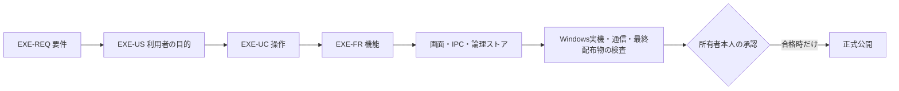

# Windows exe版：要件・技術仕様

- プロジェクト：DC-Designer ／ 版数：v0.1（2026-10-25）／ 状態：設計のみ・未実装
- 入力：[読む入口・未決事項](./desktop-release-design.md)、[配布・更新ポリシー](./release-policy.md)

> **3行で**
> 1. 開発用Webアプリをそのまま包むのではなく、実行環境・保存領域・外部送信を分離したインストール版にする。
> 2. 画像を配布物へ含めないこと、無断で送信しないことを、設定ではなく配信の必須条件にする。
> 3. 既存の編集機能と同意型の更新操作を維持する。ここで定めるのは仕様と検証基準までであり、実装計画ではない。

## 🧭 判断してほしいこと

未決・リスクは[入口のEXE-Q-01〜03、EXE-R-01](./desktop-release-design.md#-判断してほしいこと)に集約する。未決のまま正式配信してよい、という意味ではない。

## 全体図

見てほしいところ：画像保護の検査に失敗したものを、署名や本人承認だけで合格へ変更しない。

## 要点

- [範囲・要件](#範囲要件)：既存アプリに対するWindows製品化の追加設計。
- [操作・例外](#利用者操作)：AI送信の拒否、フォント未取得、保存失敗でも作業を守る。
- [同梱境界](#exe-fr-001同梱境界)：生成物を除外するだけでなく、必要な資源だけを許可する。
- [診断](#exe-fr-009診断)：画像・本文・秘密情報を持たない診断だけを利用者の操作で取り出す。
- [受け入れ基準](#受け入れ基準)：クリーンなWindows、旧版更新、異常終了、通信、配布物まで確認。
- [トレーサビリティ](#トレーサビリティ)：既存の更新IDと区別するため、新規IDに`EXE-`を付ける。

## 詳細

### 範囲・要件

利用者はWindows上で資料を作成・編集・書き出す一般利用者、公開者はリポジトリ所有者本人だけとする。アプリのローカル利用と、GitHubの開発参加・公開権限を混同しない。

| ID | 要件 | 優先度 |
| --- | --- | --- |
| EXE-REQ-001 | 利用者の画像等を配布物・更新・ログへ混入させず、外部AIへは明示確認した対象だけ送る | Must |
| EXE-REQ-002 | 基本機能をNode.js・npm・WSL・開発サーバーの事前導入なしで利用できる | Must |
| EXE-REQ-003 | 資料・設定・認証をプログラムから分離し、更新・移行時に保護する | Must |
| EXE-REQ-004 | 起動個体を識別し、全保存後の終了と、所有するWindowsプロセスの回収を行う | Must |
| EXE-REQ-005 | フォントを取得でき、取得先へ画像・作品の文字・認証情報を送らない | Must |
| EXE-REQ-006 | 検証済みコミット・署名・混入検査・本人承認を通った配布物だけ正式公開する | Must |
| EXE-REQ-007 | 日本語編集、取り込み・書き出し、印刷、発表者ビュー等の既存の製品対象機能を維持する | Must |

- In：Electronのインストール版、ユーザー単位の配置、通常ユーザー権限、ローカル保存、任意のAI連携、フォント取得、既存方針に沿う更新。
- Codex・ComfyUIは基本機能の起動条件にしない。未導入時は任意連携を無効化し、別途の導入・認証が必要と案内する。個別機能の安全条件を満たさなければ、その経路を出荷対象にしない。
- Won't：ポータブルexeの自己更新、OS全体への管理者権限要求、利用者データのクラウド同期、画像収集・自動診断送信、強制更新、既存Web版の全面再設計。
- 対応OS・CPUの最終確定はEXE-Q-03。未確認のOS・アーキテクチャを対応済みと表示しない。

### 利用者の目的

| ID | ストーリー・受け入れの中心 | 要件 |
| --- | --- | --- |
| EXE-US-001 | 利用者として、資料をPC内で扱い、送信する場合は対象と送信先を自分で確認したい。拒否しても編集を継続できる | EXE-REQ-001、003 |
| EXE-US-002 | 利用者として、開発環境なしで起動し、安全に保存・終了・再起動したい。保存できなければ終了しない | EXE-REQ-002、004 |
| EXE-US-003 | 利用者として、必要なフォントを取得して既存機能を使いたい。未取得・非対応・外部送信の有無を見分けたい | EXE-REQ-005、007 |
| EXE-US-004 | 所有者として、利用者データを含まない検証済みのWindows版だけを承認して公開したい | EXE-REQ-006 |

### 利用者操作

| ID | 基本フロー | 例外・終了条件 | 関連US |
| --- | --- | --- | --- |
| EXE-UC-001 | インストール → 起動 → 自分のAPI起動を確認 → 編集 | API不調は再試行・診断画面へ。別プロセスの応答を信頼しない | EXE-US-002、003 |
| EXE-UC-002 | AI操作 → 送信先・本文・画像の確認 → 許可した内容だけ送信 | 拒否・対象変更・期限切れは送信しない。派生スクリーンショットも確認対象 | EXE-US-001 |
| EXE-UC-003 | フォント選択 → カタログ情報で取得 → 検証 → キャッシュ・適用 | オフライン・ライセンス不適合・検証失敗は取得済みフォントまたは警告付き代替 | EXE-US-003 |
| EXE-UC-004 | 通常終了または更新の再起動 → 処理状況確認 → 全保存 → API・子プロセス終了 | 保存不明・処理中は閉じない。更新だけを理由に生成を強制停止しない | EXE-US-002 |
| EXE-UC-005 | 検証済みreleaseコミット → タグ → 隔離ビルド・検査 → 本人承認 → 署名・再検査 → 公開 | 混入・署名不一致・権限不足・未決ゲートありなら公開しない | EXE-US-004 |
| EXE-UC-006 | 利用者が旧データの場所を選択 → コピー・検証 → 新保存先で開く | 原本は削除しない。資格情報は原則再認証し、作品バックアップへ混ぜない | EXE-US-001 |

図と状態・契約の詳細は[実行構成](./desktop-release-runtime.md)と[画像保護・フォント取得](./desktop-release-privacy.md)を正本とする。

### 採用する製品構成

| 領域 | 採用する設計 | 理由・制約 |
| --- | --- | --- |
| アプリ | Electron＋React。sandbox・contextIsolationを有効化し、rendererのNode利用は無効 | 既存UIを維持し、OS操作は限定したmainの契約へ閉じ込める |
| 画面・API | 同梱静的資源の固定`app://dc-designer`＋認可した限定IPC＋mainからの内部HTTP中継 | ブラウザ保存のoriginを維持し、実sender／frameを確認する。ループバックの動的ポートはrendererへ公開せず、開発用Vite proxyと固定8787番から独立する |
| API実行 | 製品に同梱した公式Windows Node＋ビルド済みAPI。Windows native supervisorとJob Objectで所有プロセスを管理 | 利用者のNode導入は不要。Electronの`utilityProcess.kill()`だけで子孫終了を保証しない。サイズと追加ランタイムの保守負担は受け入れる |
| 配布・更新 | `electron-builder`のNSISインストール版＋`electron-updater`、ユーザー単位の配置 | 自動取得・自動適用を無効にした既存更新設計を継承する |
| 版の固定 | Electron・同梱Node・builder・updater・native helper・依存を互換性検証した固定版にする | 本書では未検証の版番号を発明しない。版が固定・検証されるまで正式配信しない |

Windows native supervisorの生成時Job所属・HANDLE監視と、その適用範囲は[実行構成](./desktop-release-runtime.md)を正本とする。Job Objectは外部送信を防ぐ仕組みではなく、[画像送信の許可制](./desktop-release-privacy.md)も別途必要になる。

### 機能・技術仕様の所在

| ID | 機能 | 正本 |
| --- | --- | --- |
| EXE-FR-001 | 同梱境界と配布物の入力・出力契約 | 本書の次節 |
| EXE-FR-002 | 自分の実行環境の起動・接続 | [実行構成](./desktop-release-runtime.md) |
| EXE-FR-003 | データ・資格情報の分離と保護 | [画像保護](./desktop-release-privacy.md) |
| EXE-FR-004 | 目的別の外部通信とAI送信確認 | [画像保護](./desktop-release-privacy.md) |
| EXE-FR-005 | 作品情報を含まないフォント取得 | [画像保護](./desktop-release-privacy.md) |
| EXE-FR-006 | 全保存後の終了・Windowsプロセス回収 | [実行構成](./desktop-release-runtime.md) |
| EXE-FR-007 | 署名・本人承認を必須とする正式配信 | [配布・更新ポリシー](./release-policy.md) |
| EXE-FR-008 | 内部窓・外部リンク・OS機能の分離 | [実行構成](./desktop-release-runtime.md) |
| EXE-FR-009 | 内容を含まない診断 | 本書の診断節 |

### EXE-FR-001：同梱境界

関連：EXE-UC-005／EXE-REQ-001、002、006。入力は検証済みコミット、固定した依存ロック、レビュー済みの静的資源目録。出力は後述の`ReleaseInventory`で説明できる配布物だけとする。

- 配布の入力は開発PCのフォルダではなく、ネットワーク・権限を制限した一時的なWindows CI環境のクリーンcheckout。利用者の`userRoot`・ホーム・開発用`.env`をマウントしない。
- 静的ファイルはレビュー済みの`resource-manifest`にあるものだけを専用ステージへ入れる。ファイル名だけでなく由来・ライセンス・ハッシュを管理する。UIアイコン・組み込みサンプル等も例外扱いしない。
- 通常の`public/`丸ごとコピーは使わない。Viteの製品ビルドでは既定のpublicコピーを無効にするか、目録から生成した隔離publicディレクトリだけを入力にする。`dist/`全体を無条件に信用しない。
- `files`・`extraResources`は専用ステージ内の必要な生成コード・実行環境・資源だけを列挙する。リポジトリ全体・ホーム・`public/**`・作業ディレクトリを包括指定しない。
- `public/generated/`、`data/`、`backup/`、`.output/`、`.env*`、認証JSON、実行時ログ、フォントの利用者キャッシュ、未承認画像を入力にしない。`.gitignore`や除外パターンだけを安全性の根拠にしない。
- シンボリックリンク、Windows junction等によるステージ外参照を拒否し、コピー元・コピー先を実体パスで検証する。検査で見つかった利用者ファイルを勝手に削除して「合格」にしない。
- Electron、同梱ランタイム、Windows用ヘルパー、製品API、preload、Web資源、PDF.jsのcmaps／standard_fonts／wasm、コードから読み込むサンプル、ライセンスを配布目録に含める。製品起動に`tsx`・watch・Vite・npmを要求しない。
- ソースマップは公開配布しない。ビルド時に開発者のキーや`VITE_*`の私的情報を埋め込まない。SBOM・ライセンス一覧・リリースノートにも利用者情報を含めない。
- GitHubがタグから自動生成するソースアーカイブも公開物として扱う。タグ対象の追跡ファイルにも禁止データがなく、画像・音声・サンプル等の由来が承認済みであることを確認する。過去に公開済みの私的情報は、今回の配布から除外するだけで未流出に戻せるとはしない。
- 署名前だけでなく最終NSIS・展開後のアプリ・asar・extraResources・更新用ファイルまで列挙・検査する。検査不能、未説明のファイル、禁止データの検出は必ず不合格とする。

`ReleaseInventory`（EXE-TBL-005）はDBではなく、配信の根拠となるJSON形式の論理ストアである。

EXE-TBL-005 ReleaseInventoryの契約

| 項目 | 内容・制約 |
| --- | --- |
| identity | アプリID、バージョン、対象OS・CPU、ソースコミット、タグ、固定したビルドツールの版 |
| resources | 配布内の正規化相対パス、由来区分、ハッシュ、サイズ、必要なライセンス。絶対パス・利用者ファイル名を含めない |
| artifacts | インストーラー・更新ファイル・メタデータの名前、サイズ、ハッシュ、署名検証結果 |
| checks | 事前・署名後の資源照合、混入検査、実機・通信・更新の検証結果、使用したルールの版 |
| approval | 所有者の承認とCI実行の参照。PATや署名鍵そのものは含めない |
| provenance | ビルド・署名・公開したものが同じ配布内容に結び付く根拠。署名による正当な差分以外の未説明変更は禁止 |

公開用の目録・SBOMと、CI内部の検証情報は公開範囲を区別する。どちらも利用者データを含まないことが前提であり、「非公開artifactだから混ぜてよい」とはしない。

### EXE-FR-009：診断

関連：EXE-REQ-001、003、004／EXE-UC-001、004。EXE-SCR-007「ヘルプ／診断」にはアプリ版、対象OS・CPU、起動・保存・更新のエラー分類だけを表示する。

- EXE-API-007 `desktopDiagnostics.export`は、本人のクリックで検証済み項目を再構成し、OS保存ダイアログでローカルの診断JSONを書き出す。入力は許可されたエラー分類の選択だけ、出力は`canceled`または`exported`。任意ファイルの読み出しAPIにしない。
- スクリーンショット、添付、画像、本文、チャット、プロンプト、ユーザー名付き絶対パス、メール、トークン、環境変数一覧、子プロセスの生stdout／stderrを含めない。自由文エラーをあとから置換する方式ではなく、許可項目だけを構成する。
- 自動アップロード、クラッシュダンプの外部送信、CIへのログ自動添付はしない。問い合わせに送る場合も、利用者が内容を確認して自分で共有する。
- ローカルログは更新設計と同じ1MiB×最大5ファイル。保存先は`<userRoot>/logs/`。利用者データをローテーション対象にしない。
- 送信元・ウィンドウ・型・上限の検証は[実行構成のIPC共通契約](./desktop-release-runtime.md)に従う。書き出し失敗は保存先とエラー分類だけを案内し、編集中の資料を変更しない。

### 非機能・受け入れの合格値

| ID | 合格値・計測の対象 | 要件 |
| --- | --- | --- |
| EXE-NFR-001 | 明示許可前・拒否後・失効後に送られる対象画像のバイト数は0。配布物・ログ・更新への画像混入も0 | EXE-REQ-001 |
| EXE-NFR-002 | 基本起動に利用者が追加するNode.js・npm・WSLの数は0。実行中のAPI個体は1つ | EXE-REQ-002、004 |
| EXE-NFR-003 | フォント取得URL・ヘッダー・本文に含まれる作品文字、画像、AI資格情報は0 | EXE-REQ-005 |
| EXE-NFR-004 | 全対象の保存確認不足で行われる通常終了・更新適用は0。OS強制終了時は未保存分の完全復元を保証しない | EXE-REQ-003、004 |
| EXE-NFR-005 | 未説明の同梱資源、署名不一致、未承認公開の許容数は0 | EXE-REQ-006 |
| EXE-NFR-006 | 未取得フォント・未導入任意連携・API障害を「利用可能／保存済み」と誤表示する件数は0 | EXE-REQ-002、005、007 |

起動・終了・フォント通信の期限値は各詳細設計の決定事項ログを正本とする。既存の更新確認10秒・保存準備30秒等は[更新設計NFR-001〜004](./desktop-update-design.md#非機能セキュリティ)を変更しない。

### 受け入れ基準

- **配布物**：隔離した試験用の`public/generated/`・`data/`・ホーム・`.env`に人工的なカナリアデータを置いても、配布物・CI artifact・ログに入らない。これは実在の利用者画像を使う試験ではない。未知の資源・外部参照・検査不能なアーカイブは配信を止める。
- **送信**：同意なし／拒否／古いID／画像差し替え／自動比較画像／プロバイダ切替／リダイレクトで送信範囲を拡張できない。画像URL、base64、multipart、スクリーンショット等の全対応経路を確認する。暗号化通信は許可済み試験環境で送信直前ペイロードとネットワークの両方を検証する。
- **製品起動**：クリーンなWindowsの通常ユーザー、日本語・空白を含むパス、Node・npm・WSL未導入で起動する。開発ポートが他アプリに使われていても、そのアプリにデータを渡さない。
- **保存・終了**：複数スライド・ノート・IME確定待ち・保留中保存、保存先の容量不足・権限拒否・API切断で確認する。通常終了と更新、main／API／Codexの異常終了、PCのスリープ復帰で所有プロセスの残留・他人のプロセスの誤停止がないことを確かめる。
- **フォント・互換性**：未取得・取得済みそれぞれのオフライン動作、Google Fonts障害、不正フォント、ライセンス、OSインストール拒否を確認する。日本語入力、PDF・PPTX取り込み、PNG・SVG・PPTX書き出し、印刷、発表者ビュー、複数画面・高DPIで検証する。
- **更新・移行**：新規インストール、旧版からの実更新、データ形式移行失敗、旧ブラウザ保存からの明示移行、アンインストール・再インストールを確認する。資格情報が復号不能なら再認証とし、作業データを削除しない。
- **公開権限**：第三者のPR・タグ・再実行・Releases直接操作・承認バイパスで正式配信できないことを検証する。署名・配信停止・未検証キャッシュの扱いは既存更新設計の受け入れ条件にも合格する。

これらは将来実施すべき合格基準であり、今回実行・合格済みという記録ではない。OS自体の侵害、別アプリの通信、利用者自身が明示して行った保存・共有まで流出ゼロを保証するものではない。

### トレーサビリティ

EXE-REQ → US → UC → FR → 画面・契約・論理ストア

| 要件 | US | UC | FR | 画面・契約・論理ストア |
| --- | --- | --- | --- | --- |
| EXE-REQ-001 | EXE-US-001 | EXE-UC-002、005 | EXE-FR-001、004、009 | EXE-SCR-002、007／EXE-API-003、004、007／EXE-TBL-004、005 |
| EXE-REQ-002 | EXE-US-002 | EXE-UC-001 | EXE-FR-002 | EXE-SCR-001／EXE-API-001、009 |
| EXE-REQ-003 | EXE-US-001 | EXE-UC-006 | EXE-FR-003 | EXE-SCR-004／EXE-API-006、009／EXE-TBL-001、002 |
| EXE-REQ-004 | EXE-US-002 | EXE-UC-001、004 | EXE-FR-002、006 | EXE-SCR-001、005／EXE-API-001、002／EXE-TBL-006 |
| EXE-REQ-005 | EXE-US-003 | EXE-UC-003 | EXE-FR-005 | EXE-SCR-003／EXE-API-005／EXE-TBL-003 |
| EXE-REQ-006 | EXE-US-004 | EXE-UC-005 | EXE-FR-007 | EXE-TBL-005／[既存の更新画面・API](./desktop-update-design.md#プロセス間通信データ) |
| EXE-REQ-007 | EXE-US-003 | EXE-UC-001、003、004 | EXE-FR-008 | EXE-SCR-006／EXE-API-008、009 |

新規のRDB・クラウドDBは追加しない。EXE-TBL-001〜004の所有者・整合性・保持期間は[画像保護のデータ契約](./desktop-release-privacy.md)、EXE-TBL-006の世代間停止記録は[実行構成](./desktop-release-runtime.md#runtime-lease)、既存のポスター・デッキの構造は現行スキーマを正本とする。

### 現状との差分と用語

| 用語・現状 | 本設計での意味・変更 |
| --- | --- |
| `userRoot` | `%LOCALAPPDATA%/DC-Designer/`。アプリ本体の配置とは別の安定した利用者専用領域 |
| アプリID / 画面origin | 更新をまたいで固定する製品識別子と`app://dc-designer`。HTTPの可変ポートと分離する |
| 起動個体 | そのmainとAPIを結び付ける一時的なID・認証情報。永続保存・rendererへの公開はしない |
| 送信許可 | 対象・送信先・実際のペイロードを固定した1操作の許可。サインインや画像選択そのものではない |
| 配布資源 | コードと承認済み静的資源。利用者の生成画像・取り込み画像とは別物 |
| 現行`package.json`のbuild | フロントのVite buildのみ。製品API・実行環境・プロセス管理・署名は未実装 |
| 現行`public/generated/`・`data/` | 開発時の保存先。製品版の読み書き先やビルド入力として流用しない |
| 現行のフォント取得 | `text=`で作品文字を送る箇所がある。製品版では廃止し、カタログ情報だけで取得する |

### 決定事項ログ

| ID | 決定・理由 | 決定者 |
| --- | --- | --- |
| EXE-D-01 | 画像の混入・無断送信は禁止。外部AIは対象と送信先を明示確認した操作だけ許可 | ユーザー回答／[ADR-002](./adr/ADR-002-private-data-and-consent.md) |
| EXE-D-02 | 製品用の画面・API接続とWindowsプロセス管理を分離する | AI判断（推奨方法の設計をユーザーが委任）／[ADR-003](./adr/ADR-003-desktop-runtime.md) |
| EXE-D-03 | フォント取得は維持。作品文字の送信をなくし、必要ならPC内でサブセット化する | 取得維持はユーザー指定、方式は安全性のためのAI判断／[ADR-004](./adr/ADR-004-font-acquisition.md) |
| EXE-D-04 | クリーンCI・許可リスト・最終配布物の検査を公開必須条件にする | 安全性のためのAI判断／[ADR-005](./adr/ADR-005-release-artifact-boundary.md) |
| EXE-D-05 | インストール版・通常ユーザー権限・任意連携は基本起動から分離。製品識別子と保存先を固定する | 既存範囲＋推奨構成のAI判断。OS・CPU・署名方式は未承認のまま明示 |
| EXE-D-06 | 新規IDにEXE-を付け、既存更新のREQ-001〜005等を改番しない。実装・公開は行わない | 定石／ユーザー依頼の範囲 |

## このドキュメントで決まったこと

上の決定事項ログを追加設計全体の正本とする。実行構成・画像保護の細部の判断は各文書に記録し、未決は[読む入口](./desktop-release-design.md)へ集約する。
