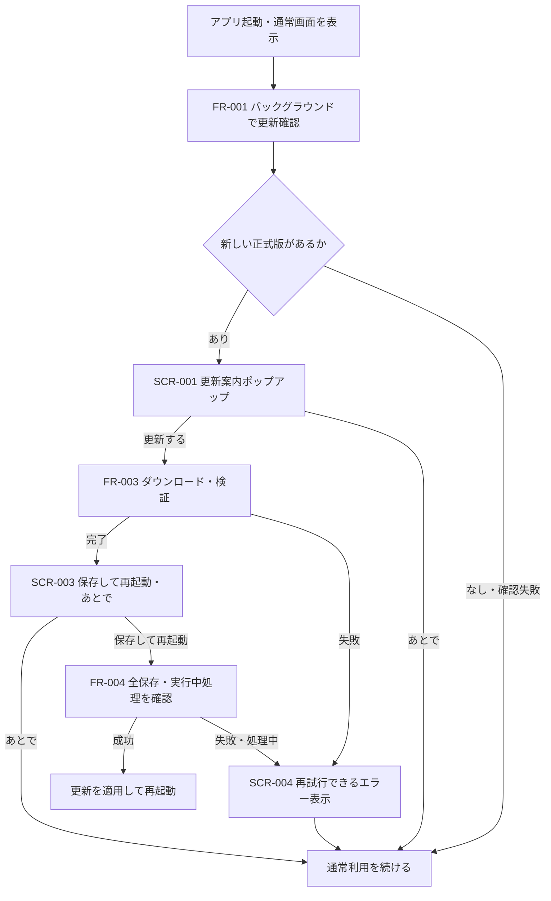

# Windows版：起動時の更新確認・ポップアップ設計

- プロジェクト：DC-Designer ／ 版数：v0.2（2026-10-25）
- 上位方針：[配布・更新ポリシー](./release-policy.md) ／ 状態：設計のみ・未実装

> **3行で**
> 1. 起動のたびに裏で更新を確認し、新しい正式版があればアプリ内ポップアップで知らせる。
> 2. 「更新する」でダウンロードし、完了後の「保存して再起動」で適用する。「あとで」は次回起動時に再通知する。
> 3. オフラインでも使え、保存に失敗したら再起動しない。配信権限や公開手順は既存方針を変えない。

## 🧭 判断してほしいこと

更新の操作方法に新たな未決事項はない。配信先・公開範囲・コード署名方式は既存方針どおり未確定であり、正式配信前に確定・検証が必要。

## 全体図

見てほしいところ：確認は起動を待たせず、ダウンロードと再起動には別々の利用者操作が必要。

## 要点

- [要件・範囲](#要件範囲)：インストール済みWindows版が対象。Web版には更新UIを出さない。
- [起動と通知](#fr-001起動ごとの確認)：1プロセスにつき1回確認し、保留した更新も次回起動時に案内する。
- [画面と操作](#画面ux)：更新案内 → ダウンロード → 保存して再起動の3段階。
- [安全な適用](#fr-004保存確認後の適用)：保存完了を確認できなければ、更新を始めない。
- [技術仕様](#技術仕様)：更新はElectronのmainプロセスが管理し、React画面は表示・操作に限定する。
- [受け入れ条件](#受け入れ条件)：通信失敗、画面遷移、保存失敗、改ざんも検証対象。

## 詳細

### 要件・範囲

この文書は更新機能だけを扱う部分設計であり、アプリ全体の設計書を新設・置換しない。配布運用の正本は引き続き [配布・更新ポリシー](./release-policy.md)。

exe化本体の実行構成・保存先・画像保護は [Windows exe版 release設計](./desktop-release-design.md) を参照。更新確認・取得には資料・画像・AIの資格情報を渡さず、通常終了と更新前の保存・プロセス停止は [実行構成](./desktop-release-runtime.md) の調停と共通化する。更新のために実行中の生成を勝手に中断しない方針は維持する。

| ID | 要件 | 優先度 |
| --- | --- | --- |
| REQ-001 | 起動ごとに正式版を確認し、起動・編集を待たせない | Must |
| REQ-002 | 新しい正式版がある場合だけアプリ内で案内し、今回は保留できる | Must |
| REQ-003 | 同意後にダウンロードし、保存確認と再起動操作を経て適用する | Must |
| REQ-004 | 通信・保存・検証に失敗しても作業データと通常利用を守る | Must |
| REQ-005 | 利用者が更新状態を確認し、手動で再確認・再試行できる | Should |

- US-001：利用者として、起動時に新版の存在を知り、作業を始めるか更新するか選びたい（REQ-001、REQ-002、REQ-005）。
- US-002：利用者として、作業を失わず、アプリ内の操作だけで安全に更新したい（REQ-003、REQ-004）。
- UC-001：アプリ起動 → 更新確認 → 新版があれば案内。保留・確認失敗なら通常利用へ戻る（US-001、US-002）。
- UC-002：「更新する」→ ダウンロード・検証 →「保存して再起動」→ 保存完了後に適用。失敗・保留なら作業を続ける（US-002）。
- Won't：強制更新、無断ダウンロード、通常終了・次回起動での自動適用、定期ポーリング、恒久的な「この版をスキップ」、プレリリースへの更新、自動ダウングレード。
- 対象はElectronでパッケージ化したインストール版。単体のポータブルexeの自己書き換えは対象外。開発用Web画面・サムネイル・書き出し用画面には表示しない。

### FR-001：起動ごとの確認

関連：REQ-001、REQ-005／UC-001。

- Electron起動後、主要ウィンドウの通常画面が表示可能になった時点でmainから確認する。ローカルAPIサーバーやChatGPTの認証状態には依存させず、確認結果を待たずに利用できる。
- 自動確認は1プロセスにつき1回。ホーム・エディタ・成果物一覧の遷移、Reactの再マウント、認証コールバック、追加ウィンドウで重複させない。プロセスを終了して起動し直したら、前回の確認日時にかかわらず新たに問い合わせる。
- 読み取るのは所有者が正式公開した更新メタデータ。`main` / `release` ブランチ、コミット、単なるタグ追加を更新とはみなさない。公開先の第一候補は既存方針の公開GitHub Releases。
- 実行中のバージョンはパッケージのアプリバージョンから取得する。文字列の大小ではなくSemVerで比較し、現在より大きい正式版で、Windows・CPUアーキテクチャ・OS要件が一致する配布物だけを対象にする。
- draft、prerelease、同一・過去バージョン、不正なバージョン・メタデータを案内しない。不正・取得失敗は「確認できなかった」であり、「最新版」と表示しない。
- 「ヘルプ／更新」の更新欄（SCR-004）から再確認できる。確認・ダウンロードの多重実行は拒否し、連続確認は30秒以上間隔を空ける。自動の即時再試行はせず、次回起動または手動操作で再試行する。

### FR-002：更新案内と保留

関連：REQ-002／UC-001。

- 新版が見つかったら、通常画面の最前面にSCR-001を表示する。認証・保存確認等のモーダルが開いている場合は、その完了後に表示し、重ねない。アプリが非表示の場合は復帰時に表示し、フォーカスを奪わない。
- 自動の案内は同じ起動中に同じ版について1回だけ。「あとで」、閉じる、Escはすべて同じ保留で、ダウンロードを始めない。保留後も更新欄から案内を再表示できる。
- 保留はmainのメモリで管理するため、画面遷移・再読み込みで再表示しない。アプリ終了で解除し、次回起動時は同じ新版でも再確認・再通知する。
- 表示待ちの案内もmainで保持し、画面側が購読を始める前に確認が終わっても失わない。表示済み・保留はAPI-007でmainに応答し、再マウント時は自動で再表示しない。更新欄からの明示的な再表示は別操作として受け付ける。
- 初期フォーカスは「あとで」。更新内容はプレーンテキストで最大2,000文字まで表示し、省略時は公式リリースページへのリンクを示す。更新内容を取得できなくても、バージョン確認が成功していれば一般的な案内文で表示する。

### FR-003：同意後のダウンロード

関連：REQ-003／UC-002。

- SCR-001の「更新する」で、案内した版のダウンロードを開始する。mainが保持する対象版と一致する操作だけを受け付け、画面から任意のURL・ファイルパスを指定させない。
- SCR-002で進捗率・取得済み容量を表示する。全体容量が不明なら不定進捗にする。「バックグラウンドで続ける」でポップアップだけを閉じ、編集を続けられる。閉じた後の進捗は更新欄に残す。
- チェックサムと所定の署名検証を通過して初めて`downloaded`とする。ファイルを取得しただけでは再起動操作を許可しない。取得・検証失敗時は旧版のまま維持し、再試行を案内する。
- 検証済みになったらSCR-003を1回表示する。「あとで」で閉じ、更新欄に「再起動で更新」を残す。通常終了では適用しない。
- 次回起動もまず正式公開情報を確認する。同じ版のキャッシュがあれば、利用者が「更新する」を選んだ際に再検証して再利用できる。キャッシュだけを信用して通知・適用せず、通信失敗時や配信停止済みの版は適用しない。
- 起動し直した後の初期案内はSCR-001とし、検証後は再ダウンロードせずSCR-003へ進める。同じ起動中に取得済みの版は更新欄から直接SCR-003を開ける。

### FR-004：保存確認後の適用

関連：REQ-003、REQ-004／UC-002。

1. 利用者がSCR-003の「保存して再起動」を選ぶ。mainは検証済みの対象版・キャッシュと、正式公開が継続していることを再確認する。再確認できない場合は適用しない。取得した版が案内対象と異なる場合や同じ版のハッシュが変わっている場合も適用を中止し、改めて確認・案内する。
2. 編集可能な全ウィンドウへ要求ID付きで保存準備を依頼する。画面遷移・新規編集・生成開始等を一時的に止め、実行中の生成・取り込み・書き出し・アップロード等がある場合は適用を保留する。処理を勝手に中断しない。
3. 開いている成果物、別スライドの保留中保存、デッキ情報・ノート・設定等の書き込みを完了させる。入力中のテキスト編集も確定してから保存する。ブラウザ内の控えだけでは保存成功と扱わない。
4. 全対象から同じ要求IDに対する保存成功の応答を受け、編集ロックを維持したままローカルサーバーの未完了書き込みがないことを確認する。
5. ここまで成功した場合だけインストーラーへ引き継ぎ、アプリを終了して更新・再起動する。成功後は新バージョンが起動し、ユーザーデータを維持する。

保存失敗、処理中、画面切断、要求ID不一致、応答なしの場合は終了・適用を中止し、画面のロックを解除してSCR-004で案内する。保存処理自体は途中で破棄せず、完了した保存は維持する。

現状の`src/editor/useAutoSave.ts`には`flushAll()`・`saveNow()`があるが、更新時の全画面・全書き込みの保証は未実装。既存の保存状態表示、`beforeunload`、`pagehide`だけで安全と判断しない。`quitAndInstall`は通常終了とイベント順が異なるため、呼び出す前に上記の保存確認を完了させる。

### FR-005：失敗時の扱い

関連：REQ-004、REQ-005／UC-001、UC-002。

| 条件 | 利用者への表示・操作 | アプリの扱い |
| --- | --- | --- |
| 最新版・配布先に自分より新しい版がない | 起動時ポップアップなし。更新欄に確認結果 | 通常利用 |
| オフライン・確認タイムアウト・404・429・配信障害 | 起動時ポップアップなし。「更新を確認できませんでした」＋手動再確認 | 通常利用。「最新版」とは表示しない |
| ダウンロード中断・容量不足 | 「更新を取得できませんでした」＋再試行・閉じる | 編集を継続。未検証ファイルは適用不可 |
| ハッシュ・署名の検証失敗 | 「更新ファイルを検証できませんでした」＋再取得・閉じる | 対象キャッシュを無効化し、検証を回避しない |
| 保存失敗・保存確認の期限超過 | 「保存を確認できなかったため、再起動を中止しました」 | 編集を継続。データと検証済み更新を維持 |
| 生成・書き出し等の実行中 | 「処理が完了してから、再度お試しください」 | 強制中断しない |
| インストーラー起動失敗・権限拒否 | アプリ稼働中はエラーを表示し、再試行を案内 | 無条件に終了・旧版削除をしない |

API停止後にmainがインストーラー開始失敗を検知した場合は、更新状態を`downloaded`へ戻しても、そのまま編集・保存可能へ戻さない。[実行構成のEXE-FR-006](./desktop-release-runtime.md#exe-fr-006)に従いruntimeを`recovering`へ移し、本人の復旧操作による新APIの起動・health・保存済みrevision確認後にだけロックを解除する。更新の再試行は公開情報と全保存の確認からやり直し、前回のACKを再利用しない。

インストーラー起動後・アプリ終了後の失敗はアプリ内表示できない場合がある。NSIS側のエラー表示・ログと公式インストーラーによる修復経路を用意し、旧版の完全復旧を保証したとは扱わない。

### 画面・UX

| ID | 画面・表示内容 | 操作 |
| --- | --- | --- |
| SCR-001 | 「新しいバージョンがあります」、現在`1.0.0` → 最新`1.0.1`、更新内容、「ダウンロード後も、再起動するまで作業を続けられます」 | 更新する／あとで／更新内容の詳細 |
| SCR-002 | 「更新をダウンロードしています」、進捗率・取得済み容量 | バックグラウンドで続ける |
| SCR-003 | 「更新の準備ができました」、「作業を保存してアプリを再起動します」 | 保存して再起動／あとで |
| SCR-004 | 全通常画面から開ける「ヘルプ／更新」の更新欄。現在版、最新の確認結果・確認日時、進捗、取得済み状態、失敗時の説明 | 状態に応じて再確認／案内を開く／再試行／再起動 |

- ポップアップはWindows通知やブラウザ標準`alert`ではなく、Reactで表示するアプリ内ダイアログ。全通常画面に共通の表示先を設ける。
- `role="dialog"`、`aria-modal`、見出しとの関連付け、フォーカストラップ、閉じた後のフォーカス復帰を設ける。Escは保留とし、Enterだけで不意に更新・再起動しない。
- SCR-002を閉じても取得は続く。取得自体を止めたい場合は通常終了できるが、終了で更新を適用しない。次回は不完全ファイルを完了扱いにせず、再取得またはライブラリの検証済みキャッシュ再利用を行う。
- `preparingRestart`では「保存を確認しています」を表示し、連打を防止する。通常終了による保存保護は別途必要であり、この機能で保証済みとは扱わない。

### 技術仕様

- **main**：更新管理は1つ。起動判定、更新先の固定、SemVer比較、ダウンロード・検証、キャッシュ、状態、保存準備の調停、インストーラー起動を担当する。
- **preload**：限定した更新用の操作・イベントだけを公開する。`contextIsolation`・sandboxを有効にし、rendererのNode.js利用は無効にする。
- **renderer**：Reactの共通表示先でポップアップ・更新欄を表示する。現状の`src/main.tsx`の通常画面分岐に統合する想定だが、`view=render`、iframe、認証用の外部ページ等では有効にしない。
- **ローカルサーバー**：既存の保存・生成を担当する。新たなHTTP更新APIや、任意のexeを実行できるAPIは作らない。
- 技術候補はElectron＋`electron-builder`（NSISインストーラー）＋`electron-updater`。依存追加・バージョン確定は今回行わず、採用版のAPIに合わせて以下の挙動を設定・検証する。

更新ライブラリに要求する設定と状態

| 項目 | 要求する設定・挙動 |
| --- | --- |
| 確認・通知 | `checkForUpdates()`を利用し、画面表示は独自管理。OS通知付きの一括処理に任せない |
| 自動ダウンロード | `autoDownload = false`。同意後に`downloadUpdate()`を実行 |
| 自動適用 | 自動適用を無効化。上流の現行APIでは`autoInstallEvent = "manual"`。旧APIの版では`autoInstallOnAppQuit = false`に相当。採用版で確認する |
| 適用 | `update-downloaded`と検証成功後にだけ、保存確認を経て`quitAndInstall`へ引き継ぐ。引数形式は採用版に合わせる |
| 更新対象 | `allowPrerelease = false`、`allowDowngrade = false`。チャンネル設定後もこれらを維持 |
| 状態 | `idle` → `checking` → `upToDate` / `available` / `error`。`available` → `downloading` → `downloaded` / `error`。`downloaded` → `preparingRestart` → `installing` / `downloaded` |
| 失敗からの復帰 | 確認失敗は再確認、取得失敗は再取得。保存準備失敗は`downloaded`へ戻してロック解除。API停止後のインストーラー開始失敗は`downloaded`＋runtimeの`recovering`とし、新APIの復旧までロックを維持する。検証不合格のキャッシュは無効化し、再取得する |
| 表示制御 | 保留・ポップアップ表示済みの版は状態とは別にmainで保持。通信が遅れても過去要求のイベントで現状態を上書きしない |

### プロセス間通信・データ

以下は追加予定の限定IPC契約であり、現在存在するAPIではない。全操作で送信元の`webContents`、メインフレーム、アプリの正規URLをmainが検証し、外部ページ・サブフレームからの要求を拒否する。

IPC契約（API-001〜API-007）

| ID | 契約名・方向 | 入出力・制限 |
| --- | --- | --- |
| API-001 | `desktopUpdate.getState`：renderer → main | 状態スナップショットを取得。再マウント時にも使用 |
| API-002 | `desktopUpdate.check`：renderer → main | 手動確認。実行中・間隔制限中は新規通信せず現在状態を返す |
| API-003 | `desktopUpdate.download`：renderer → main | 対象バージョンを入力。mainが保持する案内対象との一致と実行可能状態を検証 |
| API-004 | `desktopUpdate.install`：renderer → main | 対象バージョンを入力。ダウンロード・検証済み状態からだけ保存準備を開始。直接終了はしない |
| API-005 | `desktopUpdate.onStateChanged`：main → renderer | 状態スナップショットを通知。解除できる購読とし、再購読で重複させない |
| API-006 | `desktopUpdate.prepareForRestart`：main → renderer → main | main発行の`requestId`に対し`allSaved`・`busy`・エラー分類を応答。要求後の画面遷移・切断・未応答は失敗。main側で期限と対象全画面の応答を確認 |
| API-007 | `desktopUpdate.respondToPrompt`：renderer → main | main発行の`promptId`と表示済み／保留／バックグラウンド継続／明示的再表示を入力。mainで対象・状態を検証し、表示済み版・保留を記録。取得や適用の許可とは分離 |

- 状態スナップショット：`state`、`currentVersion`、`latestVersion?`、`releaseNotes?`、`checkedAt?`、`progress?`、`error?`、`prompt?`。日時はISO 8601。`progress`は取得済みbytes・総bytes・percent、`error`は確認／取得／検証／保存／適用の段階と利用者向け分類を持つ。
- `prompt`はmain発行の`promptId`・対象版・案内種別・表示待ち／表示済み／保留を持つ。スナップショットの復元で自動表示してよいのは表示待ちだけとし、未確認イベントや古いIDで案内状態を巻き戻さない。
- `checkedAt`は最後に正式公開情報の取得・解析が成功した日時。最新の試行が失敗した場合は、過去の成功日時を残しても「今回確認できた」とは表示しない。
- DB追加は不要。確認結果・表示済み版・保留・ダウンロード同意はセッション内メモリ、更新ファイルはユーザー別の更新専用キャッシュに分離する。再起動後にキャッシュだけで同意済みとは扱わない。
- インストール先とは別の安定した`userData`・保存先・ブラウザ保存領域を使う。更新でアプリID、保存領域のpartitionや画面originを変えて既存データを見失わない。変更が必要なら事前バックアップと移行を行う。
- exe版の画面originは`app://dc-designer`に固定し、APIのローカルHTTPポートとは切り離す。アプリ本体・利用者データ・更新キャッシュの具体的な境界は[画像保護・フォント取得](./desktop-release-privacy.md)と[実行構成](./desktop-release-runtime.md)を正本とし、本書から別の保存先を定義しない。

### 非機能・セキュリティ

| ID | 要求・値 | 扱い |
| --- | --- | --- |
| NFR-001 | 起動画面の更新確認待ち時間は0秒。メタデータ確認の期限は10秒 | 期限超過で表示上は確認失敗。取得結果を待って起動を止めない |
| NFR-002 | 更新処理は同時1件。手動確認は30秒以上間隔。進捗通知は最大4回／秒 | 連打・画面遷移で重複通信・通知を起こさない |
| NFR-003 | ダウンロードの無通信期限は60秒。保存準備の期限は30秒 | 取得通信中に適用し、取得後のローカル検証は無通信扱いしない。取得はキャンセルトークン等で停止。保存期限超過は適用だけを中止し、進行中の保存を破棄しない |
| NFR-004 | 検証不合格・保存確認不足での適用は0件 | 不明な場合は適用せず旧版で作業を続ける |

- 確認の10秒期限は単なるPromiseの打ち切りで通信中止できたと扱わない。中断できる通信は中断し、中断不可の場合は要求世代を無効化して遅延イベントを無視する。実通信が終了するまで新たな確認を重ねない。
- HTTPSのみで公式配信先に固定する。アセット配信の正規リダイレクト先を含め許可先を検証し、rendererや未検証の更新内容から更新先を変更させない。公式リリースページ以外の任意URLを外部起動しない。
- チェックサムは破損検知であり、配信元の真正性を単独で保証しない。正式配信ではコード署名・期待する発行者の検証方式を確定し、署名不一致を回避する設定を使わない。方式未確定のまま安全な自動更新が完成したとは扱わない。
- 開発者用PAT、署名用秘密鍵、AIの認証情報を更新通信に流用・同梱しない。更新メタデータ・リリースノートにスクリプトやHTMLを実行させない。
- ログは段階・バージョン・時刻・エラー分類に限定し、資料の内容、認証情報、トークン付きURLを記録しない。ローテーションは1ファイル1MiB・最大5ファイルとする。

### トレーサビリティ

| 要件 | ストーリー → ユースケース | 機能 | 画面・IPC |
| --- | --- | --- | --- |
| REQ-001 | US-001 → UC-001 | FR-001 | SCR-004／API-001、API-002、API-005 |
| REQ-002 | US-001 → UC-001 | FR-002 | SCR-001、SCR-004／API-001、API-005、API-007 |
| REQ-003 | US-002 → UC-002 | FR-003、FR-004 | SCR-002、SCR-003／API-003〜API-007 |
| REQ-004 | US-002 → UC-001、UC-002 | FR-004、FR-005 | SCR-004／API-001〜API-007 |
| REQ-005 | US-001 → UC-001 | FR-001、FR-005 | SCR-004／API-001、API-002、API-005 |

### 受け入れ条件

- 起動・通知（REQ-001、REQ-002）：毎回の新規起動で問い合わせ、新版があると1回案内する。最新版・旧版・プレリリースでは案内しない。保留後の画面遷移・再読み込みでは再通知せず、次回起動では同じ新版を再通知する。
- 通信（REQ-001、REQ-004、REQ-005）：オフライン、10秒超過、404、429、不正メタデータでも起動・編集でき、最新版と誤表示しない。遅延応答で通知が復活せず、手動確認で回復できる。
- 更新操作（REQ-003）：同意前にexeを取得せず、進捗を閉じても編集とダウンロードが続く。取得完了だけでは終了せず、通常終了・次回起動でも無断適用しない。
- データ保護（REQ-003、REQ-004）：別スライド・入力確定待ち・ノート等も保存する。保存失敗、処理中、期限超過、画面切断時に再起動せず、全保存成功時だけ適用する。
- 復旧・セキュリティ（REQ-004）：不完全キャッシュ、ハッシュ不一致、署名不一致、配信停止、空き容量不足、権限拒否、外部ページからのIPCを安全に拒否する。旧版→新版の実機更新で資料・画像・設定・認証状態の維持を確認する。

## このドキュメントで決まったこと

| ID | 決定 | 決定者 |
| --- | --- | --- |
| D-01 | 起動するたびに確認し、アプリ内ポップアップで更新を促す | ユーザー |
| D-02 | 同意後のアプリ内ダウンロードと、保存確認後の再起動で適用。保留は次回起動まで | ユーザー（選択回答）／[ADR-001](./adr/ADR-001-startup-update-prompt.md) |
| D-03 | 確認10秒、取得無通信60秒、保存30秒、手動確認間隔30秒、進捗4回／秒、本文2,000文字、ログ1MiB×5 | AI判断（おまかせ）。起動を待たせず、通信・表示の重複を抑え、失敗時に作業へ戻れる値 |
| D-04 | mainで一元管理、限定IPC、失敗時は適用しない、署名・保存の確認を回避しない | 定石。配信権限とユーザーデータの保護を維持する |

参照：[`electron-updater`上流のAppUpdater定義](https://github.com/electron-userland/electron-builder/blob/master/packages/electron-updater/src/AppUpdater.ts)（2026-10-25確認）。上流`master`は変化するため、実装では採用バージョンを固定してAPI差分・通常終了時の非適用を検証する。
